# Manual do DMaker

O DMaker é um editor de vídeos curtos que se opera por comando: você descreve o vídeo (para uma IA, pela interface ou pela linha de comando) e ele monta, narra, legenda, dubla e renderiza no formato certo de cada rede social. Este manual é para quem usa. As regras de desenvolvimento do próprio DMaker ficam em [`CLAUDE.md`](../CLAUDE.md).

## Como usar este manual

O manual é organizado por **tarefa**: "Fazer um Reel a partir de uma gravação", "Dublar um vídeo para outro idioma", "Corrigir uma palavra errada sem regravar". Procure a sua na tabela da próxima seção e siga o passo a passo.

Toda tarefa mostra os três caminhos que o DMaker oferece, e diz com clareza quando um deles não existe:

| Caminho | Quem usa | Como é |
| --- | --- | --- |
| **Pela IA** | Quem prefere pedir em português | Você descreve o que quer ao Claude (ou ao agente local) e ele chama as ferramentas do DMaker. |
| **Pela interface** | Quem prefere ver e clicar | `dmaker ui` abre o editor no navegador. |
| **Pela CLI** | Quem quer automatizar ou ter controle de cada opção | Comandos `dmaker ...` no PowerShell. |

Os exemplos de comando usam `dmaker` direto. Para isso, ative o ambiente do projeto uma vez por janela do PowerShell (`.\.venv\Scripts\Activate.ps1`, veja a instalação). Os caminhos de arquivo dos exemplos (`C:/videos/gravacao.mp4`) são inventados: troque pelos seus.

Cada tarefa segue o mesmo molde: **Quando usar**, **Antes de começar**, **Pela IA**, **Chamadas das ferramentas** (o exemplo que a IA segue), **Pela interface**, **Pela CLI**, **Como conferir** e **Se der errado**. Quando você lê `docs/ia`, é o mesmo conteúdo, em arquivos curtos para um modelo local pequeno.

Três palavras aparecem o tempo todo, e já valem aqui: a **spec** é o arquivo `spec.json` que descreve o vídeo inteiro (fontes, cortes, textos, legendas, áudio); o **preset** é o formato de saída de uma plataforma (tamanho, limite de duração e zona segura); o **mezanino** é um trecho já processado e guardado em cache, o que torna o segundo render rápido. O "Glossário", no capítulo "Conceitos", explica as outras.

## Quero fazer X, onde está?

<!-- dmaker:gerado indice -->

São 33 tarefas. A última coluna diz se o agente local (`dmaker agent`) já tem todas as ferramentas da tarefa; quando não tem, ela fica para o Claude, para a interface ou para a CLI.

**Tarefas de vídeo**

| Quero | O que entrega | Agente local |
| --- | --- | --- |
| [Fazer um Reel a partir de uma gravação](#fazer-um-reel-a-partir-de-uma-gravação) | Transforma uma gravação sua em um vídeo vertical para o Instagram, com legenda automática palavra a palavra, gancho no começo e barra de progresso. | sim |
| [Criar um projeto a partir de um modelo pronto](#criar-um-projeto-a-partir-de-um-modelo-pronto) | Cria um projeto completo de um modelo pronto (produto, depoimento, stories, vlog, tutorial, YouTube, explicativo, casamento), passando só o que muda de vídeo para vídeo. | sim |
| [Cortar as pausas de uma gravação falada](#cortar-as-pausas-de-uma-gravação-falada) | Tira as pausas, os vícios de fala e as frases repetidas de uma gravação falada e entrega um projeto de clipes já cortados, com a lista do que saiu. | sim |
| [Deixar a legenda em caixa arredondada](#deixar-a-legenda-em-caixa-arredondada) | Põe uma caixa de fundo arredondada atrás de cada linha da legenda, no estilo do TikTok, mantendo o destaque da palavra que está sendo falada. | sim |
| [Corrigir uma palavra errada na legenda](#corrigir-uma-palavra-errada-na-legenda) | Troca uma palavra que o Whisper ouviu errado nas legendas automáticas (um nome próprio, um termo técnico) sem transcrever tudo de novo. | sim |
| [Fazer um vídeo explicativo](#fazer-um-vídeo-explicativo) | Monta um vídeo de reel em que a gravação de quem explica fica num quadro arredondado embaixo, a área de cima mostra a imagem de cada assunto e o fundo troca a cada assunto. | sim |
| [Fazer um audiograma de um áudio](#fazer-um-audiograma-de-um-áudio) | Transforma um áudio (corte de podcast, entrevista, áudio de WhatsApp) em um vídeo vertical com a capa num círculo, a onda ou as barras animadas no ritmo da fala e a legenda automática. | sim |
| [Escolher a transição entre os trechos](#escolher-a-transição-entre-os-trechos) | Muda como um trecho entra a partir do anterior (corte seco, fade, deslize, zoom de passagem, chicote) e o ritmo dessa troca (linear, suave ou mola). | sim |
| [Dar um acabamento de cinema ao vídeo](#dar-um-acabamento-de-cinema-ao-vídeo) | Aplica um acabamento visual pronto, por nome (cinema, quente, frio, preto e branco, vintage), com vinheta, grão, brilho e vazamento de luz. | sim |
| [Pôr efeitos sonoros num instante do vídeo](#pôr-efeitos-sonoros-num-instante-do-vídeo) | Põe sons curtos (whoosh, pop, clique, riser, impacto) num instante marcado, ou na entrada de um texto, uma imagem ou uma transição. | sim |
| [Trocar o fundo atrás da pessoa](#trocar-o-fundo-atrás-da-pessoa) | Troca o fundo atrás de quem fala por uma cor lisa (branca ou da marca), sem tela verde, recortando a pessoa com uma rede neural. | sim |
| [Pôr o texto atrás da pessoa](#pôr-o-texto-atrás-da-pessoa) | Faz o título grande passar atrás de quem fala e na frente da parede, o efeito de profundidade dos Reels, recortando a pessoa só enquanto o texto aparece. | sim |
| [Pôr uma animação em HTML sobre o vídeo](#pôr-uma-animação-em-html-sobre-o-vídeo) | Põe por cima do vídeo uma animação que a IA escreve como código (HTML, CSS e JavaScript, com três dimensões e Lottie): um título grande, um número que conta, um objeto em 3D girando, um mapa com fotos entrando. | sim |
| [Pôr um infográfico animado no vídeo](#pôr-um-infográfico-animado-no-vídeo) | Põe por cima do vídeo um infográfico pronto que se mexe (um contador, uma barra, uma linha entre dois pontos, uma imagem entrando, uma etiqueta, um grifo à mão ou um emoji animado), escolhido pelo nome e com os valores que você quiser, nas cores e na fonte da marca. | ainda não: `render_infographic_frame` |
| [Fazer o vídeo do casamento com duas câmeras](#fazer-o-vídeo-do-casamento-com-duas-câmeras) | Monta o vídeo de uma cerimônia com duas câmeras sincronizadas pelo áudio, cortando entre elas pelas fases do rito reconhecidas na fala, com cartões de abertura e encerramento. | sim |
| [Fazer vários vídeos de uma planilha](#fazer-vários-vídeos-de-uma-planilha) | Gera um vídeo por linha de uma planilha (CSV, XLSX ou JSON), todos sobre o mesmo modelo de projeto, com validação antes, pausa e retomada. | sim |
| [Exportar o vídeo para outras plataformas](#exportar-o-vídeo-para-outras-plataformas) | Gera o mesmo projeto em vários formatos de uma vez (Reels, Shorts, Facebook, feed), cada um com o tamanho, a zona segura e o limite da plataforma. | sim |
| [Conferir o vídeo antes de publicar](#conferir-o-vídeo-antes-de-publicar) | Roda as checagens automáticas em texto (duração, zona segura, ritmo de leitura, contraste, legendas e o arquivo renderizado) sem gastar tempo olhando imagem. | ainda não: `contact_sheet` |

**Tarefas de voz e áudio**

| Quero | O que entrega | Agente local |
| --- | --- | --- |
| [Narrar um roteiro com a minha voz](#narrar-um-roteiro-com-a-minha-voz) | Transforma um texto em áudio falado com a sua voz (clonada de uma gravação sua, com a sua autorização) ou com uma voz pronta, e gera a legenda com o tempo de cada fala. | sim |
| [Clonar uma voz](#clonar-uma-voz) | Cria uma voz da biblioteca a partir de uma gravação limpa de quem fala, para usar na narração, na troca de voz e na correção de fala. | sim |
| [Criar uma voz descrevendo como ela soa](#criar-uma-voz-descrevendo-como-ela-soa) | Cria uma voz sem gravação nenhuma, só descrevendo gênero, idade, tom e sotaque. | sim |
| [Ensinar o DMaker a pronunciar um nome](#ensinar-o-dmaker-a-pronunciar-um-nome) | Cadastra como a voz deve falar um termo (uma marca, um nome estrangeiro, uma sigla) sem mudar o que está escrito na legenda. | sim |
| [Narrar um roteiro longo em segundo plano (fila)](#narrar-um-roteiro-longo-em-segundo-plano-fila) | Põe um roteiro longo (audiobook, manual narrado, vários roteiros) numa fila que narra um item por vez, retoma de onde parou e separa por capítulos. | sim |
| [Pôr a narração dentro de um vídeo](#pôr-a-narração-dentro-de-um-vídeo) | Coloca a fala sintetizada como voz do vídeo, direto na spec, e usa o texto falado como legenda, sem gerar o áudio antes. | sim |
| [Separar a voz da música e do ruído](#separar-a-voz-da-música-e-do-ruído) | Separa a fala da música e do ruído de fundo de um vídeo ou áudio, em dois arquivos: a voz limpa e o fundo. | sim |
| [Corrigir uma palavra errada sem regravar](#corrigir-uma-palavra-errada-sem-regravar) | Troca uma palavra ou frase dita errado numa gravação pela versão certa, falada com a voz do próprio falante, sem regravar nada. | sim |
| [Trocar a voz de uma gravação inteira](#trocar-a-voz-de-uma-gravação-inteira) | Troca o timbre de quem fala por uma voz da biblioteca, mantendo as palavras, o ritmo, as pausas, a entonação e o fundo. | sim |
| [Verificar se um áudio foi gerado pelo DMaker](#verificar-se-um-áudio-foi-gerado-pelo-dmaker) | Diz se um arquivo de áudio ou vídeo tem voz gerada por IA pelo DMaker, lendo a etiqueta de procedência e, sem ela, a marca d'água inaudível do áudio. | sim |

**Tarefas de dublagem e modelos**

| Quero | O que entrega | Agente local |
| --- | --- | --- |
| [Dublar um vídeo para outro idioma](#dublar-um-vídeo-para-outro-idioma) | Traduz a fala de um vídeo ou áudio e a refaz, com a voz clonada de quem fala, no idioma escolhido, mantendo o fundo; você revisa a tradução antes de gerar. | sim |
| [Dublar com mais de uma pessoa falando](#dublar-com-mais-de-uma-pessoa-falando) | Descobre quem fala em cada trecho e dubla cada pessoa com a sua própria voz clonada. | sim |
| [Dublar esticando o vídeo onde a fala não cabe](#dublar-esticando-o-vídeo-onde-a-fala-não-cabe) | Quando a tradução é mais longa que a fala original, estica o vídeo só naquele trecho em vez de acelerar ou cortar a voz. | sim |
| [Exportar as trilhas separadas da dublagem](#exportar-as-trilhas-separadas-da-dublagem) | Exporta a voz dublada, o fundo e a voz original em arquivos separados, para refazer a mixagem em outro editor (Premiere, DaVinci, CapCut). | sim |
| [Ver, baixar e apagar os modelos de IA](#ver-baixar-e-apagar-os-modelos-de-ia) | Mostra cada modelo de IA que o DMaker baixa (tamanho no disco, licença, para que serve), baixa antes de precisar, apaga o que não usa e limpa as sobras. | ainda não: `models` |

<!-- dmaker:fim-gerado indice -->

Procurando por uma palavra? Peça à IA que use a ferramenta `search_manual`, ou rode `dmaker ajuda "sua pergunta"` (seção "Usando com LLM local"): as duas buscam neste manual sem internet.

## O que é o DMaker

O DMaker corta, junta e acelera trechos; reenquadra qualquer vídeo ou imagem para o formato certo; gera cartões, textos, legendas e trilhas; narra roteiros com a sua voz, corrige uma palavra dita errado sem regravar e dubla um vídeo para outro idioma. Ele entrega vídeos prontos para o Instagram (Reels, Stories, Feed), Facebook, YouTube (Shorts e vídeo longo, 1080p ou 4K), TikTok, WhatsApp Status e LinkedIn.

Por baixo, ele usa só ferramentas abertas e locais: o [FFmpeg](https://ffmpeg.org) corta, junta e codifica; o [libass](https://github.com/libass/libass) desenha texto e legendas animadas; o [faster-whisper](https://github.com/SYSTRAN/faster-whisper) transcreve a fala sem mandar nada para a internet; o Pillow gera cartões e fundos; o OmniVoice e o Kokoro falam; o Demucs separa voz e fundo; o Ollama traduz. Tudo fica dentro da pasta do projeto (por exemplo `D:\DMaker`): nada é instalado no sistema.

### Três formas de usar

| Forma | Como | Quem usa |
| --- | --- | --- |
| Pela IA (Claude Code) | Abra uma sessão do Claude na pasta do DMaker e descreva o pedido em português | Quem quer só descrever o vídeo e receber o arquivo pronto |
| Por um modelo local (Ollama) | `dmaker agent`, `dmaker ajuda` e a pasta `docs/ia` | Tarefas mecânicas e dúvidas sem depender de uma IA em nuvem e sem internet |
| Manualmente | A interface (`dmaker ui`) ou a linha de comando (`dmaker <comando>`) | Quem prefere ver a linha do tempo, ou automatizar |

### O que continua sendo decisão humana

O DMaker não decide sozinho os cortes finos, o ritmo (quando cada trecho troca) nem qual câmera aparece em cada momento: isso é trabalho de edição, seu ou de uma IA maior como o Claude. As exceções são o corte automático de pausas (tarefa "Cortar as pausas de uma gravação falada") e o corte de cerimônia pela fala (tarefa "Fazer o vídeo do casamento com duas câmeras"), que dão um primeiro corte plausível para você revisar.

---

## Instalação passo a passo no Windows

### Pré-requisitos

1. **Python 3.11 ou mais novo.** No PowerShell: `py --version`. Se não aparecer uma versão, instale em <https://www.python.org/downloads/> marcando **Add python.exe to PATH**.
2. **Git**, só para baixar o projeto: <https://git-scm.com/download/win>. Sem Git, baixe o ZIP do repositório e descompacte.
3. **Internet na primeira vez**: o instalador baixa o FFmpeg (cerca de 110 MB) e a fonte Poppins. Os modelos de IA só baixam quando uma função precisa deles (a legenda automática, 470 MB; a voz, vários GB), e depois funcionam sem internet.
4. Para a **voz e a dublagem**: 16 GB de RAM ou mais ajudam muito. Em CPU, sintetizar fala leva dezenas de segundos por segundo de áudio (veja cada tarefa).

### Baixar e instalar

```powershell
# 1. baixe o projeto numa pasta, por exemplo D:\DMaker
git clone https://github.com/DougFSA/DMaker.git D:\DMaker
cd D:\DMaker

# 2. rode o instalador: cria o ambiente Python, instala as dependências, baixa FFmpeg e fontes
.\scripts\setup.ps1

# 3. confira se está tudo certo
.\.venv\Scripts\dmaker.exe doctor
```

O `scripts/setup.ps1` cria o `.venv`, instala o pacote com os extras `dev` e `captions` (`pip install -e ".[dev,captions]"`), roda `dmaker setup` (baixa FFmpeg e Poppins) e termina com `dmaker doctor`. Se o PowerShell recusar rodar o script (política de execução), rode antes, uma vez: `Set-ExecutionPolicy -Scope CurrentUser RemoteSigned`.

O `dmaker doctor` confere o FFmpeg e o libass (sem ele não há texto nem legendas), os filtros necessários, os encoders de hardware (NVENC, AMF, QSV) e qual seria usado com `"encoder": "auto"`, as fontes, as marcas instaladas e se o `faster-whisper`, o Playwright com o Chromium (animação em HTML) e o `mcp` estão presentes.

Para não digitar `.\.venv\Scripts\dmaker.exe` toda vez, ative o ambiente uma vez por janela do PowerShell:

```powershell
.\.venv\Scripts\Activate.ps1
```

A partir daí basta `dmaker <comando>`. **Nunca use o Python global** nem um `dmaker` instalado fora desse ambiente: o projeto só funciona com as dependências do `.venv`.

### Extras opcionais

Cada função pesada tem o seu extra do pip, para quem não a usa não pagar o download:

| Para quê | Como instalar |
| --- | --- |
| Voz, dublagem, isolamento de voz, marca d'água | Primeiro o PyTorch (versão CPU): `pip install torch torchaudio --index-url https://download.pytorch.org/whl/cpu`; depois `pip install -e ".[voice]"` |
| Ler planilha `.xlsx` no lote | `pip install -e ".[lote]"` |
| Animação em HTML sobre o vídeo, e exportar o manual em PDF | `pip install -e ".[html]"` (o `.[docs]` traz o mesmo pacote) e depois `dmaker setup --html`, que baixa o Chromium (cerca de 120 MB) para `bin/playwright`, dentro do DMaker |
| Interface nova (Vue) | Node.js instalado e, uma vez, `cd frontend; npm ci; npm run build` |
| Operador local | O [Ollama](https://ollama.com) instalado e `ollama pull gpt-oss:20b` |

Rodar `.\scripts\setup.ps1` de novo é seguro e atualiza as dependências. Para forçar o download do FFmpeg e das fontes de novo, use `dmaker setup --force`.

### Onde fica cada coisa

| Pasta | Conteúdo | No controle de versão? |
| --- | --- | --- |
| `bin/ffmpeg/` | FFmpeg e ffprobe baixados pelo `setup` | Não |
| `bin/playwright/` | O Chromium da animação em HTML e do PDF do manual, baixado por `dmaker setup --html` | Não |
| `assets/fonts/` | Fonte Poppins (licença OFL) | Sim |
| `assets/html/` | three.js e lottie-web (MIT) que as animações em HTML usam, com a licença de cada um | Sim |
| `assets/brands/<nome>/` | `brand.json` de cada marca (cores, fontes, logos, vocabulário, looks) | Sim |
| `assets/sfx/` | Biblioteca de efeitos sonoros, sintetizada pelo DMaker | Sim |
| `assets/voices/` | Suas vozes clonadas e desenhadas (dado pessoal) | Não |
| `cache/mez/` | Mezaninos (trechos já processados), com chave por conteúdo | Não |
| `cache/models/` | Modelos de IA baixados; veja com `dmaker models list` | Não |
| `cache/voice/`, `cache/stems/` | Falas já sintetizadas e vozes separadas do fundo | Não |
| `cache/jobs/<job>/` | Grafo do ffmpeg, ASS gerado e comandos de cada render | Não |
| `projects/<nome>/` | O `spec.json` de cada projeto, mais legendas e sincronia gerados | Não |
| `output/` | Vídeos, narrações, dublagens e exportações do manual | Não |
| `templates/*.json` | Modelos de projeto parametrizados | Sim |
| `docs/` | Este manual, as imagens e a versão para IA local (`docs/ia`) | Sim |

### Atualizar

```powershell
cd D:\DMaker
git pull
.\scripts\setup.ps1
```

Depois de atualizar a interface nova, rode `cd frontend; npm run build` de novo para as telas novas aparecerem.

---

## Conceitos

### Projeto e spec.json

Um **projeto** é uma pasta em `projects/<nome>/` com um arquivo `spec.json`: a descrição completa do vídeo (fontes, cortes, sobreposições, legendas, áudio, formato de saída). A **spec** é esse arquivo. Tudo no DMaker gira em torno dela: criar um projeto é gerar esse arquivo (na mão, por modelo ou por uma IA); validar, renderizar e exportar o leem; editar pela interface ou por uma operação pontual o grava de volta. A spec é validada por um modelo Pydantic: um campo desconhecido ou um valor do tipo errado é recusado na hora, com uma mensagem dizendo o quê. Todos os campos estão na seção "Referência gerada do código" (campos da spec).

Exemplo mínimo:

```json
{
  "name": "meu-reel",
  "output": { "preset": "instagram/reels" },
  "brand": "medlycare",
  "timeline": [
    { "type": "card", "title": "Sua agenda em um clique", "duration": 3 },
    { "type": "clip", "src": "D:/videos/take1.mp4", "start": 2, "end": 14, "transition": { "type": "fade", "duration": 0.5 } },
    { "type": "image", "src": "print.png", "duration": 4, "motion": "zoom-in" }
  ],
  "overlays": [
    { "type": "image", "src": "logo:symbol", "position": "top-right", "width": 0.11 },
    { "type": "text", "text": "Chega de agenda no papel", "role": "hook", "start": 3, "end": 7 },
    { "type": "progress-bar" }
  ],
  "captions": { "source": "auto", "language": "pt" },
  "audio": { "music": { "src": "trilha.mp3", "volume": 0.18, "ducking": true }, "normalize": "two-pass" }
}
```

### Presets (plataformas)

Um **preset** define o formato de saída: tamanho de tela, quadros por segundo, limite de duração da plataforma e a **zona segura**, a área que a interface de cada rede cobre com legenda, avatar ou botões, onde o DMaker evita pôr texto importante. `dmaker presets` lista todos com os números exatos; o resumo:

| id | tamanho | limite | uso |
| --- | --- | --- | --- |
| `instagram/reels` | 1080x1920 | 180 s | reels (padrão para vertical) |
| `instagram/stories` | 1080x1920 | 60 s | stories |
| `instagram/feed-portrait` | 1080x1350 | 90 s | post 4:5 |
| `instagram/feed-square` | 1080x1080 | 90 s | post 1:1 |
| `instagram/feed-landscape` | 1080x608 | 90 s | post horizontal |
| `facebook/reels` | 1080x1920 | 90 s | reels no Facebook |
| `facebook/stories` | 1080x1920 | 20 s | stories no Facebook |
| `facebook/feed-portrait`, `feed-square`, `feed-landscape` | conforme a proporção | sem limite prático | posts e anúncios |
| `youtube/shorts` | 1080x1920 | 180 s | shorts |
| `youtube/video` | 1920x1080 | sem limite | vídeo longo |
| `youtube/video-4k` | 3840x2160 | sem limite | vídeo longo em 4K |
| `tiktok/video` | 1080x1920 | 600 s | TikTok |
| `whatsapp/status` | 1080x1920 | 30 s | status do WhatsApp |
| `linkedin/feed-square`, `linkedin/feed-landscape` | 1080x1080 / 1920x1080 | 600 s | posts no LinkedIn |

Atalhos aceitos onde se pede um preset: `reels`, `stories`, `shorts`, `youtube`, `feed`, `square`, `tiktok`, `status`, `linkedin`.

### Marca (brand)

Uma **marca** (`"brand": "medlycare"` na spec) aplica cores, fonte, logos e regras de texto de um `assets/brands/<nome>/brand.json`, sem escrever esses valores em cada projeto. Existem três instaladas: `default` (tema neutro, fundo escuro, destaque amarelo nas legendas), `medlycare` (veja "Marca MedlyCare") e `pascom-sjb` (a paróquia, com cartões de layout fixo para casamentos). A marca também pode trazer o vocabulário das legendas, o dicionário de pronúncia da voz, o raio da caixa arredondada e os seus próprios looks.

### Trechos (timeline)

A `timeline` é a lista, em ordem, do que aparece no vídeo. São três tipos:

- **`clip`**: um trecho de vídeo (`src` ou `source`, `start` e `end` em segundos, `speed`, `volume`, reenquadramento e cor);
- **`image`**: uma foto ou print, com `duration` e `motion` (movimento de câmera: `zoom-in`, `zoom-out`, `pan-left`, `pan-right`);
- **`card`**: um cartão gerado no visual da marca (título, subtítulo, variante clara ou escura), ou um layout fixo da marca, ou um fundo liso (`flat`).

Cada trecho pode ter uma `transition` de entrada (como ele chega, vindo do anterior; veja a tarefa "Escolher a transição entre os trechos"), um `look` (acabamento visual pronto; veja "Dar um acabamento de cinema ao vídeo") e ajustes de cor.

### Sobreposições (overlays)

Ficam por cima da linha do tempo principal, cada uma com o seu intervalo (`start` e `end`): **texto** (com um `role` que define aparência e posição: `hook`, `title`, `subtitle`, `cta`, `lower-third`, `custom`), **imagem** (logo ou PNG), **vídeo** (picture-in-picture: uma segunda fonte em retângulo, cantos redondos ou círculo, com borda e sombra), **barra de progresso**, **audiograma** (a onda ou as barras de um áudio, animadas no ritmo dele) e **composição em HTML** (`type: "html"`: uma animação escrita em HTML, CSS e JavaScript, inclusive três dimensões e Lottie, que o DMaker desenha quadro a quadro, com fundo transparente, por cima do vídeo; no lugar do `src`, `infographic` usa um dos infográficos prontos pelo nome). Uma imagem com `shape: "circle"` aparece recortada num círculo, e um texto ou uma composição em HTML com `layer: "behind-person"` passa atrás da pessoa. Um texto ou uma imagem também pode se encaixar numa **região** nomeada do quadro (`regions`), em vez de uma posição em pixels.

### Legendas

`captions.source: "auto"` transcreve a fala com o Whisper (local) e grava `projects/<nome>/captions.auto.json` (com a confiança de cada palavra) e um `.srt`. O estilo padrão é `karaoke`, com destaque palavra a palavra, como nos Reels. Os outros modos são `classic`, `boxed` e `rounded` (caixa de fundo arredondada por linha, no estilo do TikTok). `vocabulary` e `replacements` corrigem nomes que o Whisper costuma errar. Em vez de `auto`, `source` aceita o caminho de um `.srt` pronto ou `"narration"` (usa o texto da narração).

### Áudio

`audio.music` toca uma trilha de fundo, com `ducking` (abaixa quando há voz). `audio.tracks` são faixas externas (a mesa de som, por exemplo) que seguem os cortes e se misturam ao áudio dos clipes. `audio.narration` põe a fala sintetizada como voz do vídeo, e `audio.voiceover` põe um arquivo de áudio seu (um corte de podcast, um áudio de WhatsApp) como voz, sem precisar de um trecho de vídeo. `audio.sfx` põe efeitos sonoros em instantes marcados. `audio.normalize: "two-pass"` (padrão) mede e ajusta a loudness para -14 LUFS em duas passadas, o alvo comum das redes.

### Fontes de sessão e multicâmera

Para eventos com mais de uma câmera ou um gravador separado, `sources` declara cada fonte do mesmo evento, e `sync: "auto"` descobre, por correlação de áudio, em que instante do relógio da câmera principal cada uma começa. Clipes com `source` (no lugar de `src`) usam esse tempo comum da sessão: trocar de câmera é só trocar o nome. Câmeras que gravam em vários arquivos usam `parts`. A tarefa "Fazer o vídeo do casamento com duas câmeras" mostra o passo a passo.

### Cartões por layout de marca

Uma marca com identidade visual própria (a `pascom-sjb`, com placa floral e fontes cursivas) define cartões fixos no `brand.json`: `layout` e `fields` no lugar de `title` e `subtitle`. É o mecanismo dos cartões de abertura, créditos e encerramento do modelo `casamento-pascom`. O formato dos elementos (`text`, `lines`, `blocks`, `image`) está no `dmaker://guide`.

### Proxies

Vídeos em formatos que o navegador não decodifica (HEVC, ProRes, alguns MOV de câmera) tocam na prévia da interface por um **proxy**: uma cópia leve, 540p em H.264, gerada em segundo plano em `cache/proxy/`. O render final sempre lê o arquivo original. `dmaker proxies <projeto>` gera os que faltam.

### Cache

O DMaker guarda resultados intermediários para reeditar rápido: **mezaninos** (`cache/mez/`: um trecho já cortado, reenquadrado e codificado no tamanho final, por hash de conteúdo, então mudar um campo que não afeta aquele trecho não o invalida), as animações em HTML já desenhadas (também em `cache/mez/`, por hash do HTML, dos arquivos da pasta, do tamanho, da duração e dos dados), proxies, formas de onda, falas sintetizadas, vozes separadas do fundo e, por job, o grafo de filtros e os comandos usados. `dmaker clean` limpa mezaninos, proxies e formas de onda; `dmaker clean --jobs` limpa também o histórico de jobs.

### Jobs e saídas

Um **job** é um render ou uma exportação rodando (ou já terminada) em segundo plano, com progresso por etapa. Todo job aparece na interface (ela sobe sozinha se não estiver aberta). Os vídeos renderizados e as miniaturas ficam em `output/`, nomeados `<projeto>__<preset>.mp4` (final) ou `<projeto>__<preset>__preview.mp4` (prévia).

### Voz gerada: marca d'água e etiqueta de procedência

Toda fala que o DMaker sintetiza (narração, correção de fala, troca de voz, dublagem) sai identificável de dois jeitos. A **marca d'água** é um sinal inaudível dentro do áudio (AudioSeal), a última coisa feita na voz, que sobrevive à mixagem, ao ajuste de ritmo e ao AAC do vídeo. A **etiqueta de procedência** é um comentário no contêiner do arquivo (`DMaker: voz gerada por IA (v1); trechos=33.10-34.42`) que diz também em que trechos a voz gerada entra, o que acha uma narração curta dentro de um vídeo longo. A etiqueta some se um programa recodifica o arquivo e descarta os metadados (as redes sociais fazem isso). Áudio que o DMaker não sintetizou (a gravação de um cliente, uma música) nunca é marcado. Para conferir um arquivo, veja a tarefa "Verificar se um áudio foi gerado pelo DMaker". `DMAKER_WATERMARK=0` desliga as duas.

### Glossário

| Termo | O que é |
| --- | --- |
| **Spec** | O arquivo `spec.json` que descreve o vídeo inteiro. Veja "Projeto e spec.json". |
| **Preset** | O formato de saída de uma plataforma (tamanho, limite de duração, zona segura). |
| **Mezanino** | O intermediário de um trecho: já cortado, reenquadrado e codificado no tamanho final, guardado em `cache/mez`. É o que torna a segunda renderização rápida. |
| **Zona segura** | A parte do quadro que o app de cada rede não cobre com botões e legenda. |
| **Prévia (preview)** | Um render rápido, em baixa resolução, para conferir corte, texto e legendas. |
| **Render** | O vídeo final, em qualidade de entrega. |
| **Ducking** | A música abaixar sozinha quando alguém fala. |
| **LUFS** | A medida de volume percebido; as redes normalizam perto de -14. |
| **Job** | Um trabalho em segundo plano (render, narração, dublagem) com progresso. |
| **Ollama** | O programa que roda modelos de linguagem na sua máquina; traduz a dublagem e opera o agente local. |
| **MCP** | O protocolo pelo qual uma IA chama as ferramentas do DMaker (`dmaker mcp`). |
| **Look** | Um acabamento visual pronto, por nome (`cinema`, `quente`...). |
| **Voz clonada** | Uma voz criada a partir de uma gravação de quem fala. Só com a autorização do dono. |
| **Diarização** | Descobrir quem fala em cada momento, para a dublagem usar uma voz por pessoa. |
| **Stems (trilhas separadas)** | Voz dublada, fundo e voz original em arquivos separados, para remixar em outro editor. |

---

## Usando com o Claude (Claude Code)

### Por que abrir a sessão na pasta do DMaker

O Claude Code lê, quando a sessão está na pasta do projeto, o `CLAUDE.md`, a skill `dmaker` em `.claude/skills/dmaker/SKILL.md` (o roteiro de como operar o editor) e o `.mcp.json` (que liga o servidor MCP do DMaker às ferramentas do Claude). Fora dessa pasta nada disso carrega: o Claude não vai saber que o DMaker existe.

### Como pedir

Descreva o que você quer, em português, como pediria a um editor de vídeo:

> "Faz um reel de 30 s desse vídeo, legenda automática, logo do MedlyCare no canto, gancho 'Chega de agenda no papel' e CTA no final. Depois exporta para Shorts."

### O que a IA faz por baixo

Sempre nesta ordem (é o fluxo da skill `dmaker`): entende o pedido; vê os modelos prontos (`list_templates`); cria o projeto (`new_from_template` ou, sem modelo que sirva, `probe_media` e `save_project`); valida (`validate_project`); gera uma prévia (`render_project` com `preview=true`); confere com `qa_report` (só olha imagem se o relatório apontar algo); corrige (`edit_project`, `fix_captions`); e faz o render final e as exportações. Cada tarefa deste manual tem, em "Chamadas das ferramentas", a sequência exata para aquele pedido.

### Como acompanhar

Todo render (pela IA, pela CLI ou pela interface) aparece na interface gráfica: se ela não estiver aberta, sobe sozinha, e o navegador abre no projeto e no job, com a barra de progresso e a etapa em execução. Peça para não abrir (`show_ui=false`) só se você realmente não quiser ver.

### Como pedir ajustes

Depois de ver a prévia, o ajuste é outro pedido em português: "corta o trecho 2 em 5 segundos", "troca a música por essa", "aumenta o logo um pouco". A IA usa `timeline_view` para achar o índice e o tempo certos antes de aplicar a operação, então você não precisa saber o formato da spec.

### Dicas de economia de tokens

- Prefira o modelo pronto (`new_from_template`) a escrever a spec inteira.
- Rode `qa_report` antes de `contact_sheet` e `frames`: as duas últimas devolvem imagens, caras em tokens.
- `read_captions` e `transcribe_media` têm um modo compacto por padrão; use `mode="full"` só quando precisar do texto inteiro, palavra por palavra.
- Em dúvida de como se faz algo, a IA pode chamar `search_manual` e ler só o trecho certo, em vez do manual todo.
- Deixe o `dmaker agent` cuidar de renders repetidos depois que o corte já estiver aprovado.

### MCP em outras ferramentas

O DMaker é um servidor MCP por stdio, então Claude Desktop, Cursor, Windsurf, o LM Studio ou outra sessão do Claude Code também o operam. Para subir à mão: `dmaker mcp`. O projeto já traz o `.mcp.json` para o Claude Code. Para o Claude Desktop, adicione em `claude_desktop_config.json`:

```json
{
  "mcpServers": {
    "dmaker": { "command": "D:\\DMaker\\.venv\\Scripts\\dmaker.exe", "args": ["mcp"] }
  }
}
```

A lista de todas as ferramentas, com os parâmetros, está em "Referência gerada do código". Há também dois recursos (`dmaker://guide`, a referência completa da spec que o Claude lê; e `dmaker://schema`, o esquema JSON da spec) e um prompt, `editar-video`.

---

## Usando com LLM local (Ollama)

Sem internet, quem opera o DMaker pode ser um modelo pequeno rodando na sua máquina. O DMaker oferece quatro coisas para isso: o **agente local** (`dmaker agent` e a tela **Agente** da interface), que chama as ferramentas; a **pasta `docs/ia`**, o manual em arquivos curtos, um por tarefa e um por kit; o **`dmaker ajuda`**, que responde dúvidas com o modelo e a busca no manual; e o **`dmaker doctor --offline`**, que confere se tudo já está baixado.

### Requisitos

- Um servidor de modelo local: o [Ollama](https://ollama.com) no ar (o aplicativo aberto, ou `ollama serve`) ou, por `DMAKER_AGENT_ENGINE=openai`, qualquer servidor compatível com a API da OpenAI (llama.cpp server, LM Studio).
- Um modelo que chame ferramentas: `ollama pull gpt-oss:20b` (padrão). Contexto de 16 mil a 32 mil tokens basta.
- Memória: o `gpt-oss:20b` ocupa cerca de 14 GB. Com 16 GB de RAM, feche o resto; sem placa de vídeo a resposta leva de dezenas de segundos a minutos. Modelos de 30 bilhões de parâmetros (Qwen3-30B-A3B, Qwen3-Coder-30B-A3B) pedem mais memória e não cabem numa máquina de 16 GB.

### Usar sem internet: o passo a passo

1. **Com internet, uma vez**: baixe o que as funções usam. `dmaker doctor --offline` lista cada peça (modelo de linguagem, Whisper, OmniVoice, Demucs, recorte de pessoa, AudioSeal, Chromium do Playwright, sons e fontes), diz onde procurou, o que falha sem ela e o comando para baixar (`dmaker models download <modelo>`, `ollama pull <modelo>`, `dmaker setup --html` para o Chromium, que o DMaker guarda em `bin/playwright`).
2. **Confira de novo**: `dmaker doctor --offline` sai com código 0 e a frase "Tudo pronto: o DMaker funciona sem internet" quando não falta nada.
3. **Desligue a rede e use**: `dmaker agent`, a tela **Agente** da interface ou `dmaker ajuda`. Nada nesse caminho fala com a internet: o modelo, a transcrição, a voz e o render rodam na sua máquina.

### O agente local (`dmaker agent`)

```powershell
dmaker agent                                          # conversa no terminal
dmaker agent --once "liste os templates disponíveis"  # um pedido só
dmaker agent --model qwen3:8b --num-ctx 32768         # outro modelo, por opção
dmaker agent --engine openai --url http://127.0.0.1:8080 --model meu-modelo
```

No modo de conversa: `/sair` encerra, `/limpar` reinicia o histórico e `/ferramentas` lista o que o agente pode usar agora. Cada chamada de ferramenta aparece numa linha discreta (`-> render_project(...)`), e a primeira linha de cada pedido diz o kit escolhido.

**Kits de ferramentas.** O modelo pequeno se perde com dezenas de ferramentas, então cada pedido passa por uma triagem curta que escolhe um kit e o modelo só vê as ferramentas e o manual curto daquele kit. Os kits são: **Edição e render**, **Legendas**, **Voz e narração**, **Dublagem**, **Correção de fala e isolamento**, **Multicâmera**, **Composições e infográficos** e **Lote**. A triagem é por palavras (português com e sem acento) e só chama o modelo quando as palavras não decidem; um pedido que cruza dois kits recebe os dois. O manual de cada kit é o arquivo `docs/ia/agente-<kit>.md`, **gerado** pelo `dmaker manual build` das mesmas tarefas deste manual.

**Receitas.** Três ferramentas do servidor MCP fazem em uma chamada o que seriam várias, para o agente local e para o Claude: `narrate_into_project` (narra o roteiro e o põe no projeto, com a legenda), `cut_pauses_and_caption` (corta pausas e vícios e deixa a legenda, esperando o fim) e `build_explainer_video` (monta o vídeo explicativo dos assuntos).

**Proteções.** O agente confere os argumentos de cada chamada contra o esquema da ferramenta e devolve o erro ao modelo em português simples; nunca usa um caminho de arquivo que não existe e não veio de você nem de uma listagem (ele pergunta); e **pede a sua confirmação** antes do que é longo ou difícil de desfazer: render final, exportar, dublar (gerar o vídeo dublado, ou refazer por cima uma dublagem que já existe e perder as traduções que você revisou), rodar um lote, apagar um trecho, sobrescrever um projeto ou um arquivo. Clonar uma voz só acontece se você confirmar que o dono da voz autorizou. No terminal a pergunta aparece na própria conversa; na interface, vira um botão. Sem terminal interativo, tudo que pede confirmação é recusado.

**O que o pedido já diz.** Um modelo pequeno pergunta o que você acabou de escrever. Por isso, antes de o modelo ler o pedido, uma regra simples (sem modelo) acha nele o nome de um projeto que já existe, os arquivos, os intervalos de tempo ("de 0:12 a 0:20", "os primeiros 30 s"), o que está entre aspas, o idioma, a data e o casal, e acrescenta um bloco curto "O que o pedido já diz" com esses dados. Quando o pedido cita um arquivo e nenhum trecho, o bloco avisa que vale o arquivo inteiro; sem nome de projeto, sugere um a partir do arquivo.

**Confirmação por conversa.** Onde não há botão nem terminal para perguntar, a chamada que pede confirmação fica pendente: o modelo faz a pergunta e só um sim claro na mensagem seguinte ("sim", "confirmo", "pode fazer") executa exatamente aquela chamada, com os mesmos argumentos. Resposta com ressalva, negação, pergunta ou outro pedido não executa nada e descarta a pendência. O render em rascunho da dublagem não pede o sim; só o final pede. Preparar a dublagem de um vídeo que ainda não tem projeto também não pede, mas se o projeto de dublagem de destino já existe (o do padrão `output/dublagem/<nome>.<idioma>.dub.json` ou o que você indicou) o agente pergunta antes de refazê-lo, porque preparar de novo escreve por cima e apaga as traduções revisadas.

**Configuração.** Por variável de ambiente (as opções da linha de comando valem por cima): `DMAKER_AGENT_ENGINE` (`ollama` ou `openai`), `DMAKER_AGENT_MODEL`, `DMAKER_AGENT_URL`, `DMAKER_AGENT_NUM_CTX`, `DMAKER_AGENT_TIMEOUT`, `DMAKER_AGENT_THINK` (`low`, `medium` ou `high`: o esforço de raciocínio dos modelos que o aceitam, como o `gpt-oss`; `low` encurta bastante a espera na CPU) e `DMAKER_AGENT_FREE_HTML` (`1` libera o HTML livre nas composições, só com um modelo que a avaliação mostrou dar conta; sem isso o agente usa só os infográficos prontos).

**O que ele faz bem**: criar projeto a partir de um modelo pronto, validar, gerar prévia, ler o `qa_report`, cortar pausas, narrar, dublar, corrigir uma palavra da fala, legendas, lote e o casamento padrão da PASCOM. **O que fica para o Claude ou para uma pessoa**: decidir cortes e ritmo, escolher a câmera de cada momento e escrever uma spec do zero. A coluna "Agente local" da tabela "Quero fazer X, onde está?" diz, tarefa por tarefa, se ele já tem todas as ferramentas necessárias.

### A tela Agente (interface nova)

A tela **Agente** é a mesma conversa na interface: você escreve o pedido, e a resposta aparece ao vivo, com o kit escolhido, cada ferramenta chamada (com a barra de andamento de um render ou de uma transcrição) e a resposta final. Quando o agente precisa de um sim, ele para e mostra os botões **Confirmar** e **Não fazer** (ou **O dono da voz autorizou** e **Não autorizou**, ao clonar uma voz). **Nova conversa** limpa o histórico. Se o servidor do modelo não está respondendo, a tela diz qual endereço tentou e o que abrir.

### Medir o agente: `dmaker agent eval`

`dmaker agent eval` roda a bateria de pedidos reais em português (`tests/data/agent_eval.json`) contra o modelo configurado e gera o relatório por modelo: acerto, média de passos, tempo por pedido, tempo até a primeira resposta e memória do processo do modelo, além de quantos arquivos foram apagados ou sobrescritos sem confirmação (precisa ser zero). Cada pedido roda numa pasta de dados temporária, com mídia sintética. Por padrão as ferramentas pesadas (render, Whisper, dublagem) são simuladas; `--real-tools` as executa de verdade. `--fake` usa um modelo falso que segue o roteiro de cada pedido e serve para validar a própria bateria. O teste lento equivalente fica desligado: `DMAKER_AGENT_EVAL=1` o liga. Modelos grandes demais para a máquina ficam registrados no relatório como "não medidos".

**O que foi medido.** Medido com o `gpt-oss:20b` na CPU de uma máquina de 16 GB (contexto de 16 mil tokens, `DMAKER_AGENT_THINK=low`, ferramentas pesadas simuladas): a primeira rodada acertou 41% (9 de 22) e a final, com o bloco "O que o pedido já diz" e a confirmação por conversa, 82% (18 de 22), com nenhum arquivo apagado ou sobrescrito sem confirmação, 2,5 passos e 374 s por pedido, 9,1 GB de memória do modelo e no máximo 7.101 tokens lidos num passo (o kit de edição, com 21 ferramentas, cabe nos 16 mil). A primeira resposta de um pedido simples leva cerca de 13 s com o kit já em uso e de 3 a 7,5 min ao trocar de kit, porque o prompt de uns 4 mil tokens é lido na CPU. Os pedidos que ainda falham são os em que o modelo pergunta o que a pessoa já disse (a coluna de uma planilha) ou não chama a ferramenta de legendas num projeto sem legendas; a medida oscila de uma rodada para outra em alguns pedidos: repetidos os cinco que oscilaram, quatro passaram (dublagem, casamento, lote e validar) e só o de corrigir legenda falhou de novo. O número oficial é o da rodada completa, e um ou dois acertos a mais ou a menos entre rodadas é esperado.

### Pergunte ao manual: `dmaker ajuda`

```powershell
dmaker ajuda "como dublo um vídeo para inglês?"
dmaker ajuda "como sei se um áudio foi gerado pelo DMaker?" --no-model
```

O comando busca no manual (sem internet, por palavras) os trechos que combinam com a pergunta, pede ao modelo local uma resposta curta em cima deles e **cita a seção** do manual. Se a pergunta é uma tarefa que o agente local já sabe fazer, ele oferece executá-la, entregando ao agente o arquivo de `docs/ia` da tarefa como manual. Um modelo pequeno às vezes mistura o nome de uma ferramenta com um comando (escreve `dmaker dub get`, que não existe); por isso o `dmaker ajuda` confere cada comando `dmaker ...` da resposta contra a CLI e avisa quando algum não existe. Sem o Ollama no ar, `dmaker ajuda` mostra o passo a passo da tarefa e os trechos encontrados, sem resposta do modelo (também com `--no-model`).

### A pasta `docs/ia`: o manual para modelo pequeno

Cada tarefa tem um arquivo curto em `docs/ia`, sempre no mesmo molde: quando usar (com as frases de pedido), o que perguntar antes, as ferramentas MCP na ordem com um exemplo de argumentos válido, o equivalente na CLI, como conferir e os erros comuns. O `llms.txt` é o índice (uma linha por tarefa). Os arquivos são **gerados** deste manual e do código por `dmaker manual build`; nunca se escrevem à mão. A pasta vai junto na instalação, então existe sem internet.

**Open WebUI**: crie uma base de conhecimento (Workspace, depois Knowledge) e envie `llms.txt` e os `.md` de `docs/ia`; no chat, chame a base digitando `#` e escolhendo-a. **LM Studio**: anexe `llms.txt` e o arquivo da tarefa ao chat (clipe de papel ou arrastar), ou cole o arquivo da tarefa no prompt de sistema. Em ambos, os nomes dos menus mudam entre versões: o que vale é entregar o `llms.txt` e o arquivo da tarefa certa ao modelo. Para o modelo chamar as ferramentas de verdade, ligue o servidor MCP (`dmaker mcp`) ao programa, se a versão dele aceitar MCP por stdio.

### Busca: a ferramenta `search_manual`

Qualquer IA ligada ao DMaker pode chamar `search_manual(question, limit)`: devolve os trechos mais relevantes (seção, nota e texto) e a tarefa que mais combina, com o caminho do arquivo de `docs/ia`. A busca é por palavras (BM25), sem modelo de embeddings, então responde na hora e sem internet.

### Limites de velocidade em CPU

Sem placa de vídeo, cada resposta do modelo leva de dezenas de segundos a minutos, e um pedido com várias etapas soma esse tempo a cada chamada. Para prazos curtos ou muitos ajustes finos, prefira o Claude Code.

---

## Usando pela interface gráfica

Há duas interfaces. A **interface nova** (Vue) é a que abre em `/`; a **interface clássica** continua em `/classica` e tem o que a nova ainda não cobre: o player e a linha do tempo do editor (os formulários, o JSON, as legendas e o preview do editor já estão na nova) e a aba Voz (narração) e a aba Modelos. A biblioteca de vozes e a criação de voz (clonar e desenhar) já funcionam na nova.

```powershell
cd D:\DMaker
dmaker ui
```

Abre em <http://127.0.0.1:8765> (`--port` troca a porta; `--no-browser` não abre o navegador). Deixe a janela do PowerShell aberta: `Ctrl+C` encerra. Sem o build do front (`cd frontend; npm run build`), a clássica abre em `/`.

### Interface nova

A barra lateral tem: **Projetos**, **Lote**, **Editor**, **Voz**, **Dublagem**, **Fila**, **Modelos**, **Saídas**, **Transições**, **Looks**, **Infográficos** e **Agente**. Hoje funcionam **Projetos**, **Lote**, **Editor** (sem o player e a linha do tempo, que ainda estão na clássica), **Dublagem**, **Saídas**, **Transições**, **Looks**, **Infográficos** e **Agente**; Voz, Fila e Modelos aparecem com o selo "em breve": cada um abre uma tela "em construção" com o botão **Abrir a interface clássica**, onde a função continua funcionando até a nova cobrir tudo. A Voz já tem as abas de cada seção (Vozes, Narração, Pronúncia, Isolar voz, Corrigir fala e Trocar voz), e a primeira (**Vozes**) e as três últimas já funcionam por inteiro; Narração e Pronúncia mostram a tela "em construção" até chegarem. Escolha a aba depois de abrir **Voz** na barra lateral.

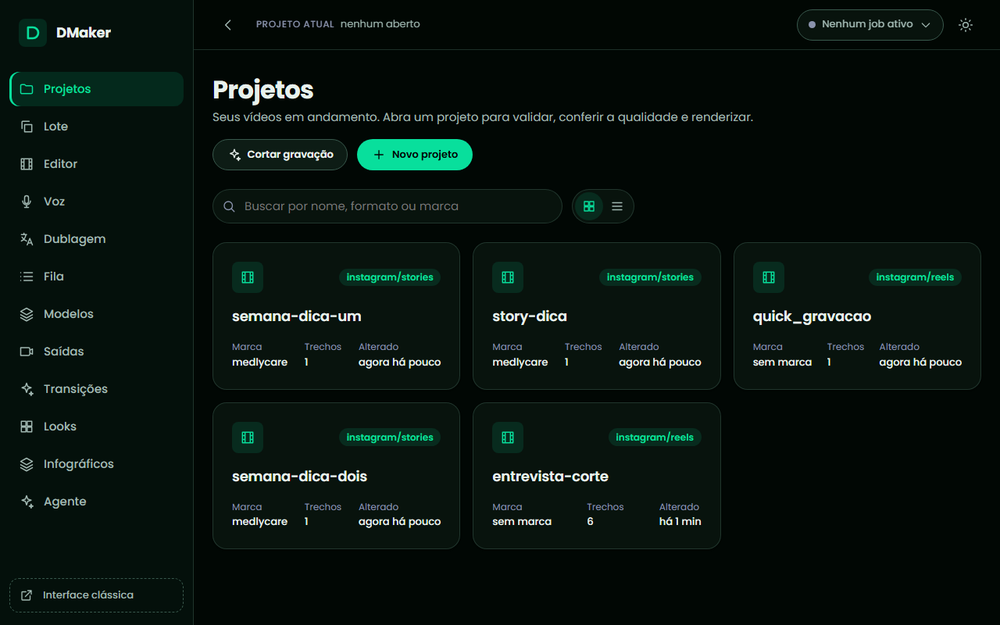

- **Projetos**: a lista dos seus projetos (cartões ou tabela, com busca). **Novo projeto** cria a partir de um modelo pronto ou do zero, escolhendo os arquivos. **Cortar gravação** corta pausas e vícios de uma gravação falada. Abrir um projeto leva à tela dele.
- **Tela do projeto**: **Validar** (duração final e avisos), **Conferir qualidade** (o relatório de QA em texto), **Renderizar** (prévia, versão final ou só alguns trechos, em um ou mais formatos), **Abrir no editor** (abre o projeto no editor da interface nova; **Abrir na clássica** é o caminho secundário) e o cartão de **Cortes automáticos** com **Desfazer** em cada corte. Um projeto com spec inválida mostra o motivo e o botão **Abrir no editor para corrigir**. O andamento aparece ao vivo.
- **Editor**: o projeto aberto para edição, com a barra de ações (**Salvar**, **Desfazer**, **Refazer**, **Validar**, **Prévia**, **Render final**, **Exportar**) e abas embaixo. **Propriedades** é o formulário da spec em blocos recolhíveis (**Saída**, **Fontes sincronizadas**, **Trechos**, **Sobreposições**, **Legendas** e **Áudio**). **JSON** mostra a spec inteira como texto, a saída para tudo que não tem formulário (look, efeitos sonoros, recorte de pessoa, composições). **Legendas** (aparece quando o projeto tem legendas automáticas) edita o texto de cada frase. **Preview** mostra o vídeo já renderizado, o relatório de QA, a grade de quadros e um quadro num instante. **Salvar** (ou `Ctrl+S`) grava; o selo **Não salvo** avisa quando há mudança, e sair da tela pergunta se descarta. **Validar** e os renders salvam antes. As caixas do player, da linha do tempo, dos filtros e da mídia aparecem com um aviso de que ainda não estão disponíveis: por enquanto, estão na interface clássica.
- **Lote**: o passo a passo de vários vídeos de uma planilha (veja a tarefa "Fazer vários vídeos de uma planilha").
- **Saídas**: os vídeos já gerados, com busca e filtro; assista ali ou baixe.
- **Voz, aba Vozes**: a **Biblioteca** lista as vozes prontas, clonadas e desenhadas, com filtro por marca. Em cada voz, **Ouvir** gera uma amostra curta (um job; a primeira vez carrega o modelo e demora) e toca, **Usar** a escolhe para o roteiro da Narração (a escolha fica guardada) e **Remover** apaga, depois de perguntar (as vozes prontas não saem). O cartão **Nova voz** tem **Clonar** (nome, arquivo de áudio ou microfone, o que é dito, idioma, marca e a caixa de permissão do dono da voz) e **Desenhar** (gênero, faixa etária, tom, sotaque, idioma, marca, voz sussurrada e descrição livre). Veja as tarefas "Clonar uma voz" e "Criar uma voz descrevendo como ela soa".
- **Voz, abas Isolar voz, Corrigir fala e Trocar voz**: escolha um arquivo do projeto aberto ou envie um do computador, acompanhe a etapa e o tempo do trabalho, ouça o antes e o depois (a correção toca só o trecho trocado, com 1,5 s de folga) e baixe o resultado. **Usar no projeto** troca o arquivo original pelo novo em tudo que o projeto usa e salva. O resultado e o que você preencheu ficam guardados ao trocar de aba. Veja as tarefas "Separar a voz da música e do ruído", "Corrigir uma palavra errada sem regravar" e "Trocar a voz de uma gravação inteira".
- **Dublagem**: prepara a tradução de um vídeo ou áudio, mostra as falas numa tabela para você corrigir, gera o vídeo dublado, compara com o original e baixa o vídeo, a legenda e as trilhas. Você pode **Parar** qualquer etapa, e a dublagem preparada fica guardada para abrir depois. Veja a tarefa "Dublar um vídeo para outro idioma".
- **Agente**: a conversa com o agente local, com o andamento das ferramentas ao vivo e botões de confirmação (veja "Usando com LLM local").
- **Transições**, **Looks** e **Infográficos**: catálogos com a prévia de cada um (veja as tarefas "Escolher a transição entre os trechos", "Dar um acabamento de cinema ao vídeo" e "Pôr um infográfico animado no vídeo"); no de infográficos, o formulário monta os campos do esquema do modelo e mostra o quadro com o que você digitou.

Um aviso de **jobs** na barra superior mostra o que está rodando e leva ao andamento.

### Interface clássica: o editor

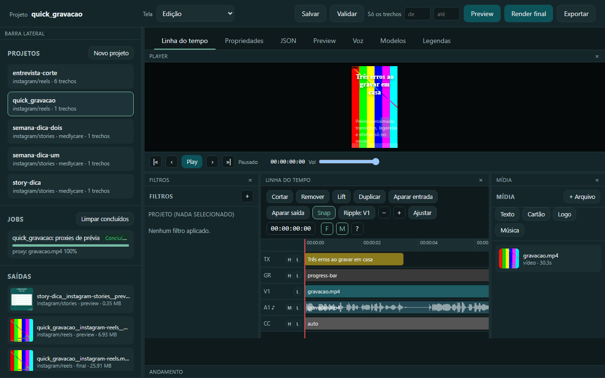

**Barra superior**: nome do projeto (com **não salvo** quando há mudanças pendentes), o seletor **Tela** (layouts), **Salvar**, **Validar**, o campo **Só os trechos** (render parcial), **Preview**, **Render final** e **Exportar**. **Barra lateral**: **Projetos** (com **Novo projeto**), **Jobs** e **Saídas**. **Abas**: **Linha do tempo**, **Propriedades**, **JSON**, **Preview**, **Voz**, **Modelos** e **Legendas** (aparece quando há legendas automáticas).

**Linha do tempo** (no estilo do Shotcut): o player em cima e as trilhas embaixo (arraste a alça entre os dois para redimensionar). De cima para baixo:

| Trilha | Conteúdo |
| --- | --- |
| `V2`, `V3`... | Sobreposições de vídeo (picture-in-picture) |
| `TX` | Sobreposições de texto |
| `GR` | Sobreposições de imagem e a barra de progresso |
| `V1` | Os trechos principais: vídeo, imagem ou cartão |
| `A1` | Áudio de cada trecho da `V1` |
| `A2`... | Faixas de áudio externas sincronizadas |
| `NAR` | Narrações (com a duração real das falas já sintetizadas; arraste para mudar o início) |
| `MUS` | Música de fundo |
| `CC` | Legendas |

Clique ou arraste na régua para mover o cursor; clique num item para selecionar (`Ctrl` seleciona vários); arraste o meio de um item para mover e as bordas para aparar, com encaixe (snap). A barra de ferramentas tem **Cortar no cursor**, **Remover**, **Lift**, **Duplicar**, **Aparar entrada** e **Aparar saída até o cursor**, **Snap** e o zoom. Cortar, mover, aparar, duplicar e remover são "ripple": a `V1` nunca fica com buracos.

O **player** mostra uma prévia ao vivo aproximada: toca o trecho sob o cursor, as sobreposições de texto e imagem e o picture-in-picture. **Não mostra** transições, movimento de câmera em fotos, legendas, looks, correção de cor nem a troca de fundo: isso só sai no render.

| Aparece na prévia ao vivo | Só aparece no render |
| --- | --- |
| Corte, ordem e duração dos trechos | Transições e looks |
| Sobreposições de texto e imagem | Movimento de câmera em fotos e cartões |
| Picture-in-picture (posição, forma, borda) | Legendas automáticas |
| Áudio dos clipes, da mesa, das faixas externas e da música | Correção de cor e troca de fundo |
| Proxy 540p para vídeos que o navegador não decodifica | Codificação final e miniatura |

**Painéis laterais** (botões `F` e `M`, ou o `×` do painel; o estado é lembrado): **Filtros**, à esquerda, mostra os grupos de campos do item selecionado (ou do projeto) que já saem do padrão, e o botão **+** lista os que ainda não foram aplicados (reenquadrar, cor, velocidade, transição, posição, forma, estilo do texto...); **Mídia**, à direita, lista as fontes e os arquivos usados, com miniatura: arraste para a `V1` para inserir um trecho, ou para uma trilha acima para criar uma sobreposição; os botões **Texto**, **Cartão**, **Logo** e **Música** criam cada um no cursor.

**Mudo, oculto e bloqueio por trilha**: o cabeçalho de cada trilha tem `M` (mudo, nas de áudio), `H` (ocultar, nas de vídeo, texto, imagem e legenda; a `V1` não oculta) e um cadeado (bloqueia seleção e arraste, só na interface). Mudo e oculto ficam salvos na spec e valem também no **render final**.

**Propriedades e JSON**: a aba **Propriedades** tem os campos em formulário (Saída, Fontes sincronizadas, Linha do tempo, Sobreposições, Legendas, Áudio); a aba **JSON** mostra a mesma spec como texto, com **Aplicar** para validar e salvar.

**Legendas**: com legendas automáticas geradas, a aba **Legendas** mostra uma tabela (Início, Fim, Texto) para corrigir; **Salvar legendas** grava. Gere a prévia de novo para ver.

**Preview, Render e Exportar**: **Validar** mostra a duração final e os avisos. **Preview** gera uma versão rápida em baixa resolução, com transições e legendas. O painel **Andamento** mostra cada etapa e a barra de progresso; ao terminar, o vídeo aparece na aba **Preview**, com o **Relatório de QA**, a **Grade de quadros** e **Quadro em t=**. **Render final** gera a versão de entrega; **Exportar** roda o projeto para outros formatos de uma vez.

**Organização da tela**: arraste a barra de título de um painel e solte sobre outro para trocar de lugar; arraste os divisores para redimensionar; o seletor **Tela** traz os layouts Edição, Efeitos, Áudio, Player e Revisão e os que você salvar (**Salvar layout como...**). Veja o formato em "Anexos".

**Atalhos de teclado** (a lista completa fica na tecla `?`, onde dá para clicar numa tecla e trocá-la; as trocas ficam no navegador):

| Tecla | Ação |
| --- | --- |
| Espaço, `K`, `J`, `L` | Reproduzir ou pausar, pausar, retroceder, avançar (repetir acelera 2x, 4x, 8x) |
| Setas, `Alt` + setas | Um quadro; edição anterior ou próxima |
| `Home`, `End`, `Page Up`, `Page Down` | Início, fim, 1 segundo para trás ou para frente |
| `S` | Cortar no cursor |
| `X` ou `Delete` | Remover (ripple) |
| `Z` | Lift (remove sem deixar lacuna na `V1`) |
| `I`, `O` | Aparar entrada ou saída até o cursor |
| `Ctrl+D`, `Ctrl+A` | Duplicar, selecionar tudo |
| `Ctrl+M`, `Ctrl+H`, `Ctrl+L` | Mudo, ocultar, bloquear a trilha atual |
| `A`, `V` | Acrescentar a mídia selecionada no fim da `V1`, inserir no cursor |
| `=`, `-`, `0`, `Ctrl+P` | Aproximar, afastar, ajustar à janela, alternar encaixe |
| `Ctrl+Z`, `Ctrl+Y`, `Ctrl+S` | Desfazer, refazer, salvar |
| `Escape`, `?` | Limpar a seleção, mostrar a lista |

### Interface clássica: a aba Voz

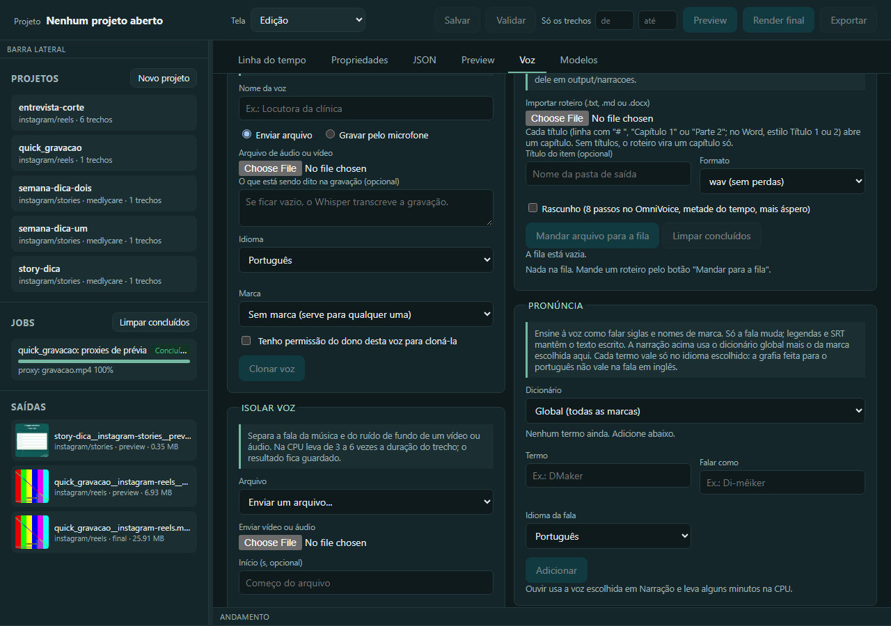

A aba **Voz** reúne, em seções, tudo o que fala: **Vozes** (a biblioteca), **Nova voz** (**Clonar** com arquivo ou microfone, **Desenhar** por descrição), **Isolar voz**, **Narração** (com prévia ao vivo e **Parar**), **Fila de narrações**, **Pronúncia**, **Corrigir fala**, **Trocar voz** e **Dublar**. Cada tarefa de voz deste manual diz em qual seção clicar. A aba **Modelos** lista os modelos de IA instalados, o tamanho, a licença, e deixa baixar, apagar e limpar sobras.

---

## Usando pela linha de comando

Todos os comandos são `dmaker <comando>` (sempre o `dmaker` do `.venv`, nunca o Python global). `dmaker <comando> --help` mostra as opções na hora, com a versão instalada, e a lista completa de comandos e opções está em "Referência gerada do código".

### Fluxo típico

```powershell
dmaker presets                                                  # ver os formatos
dmaker probe video.mp4 foto.jpg                                 # inspecionar as fontes
dmaker new meu-reel --preset instagram/reels --src a.mp4 --src b.mp4
dmaker validate projects\meu-reel\spec.json
dmaker render projects\meu-reel\spec.json --preview             # conferir rápido
dmaker qa projects\meu-reel\spec.json                           # relatório de QA em texto
dmaker render projects\meu-reel\spec.json                       # final
dmaker export projects\meu-reel\spec.json youtube/shorts facebook/reels
```

Ou, a partir de um modelo pronto (mais rápido para os casos já cobertos; veja "Criar um projeto a partir de um modelo pronto"):

```powershell
dmaker templates
dmaker new-from-template stories-medlycare meu-story --param print=C:\prints\agenda.png
```

### Escrever a spec na mão (resumo)

Para os casos sem modelo pronto, escreva `projects/<nome>/spec.json`. Os campos principais: `output` (`preset`, `quality`, `encoder`, `fps`), `brand`, `timeline` (`clip`, `image`, `card`), `overlays`, `captions`, `audio`, `sources`, `multicam`, `look`, `regions`. Tempos são sempre em segundos; caminhos relativos partem da pasta da spec (prefira absolutos, com barra `/`). Todos os campos, com tipo, limites e padrão, estão na referência gerada, e os valores aceitos de cada um no `dmaker://guide`. Depois de escrever, sempre `dmaker validate` antes de renderizar.

### Depurar um render

- `dmaker render ... --dry-run` mostra os comandos ffmpeg sem rodar.
- O grafo de filtros fica em `cache/jobs/<job>/graph.pretty.txt`, o texto e as legendas em ASS em `overlay.ass` e os comandos completos em `cmd.txt`.
- Um erro do ffmpeg chega com as últimas linhas do `stderr` e o comando completo.
- `dmaker qa` roda as checagens sem renderizar; com `--output`, confere também um vídeo já renderizado (duração, resolução, quadros pretos, silêncio, loudness).

---

## Tarefas de vídeo

Os exemplos de CLI desta parte supõem que você está na pasta do DMaker (`cd D:\DMaker`, com o ambiente ativo) e que os arquivos de exemplo (`gravacao.mp4`, `prints\agenda.png`) estão ali ou que você troca pelo caminho completo.

### Fazer um Reel a partir de uma gravação
<!-- tarefa: reel -->
Transforma uma gravação sua em um vídeo vertical para o Instagram, com legenda automática palavra a palavra, gancho no começo e barra de progresso.

#### Quando usar

Você tem um vídeo falado (celular, webcam) e quer um Reel pronto, sem montar uma linha do tempo. Serve também para Shorts, TikTok e Stories: troque o formato. Para vários trechos, cartões e fotos, use um modelo pronto (tarefa "Criar um projeto a partir de um modelo pronto").

**Pedidos que levam a esta tarefa:**
- "Faz um reel de 30 segundos desse vídeo com legenda"
- "Põe legenda automática e um gancho nesse vídeo e deixa vertical"
- "Transforma essa gravação em short"

#### Antes de começar

- Qual é o arquivo de vídeo (caminho completo) e se é falado em português.
- Em que segundos o Reel começa e termina (o padrão é do início ao fim; Reels aceitam até 180 s).
- Qual frase de gancho aparece nos primeiros 3 segundos, se quiser uma, e o formato (Reels é o padrão).
- Se pediu uma marca (MedlyCare): `brand` com o nome em minúsculas (`medlycare`) e `logo` para pôr o logo. A marca não é o gancho.

#### Pela IA

Diga ao Claude (ou ao agente local, veja a coluna "Agente local" do índice): "Faz um Reel de 30 segundos de `gravacao.mp4`, com legenda automática e o gancho 'Três erros ao gravar em casa'." Ele confere a gravação, monta uma prévia, lê o relatório de QA e só então renderiza a versão final. A primeira legenda baixa o modelo do Whisper (470 MB) e transcreve em cerca de 1 minuto por minuto de gravação.

#### Chamadas das ferramentas

```json
[
  {"tool": "probe_media", "arguments": {"paths": ["C:/videos/gravacao.mp4"]}, "para": "ver duração e orientação da gravação"},
  {"tool": "quick_edit", "arguments": {"src": "C:/videos/gravacao.mp4", "preset": "instagram/reels", "start": 0, "end": 30, "captions": true, "hook": "Três erros ao gravar em casa", "preview": true}, "para": "montar a prévia do Reel com legenda"},
  {"tool": "qa_report", "arguments": {"name_or_path": "quick_gravacao", "output": false}, "para": "conferir zona segura, ritmo e legenda do projeto"},
  {"tool": "quick_edit", "arguments": {"src": "C:/videos/gravacao.mp4", "preset": "instagram/reels", "start": 0, "end": 30, "captions": true, "hook": "Três erros ao gravar em casa"}, "para": "gerar a versão final"},
  {"tool": "qa_report", "arguments": {"name_or_path": "quick_gravacao", "output": true}, "para": "conferir o arquivo final (duração, resolução, loudness)"}
]
```

#### Pela interface

Na interface nova, **Projetos**, **Novo projeto**: dê um nome, deixe o modelo em "Do zero (escolher arquivos)", escolha o formato (`instagram/reels`), a marca, o arquivo de vídeo e marque **Gerar legendas automáticas** (e **Incluir o logo da marca**, se quiser). **Criar projeto** abre a tela do projeto: **Validar**, depois **Renderizar** com a opção **Prévia**, e por fim **Versão final**. O gancho é um texto: abra **Editar na clássica**, adicione um texto com o papel `hook` na trilha `TX` (botão **Texto**).

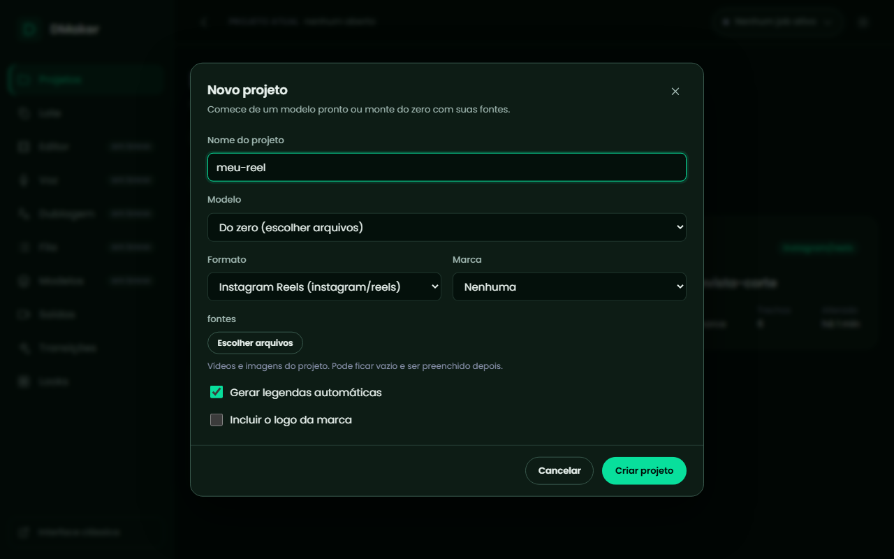

#### Pela CLI

```powershell
dmaker probe gravacao.mp4
dmaker quick gravacao.mp4 --preset instagram/reels --start 0 --end 30 --captions --hook "Três erros ao gravar em casa" --preview
dmaker qa projects\quick_gravacao\spec.json
dmaker quick gravacao.mp4 --preset instagram/reels --start 0 --end 30 --captions --hook "Três erros ao gravar em casa"
dmaker qa projects\quick_gravacao\spec.json --output output\quick_gravacao__instagram-reels.mp4
```

O comando mostra o caminho do vídeo gerado em `output/` (a prévia sai com o sufixo `__preview` e em resolução menor de propósito, 540x960; por isso o QA do arquivo só vale para a versão final). Com `--logo --brand medlycare` entra o logo da marca; `--cta "texto"` põe a chamada nos últimos 4 segundos; `--music trilha.mp3` põe a trilha.

#### Como conferir

Abra o MP4 de `output/` e veja as legendas em sincronia e o gancho no topo. `dmaker qa` diz em texto se algo foge da zona segura, do ritmo de leitura ou do contraste; com `--output` e o arquivo **final**, confere também a duração, a resolução, os quadros pretos, o silêncio e a loudness perto de -14 LUFS. Só olhe quadros (`dmaker sheet`) se o relatório apontar algo.

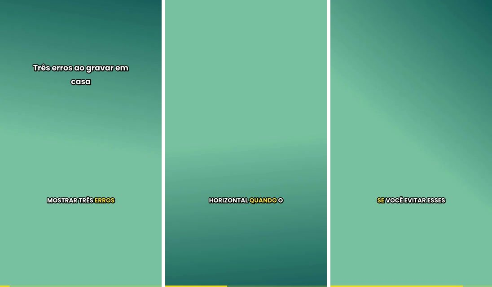

#### Se der errado

- **"Fonte não encontrada"**: o caminho do vídeo está errado; use o caminho completo.
- **A legenda errou um nome**: veja a tarefa "Corrigir uma palavra errada na legenda".
- **A legenda não aparece**: faltou `--captions`, ou o vídeo não tem fala; a transcrição baixa o modelo na primeira vez e precisa de internet só nessa vez.
- **A legenda ficou torta no vídeo horizontal**: use `--reframe crop` ou `--reframe blur`.
- **O QA avisou "cue longa" ou "baixa confiança"**: são sugestões, não erros; veja a legenda suspeita e, se estiver errada, corrija-a (tarefa da legenda).

### Criar um projeto a partir de um modelo pronto
<!-- tarefa: modelo -->
Cria um projeto completo de um modelo pronto (produto, depoimento, stories, vlog, tutorial, YouTube, explicativo, casamento), passando só o que muda de vídeo para vídeo.

#### Quando usar

O vídeo que você quer já cabe num dos modelos de `templates/`: é o caminho mais rápido e o que o agente local faz melhor. Sem modelo que sirva, escreva a spec (veja "Escrever a spec na mão").

**Pedidos que levam a esta tarefa:**
- "Faz um story com esse print e a pergunta 'Chegou sem hora marcada?'"
- "Monta um reel de produto com esses três prints"
- "Quais modelos de vídeo existem?"

#### Antes de começar

- Que tipo de vídeo é (produto, depoimento, story, vlog, tutorial, explicativo) para escolher o modelo.
- Os arquivos que o modelo pede (prints, vídeos) com o caminho completo: são os parâmetros obrigatórios (`list_templates` marca quais). Pergunte só o que falta deles.
- Os textos (título, gancho, CTA) têm padrão no modelo: se o usuário não deu um texto, use o padrão e siga em frente, sem perguntar.

#### Pela IA

Peça pelo resultado ("um story com este print e este título"). A IA lista os modelos, escolhe um, cria o projeto passando os parâmetros, valida (a mensagem nomeia o parâmetro que falta), gera a prévia, lê o QA e renderiza. O agente local faz esta tarefa de ponta a ponta.

#### Chamadas das ferramentas

```json
[
  {"tool": "list_templates", "arguments": {}, "para": "escolher o modelo e ver os parâmetros de cada um"},
  {"tool": "new_from_template", "arguments": {"template": "stories-medlycare", "name": "story-dica", "params": {"print": "C:/imagens/agenda.png", "titulo": "Chegou sem hora marcada?", "texto": "A fila de espera organiza quem chega e avisa o profissional"}}, "para": "criar o projeto"},
  {"tool": "validate_project", "arguments": {"name_or_path": "story-dica"}, "para": "ver a duração e os avisos"},
  {"tool": "render_project", "arguments": {"name_or_path": "story-dica", "preview": true}, "para": "gerar a prévia"},
  {"tool": "qa_report", "arguments": {"name_or_path": "story-dica", "output": false}, "para": "conferir antes da versão final"},
  {"tool": "render_project", "arguments": {"name_or_path": "story-dica"}, "para": "gerar a versão final"}
]
```

#### Pela interface

**Projetos**, **Novo projeto**: escolha o **Modelo** na lista; a janela mostra a descrição e um campo para cada parâmetro (obrigatórios marcados). **Criar projeto** abre o projeto; use **Validar**, **Renderizar** (**Prévia**) e **Versão final**.

#### Pela CLI

```powershell
dmaker templates
dmaker new-from-template stories-medlycare story-dica --param print=prints\agenda.png --param titulo="Chegou sem hora marcada?"
dmaker validate projects\story-dica\spec.json
dmaker render projects\story-dica\spec.json --preview
dmaker render projects\story-dica\spec.json
```

`--param chave=valor` repete para cada parâmetro (listas separadas por vírgula); `--params-json '{"titulo": "..."}'` passa tudo de uma vez. Os modelos: `reel-medlycare-produto` (capturas de tela com movimento e CTA), `reel-medlycare-depoimento` (um corte com gancho e crédito), `stories-medlycare` (uma dica sobre um print), `pessoal-vlog-reel` (vídeos em sequência com título e trilha), `youtube-longo` (abertura, gravação, CTA), `tutorial-tela-webcam` (tela e webcam em picture-in-picture), `explicativo` (veja a tarefa própria), `audiograma` (um áudio com capa, onda e legenda; veja a tarefa própria), `casamento-multicam` e `casamento-pascom` (veja "Fazer o vídeo do casamento com duas câmeras"). `dmaker templates` mostra os parâmetros de cada um.

#### Como conferir

`dmaker validate` mostra a duração final e os avisos (limite da plataforma, regra da marca, arquivo faltando). A prévia em `output/` confirma corte, texto e ritmo. O formato de um arquivo de modelo (para criar um novo) está em `templates/README.md`.

#### Se der errado

- **"parâmetro obrigatório ausente"**: a mensagem nomeia o parâmetro; confira com `dmaker templates`.
- **Arquivo não encontrado**: caminhos relativos partem da pasta do projeto; prefira o caminho completo com barra `/`.
- **Aviso de travessão**: a regra da marca proíbe travessão em texto na tela; troque por vírgula ou dois-pontos.

### Cortar as pausas de uma gravação falada
<!-- tarefa: cortar-pausas -->
Tira as pausas, os vícios de fala e as frases repetidas de uma gravação falada e entrega um projeto de clipes já cortados, com a lista do que saiu.

#### Quando usar

Você gravou falando (entrevista, aula, depoimento) e quer o vídeo sem silêncios e "hum", "né", "ééé". Use no lugar de cortar clipe a clipe à mão.

**Pedidos que levam a esta tarefa:**
- "Corta as pausas dessa gravação"
- "Tira os hum e os silêncios do vídeo"
- "Deixa a entrevista mais enxuta"

#### Antes de começar

- O arquivo (vídeo ou áudio com fala) e o nome do projeto novo.
- A intensidade: `suave` (só pausas), `normal` (pausas e vícios, o padrão) ou `agressiva` (também falsos começos e frases repetidas, ficando com a última tomada).

#### Pela IA

Diga: "Corta as pausas e os vícios de `entrevista.mp4`, intensidade normal." A IA usa a receita `cut_pauses_and_caption`, que corta, deixa a legenda seguindo a fala cortada e espera o fim em uma chamada só; depois mostra a lista dos cortes e você diz quais devolver. A transcrição leva cerca de 1 minuto por minuto de gravação, e cortar de novo a mesma gravação com outra intensidade reaproveita a transcrição. Quem quer só o corte, sem esperar, usa `autocut`.

#### Chamadas das ferramentas

```json
[
  {"tool": "cut_pauses_and_caption", "arguments": {"source": "C:/videos/entrevista.mp4", "name": "entrevista-corte", "intensity": "normal"}, "para": "cortar as pausas e deixar a legenda pronta, esperando o fim"},
  {"tool": "list_cuts", "arguments": {"name_or_path": "entrevista-corte"}, "para": "mostrar o que saiu, com tempo e motivo"},
  {"tool": "undo_cut", "arguments": {"name_or_path": "entrevista-corte", "cut_id": 3}, "para": "devolver ao projeto o corte número 3"},
  {"tool": "render_project", "arguments": {"name_or_path": "entrevista-corte", "preview": true}, "para": "gerar a prévia"},
  {"tool": "qa_report", "arguments": {"name_or_path": "entrevista-corte", "output": false}, "para": "conferir o resultado"}
]
```

#### Pela interface

Interface nova, **Projetos**, **Cortar gravação**: escolha o vídeo ou áudio, o nome do projeto e a **Intensidade**; em **Ajustes** estão a **Pausa mínima (s)** e o **Respiro (s)**; deixe marcada **Legendas automáticas seguindo a fala cortada** se quiser legendas. **Cortar** roda em segundo plano. Dentro do projeto, o cartão **Cortes automáticos** lista cada corte com **Desfazer**.

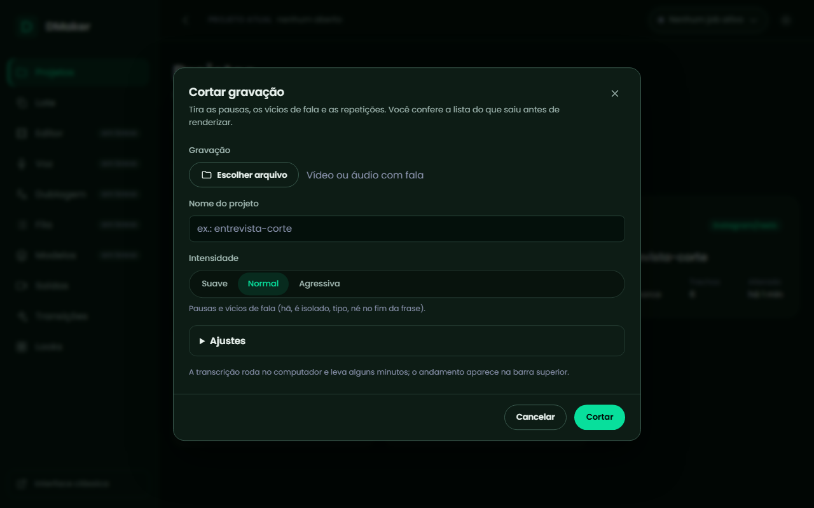

#### Pela CLI

```powershell
dmaker autocut entrevista.mp4 --name entrevista-corte --intensity normal
dmaker cuts entrevista-corte
dmaker uncut entrevista-corte 3
dmaker render projects\entrevista-corte\spec.json --preview
```

`--min-pause` (padrão 0,5 s) é a pausa acima da qual há corte e `--breath` (0,15 s) o silêncio que sobra de cada lado da fala. `--overwrite` refaz um projeto que já existe.

#### Como conferir

`dmaker cuts` lista cada corte com tempo na gravação original, motivo (`silence`, `filler`, `repetition`) e as palavras tiradas. Ouça a prévia nas emendas: cada borda cai no vale de energia mais próximo, sem passar por dentro de uma palavra. As legendas seguem a fala cortada.

#### Se der errado

- **"Nada passou do limite"**: a gravação tem ruído forte ou volume muito baixo; tente `--intensity agressiva` ou uma `--min-pause` menor.
- **O "né" ou o "é" sumiu no meio da frase**: o "né" só sai quando fecha a frase antes de uma pausa; se saiu errado, devolva o corte com `dmaker uncut`.
- **Mexi na linha do tempo e a legenda saiu do lugar**: volte `captions.source` para `"auto"` para transcrever de novo.

### Deixar a legenda em caixa arredondada
<!-- tarefa: legenda-caixa -->
Põe uma caixa de fundo arredondada atrás de cada linha da legenda, no estilo do TikTok, mantendo o destaque da palavra que está sendo falada.

#### Quando usar

Você quer a legenda com caixa de fundo (mais legível sobre imagens claras ou movimentadas) em vez do texto solto com contorno. O mesmo desenho vale para gancho, título e chamada.

**Pedidos que levam a esta tarefa:**
- "Faz a legenda ficar em caixa"
- "Quero a legenda arredondada, estilo TikTok"
- "Põe um fundo atrás da legenda"

#### Antes de começar

- O projeto já tem legendas automáticas (`captions.source` é `auto`, um `.srt` ou `narration`).
- Se quiser cantos mais ou menos redondos, o raio e a margem vêm da marca (`rounded_box_radius` e `rounded_box_padding` no `brand.json`; padrão 28 px na base 1080).

#### Pela IA

Diga: "Deixa a legenda do projeto `meu-reel` em caixa arredondada." A IA muda o modo da legenda para `rounded`, gera a prévia e confere no QA. Para texto sobreposto (gancho, título, CTA), peça "caixa arredondada nesse título".

#### Chamadas das ferramentas

```json
[
  {"tool": "edit_project", "arguments": {"name": "meu-reel", "op": {"type": "set_field", "path": "captions.style.mode", "value": "rounded"}}, "para": "trocar o modo da legenda para caixa arredondada"},
  {"tool": "render_project", "arguments": {"name_or_path": "meu-reel", "preview": true}, "para": "gerar a prévia para ver a caixa"},
  {"tool": "qa_report", "arguments": {"name_or_path": "meu-reel", "output": false}, "para": "conferir que a legenda cabe na zona segura"}
]
```

#### Pela interface

Interface nova, **Editor**, aba **Propriedades**, bloco **Legendas**: em **Estilo** escolha **Caixa arredondada** (as outras são Karaokê, Clássico e Caixa). **Salvar**, depois **Prévia**. Para um texto (gancho, título, CTA), o painel **Filtros** da interface clássica, grupo **Estilo**, só liga a **Caixa de fundo** retangular; o formato arredondado do texto (`"box_shape": "rounded"`) se põe na aba **JSON** do **Editor**.

#### Pela CLI

```powershell
dmaker new meu-reel --preset instagram/reels --src gravacao.mp4
dmaker render projects\meu-reel\spec.json --preview
```

A CLI não tem um comando que mude só o estilo: edite `projects\meu-reel\spec.json` e ponha `"captions": {"source": "auto", "style": {"mode": "rounded", "max_words": 6, "max_chars": 30}}`; depois rode `dmaker validate projects\meu-reel\spec.json` e o render. Num texto, o campo é `"style": {"box_shape": "rounded"}`.

#### Como conferir

Na prévia, cada linha tem a sua caixa, e linhas de larguras diferentes se emendam com curvas suaves; a palavra ativa continua destacada por cima. A cor e a opacidade da caixa seguem `box_color` e `box_alpha`.

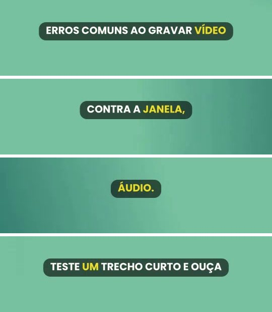

#### Se der errado

- **A caixa não aparece**: o modo continua `karaoke`; confira `captions.style.mode`.
- **A legenda ficou grande demais**: reduza `max_words` e `max_chars`, ou `size`.
- **"Extra inputs are not permitted"**: o nome do campo está errado; veja "Campos da spec" na referência.

### Corrigir uma palavra errada na legenda
<!-- tarefa: corrigir-legenda -->
Troca uma palavra que o Whisper ouviu errado nas legendas automáticas (um nome próprio, um termo técnico) sem transcrever tudo de novo.

#### Quando usar

A legenda saiu com "Medicare" em vez de "MedlyCare", ou com um nome trocado. Isto corrige o **texto da legenda**; para corrigir o que a pessoa **disse** no áudio, veja "Corrigir uma palavra errada sem regravar".

**Pedidos que levam a esta tarefa:**
- "A legenda escreveu o nome errado, corrige"
- "Troca 'medly care' por 'MedlyCare' nas legendas"

#### Antes de começar

- O nome do projeto e as duas grafias: a errada, como saiu, e a certa.

#### Pela IA

Diga: "No projeto `meu-reel`, a legenda trocou MedlyCare por 'medly care'; corrige." A IA lê as legendas suspeitas, aplica a troca em todas as falas e gera a prévia. Para o erro não voltar, ela também pode somar o termo em `captions.vocabulary` ou `replacements`.

#### Chamadas das ferramentas

```json
[
  {"tool": "read_captions", "arguments": {"name_or_path": "meu-reel", "mode": "compact"}, "para": "ver as legendas suspeitas"},
  {"tool": "fix_captions", "arguments": {"name_or_path": "meu-reel", "replacements": {"medly care": "MedlyCare"}}, "para": "trocar a grafia em todas as falas"},
  {"tool": "render_project", "arguments": {"name_or_path": "meu-reel", "preview": true}, "para": "gerar a prévia com o texto corrigido"}
]
```

#### Pela interface

Interface nova, **Editor**, aba **Legendas** (aparece quando o projeto tem legendas automáticas): corrija o texto na tabela (Início, Fim, Texto) e **Salvar legendas**; o tempo das palavras da frase é refeito sozinho. Gere a **Prévia** de novo.

#### Pela CLI

```powershell
dmaker captions gravacao.mp4 --lang pt --model small
```

Este comando só transcreve e grava `.srt` e `.json`. A troca de palavras em um projeto é feita pela IA (`fix_captions`) ou na interface; na CLI, edite `projects\meu-reel\captions.auto.json`/`.srt` ou acrescente o termo em `captions.replacements` na spec.

#### Como conferir

Gere a prévia e procure a palavra: o próximo render usa o texto corrigido, sem transcrever de novo (a transcrição fica em cache enquanto as fontes não mudam).

#### Se der errado

- **A palavra voltou errada**: acrescente-a em `captions.vocabulary` (nomes) ou `captions.replacements` ("errado": "certo") na spec; a marca já traz o vocabulário dela.
- **Quero refazer a transcrição**: rode o render com `--force`.

### Fazer um vídeo explicativo
<!-- tarefa: explicativo -->
Monta um vídeo de reel em que a gravação de quem explica fica num quadro arredondado embaixo, a área de cima mostra a imagem de cada assunto e o fundo troca a cada assunto.

#### Quando usar

Você grava uma explicação de frente para a câmera e tem uma imagem ou infográfico para cada assunto. A fala nunca é cortada na troca de fundo, porque a gravação é uma só, contínua.

**Pedidos que levam a esta tarefa:**
- "Faz um vídeo explicativo com minha gravação e essas três imagens"
- "Quero o rosto embaixo e o gráfico em cima"

#### Antes de começar

- A gravação (vertical ou horizontal) e a duração dela.
- Os assuntos, em ordem: o segundo em que cada um termina (`fim`), o fundo (`escuro`, `claro`, `bege`, uma cor `#RRGGBB` ou uma imagem), a imagem de cada um, se houver, e o infográfico, se houver (`infografico`: `{"nome": "contador", "parametros": {"ate": 10000}}`, um dos modelos da tarefa "Pôr um infográfico animado no vídeo"). O fim do último assunto é a duração da gravação.

#### Pela IA

Diga: "Explicativo com `gravacao.mp4` de 60 s: assunto 1 até 20 s com `assunto1.png`, assunto 2 até 40 s com um contador até 10.000, assunto 3 até 60 s com uma barra até 95 de 400." A IA usa a receita `build_explainer_video`, que cria o projeto pelo modelo `explicativo` e já devolve a duração e os avisos; sem o `fim` dos assuntos, ela divide a gravação em partes iguais. Depois gera a prévia.

#### Chamadas das ferramentas

```json
[
  {"tool": "build_explainer_video", "arguments": {"name": "meu-explicativo", "recording": "C:/videos/gravacao.mp4", "subjects": [{"fim": 20, "fundo": "escuro", "imagem": "C:/imagens/assunto1.png"}, {"fim": 40, "fundo": "bege", "infografico": {"nome": "contador", "parametros": {"ate": 10000, "prefixo": "+ de R$"}}}, {"fim": 60, "fundo": "claro", "infografico": {"nome": "barra", "parametros": {"valor": 95, "maximo": 400, "sufixo": "mg", "limite": 400}}}]}, "para": "criar o projeto e conferir duração e avisos"},
  {"tool": "render_project", "arguments": {"name_or_path": "meu-explicativo", "preview": true}, "para": "gerar a prévia"}
]
```

#### Pela interface

**Projetos**, **Novo projeto**, **Modelo** `explicativo`: preencha a gravação e a lista de assuntos (um texto JSON, como no exemplo da CLI). **Criar projeto**, **Validar** e **Renderizar** (**Prévia**).

#### Pela CLI

```powershell
dmaker new-from-template explicativo meu-explicativo --param gravacao=gravacao.mp4 --params-json '{"assuntos": [{"fim": 20, "fundo": "escuro", "imagem": "assunto1.png"}, {"fim": 40, "fundo": "bege", "imagem": "assunto2.png"}, {"fim": 60, "fundo": "claro"}]}'
dmaker validate projects\meu-explicativo\spec.json
dmaker render projects\meu-explicativo\spec.json --preview
```

Opções do modelo: `foco` (ponto do rosto que o quadro mantém visível; padrão `[0.5, 0.3]`), `legendas` (padrão ligado), `legenda_modo` (`rounded`, `karaoke`, `classic`, `boxed`) e `marca`.

#### Como conferir

O quadro do rosto e a área de cima ficam dentro da zona segura do Reels. `dmaker validate` avisa se a gravação é mais curta que o fim do último assunto. Na prévia, confira que o fundo troca no segundo certo e que a fala segue contínua.

#### Se der errado

- **Aviso de gravação mais curta**: o `fim` do último assunto passa da duração do arquivo; corrija o número.
- **Rosto cortado**: ajuste `foco` (em gravação vertical o rosto fica no terço de cima).
- **Imagem fora do lugar**: ela entra inteira e centrada na região `topo`, sem distorcer; use uma imagem com a proporção da área de cima.
- **Aviso `overlays[N].data...` no `validate`**: um parâmetro do infográfico de um assunto está fora do esquema do modelo; a mensagem diz qual e o que é aceito.

### Fazer um audiograma de um áudio
<!-- tarefa: audiograma -->
Transforma um áudio (corte de podcast, entrevista, áudio de WhatsApp) em um vídeo vertical com a capa num círculo, a onda ou as barras animadas no ritmo da fala e a legenda automática.

#### Quando usar

Você só tem o áudio e quer divulgá-lo numa rede social, onde o que roda é vídeo. O vídeo dura o que o áudio toca: o modelo `audiograma` mede o arquivo sozinho.

**Pedidos que levam a esta tarefa:**
- "Faz um audiograma desse corte do podcast com esta capa"
- "Transforma esse áudio de WhatsApp em um vídeo com onda e legenda"
- "Quero um vídeo do episódio 12 com a foto e as barras mexendo no ritmo da fala"

#### Antes de começar

- O arquivo de áudio (`.mp3`, `.wav`, `.m4a`, `.ogg`) e a capa (PNG ou JPG, a foto do episódio ou do convidado), com o caminho completo.
- O título (opcional, sem travessão) e o desenho: `circle` (o padrão, barras em volta da foto), `bars` (barras simétricas embaixo dela) ou `wave` (linha de onda embaixo dela).
- Se há música de fundo junto da voz, peça `seguir=voice`: o desenho então acompanha só a voz e fica parado nas pausas.

#### Pela IA

Diga: "Faz um audiograma de `ep12.mp3` com a capa `capa.jpg`, título 'Episódio 12', desenho em círculo." A IA cria o projeto pelo modelo `audiograma` (que mede o áudio), valida, gera a prévia, lê o relatório de QA e só então renderiza. A legenda sai do próprio áudio, pelo Whisper, no instante em que ele toca.

#### Chamadas das ferramentas

```json
[
  {"tool": "probe_media", "arguments": {"paths": ["C:/audios/ep12.mp3"]}, "para": "conferir que o áudio abre e quanto dura"},
  {"tool": "new_from_template", "arguments": {"template": "audiograma", "name": "episodio-12", "params": {"audio": "C:/audios/ep12.mp3", "capa": "C:/imagens/capa.jpg", "titulo": "Episódio 12", "estilo": "circle"}}, "para": "criar o projeto (a duração do vídeo é a do áudio)"},
  {"tool": "validate_project", "arguments": {"name_or_path": "episodio-12"}, "para": "avisar de áudio que passa do fim do vídeo ou de arquivo ausente"},
  {"tool": "render_project", "arguments": {"name_or_path": "episodio-12", "preview": true}, "para": "gerar a prévia"},
  {"tool": "qa_report", "arguments": {"name_or_path": "episodio-12", "output": false}, "para": "conferir texto, legenda e zona segura"},
  {"tool": "render_project", "arguments": {"name_or_path": "episodio-12"}, "para": "gerar a versão final"}
]
```

#### Pela interface

Interface nova, **Projetos**, **Novo projeto**, **Modelo** `audiograma`: preencha o **audio** e a **capa** (os obrigatórios) e, se quiser, o título, o desenho (**estilo**), o que o desenho acompanha (**seguir**) e o **fundo**. **Criar projeto**, **Validar** e **Renderizar** (**Prévia**). O ajuste fino do desenho (tamanho, posição, raio do círculo) se faz na aba **JSON** do **Editor** (interface nova).

#### Pela CLI

```powershell
dmaker new-from-template audiograma episodio-12 --param audio=ep12.mp3 --param capa=capa.jpg --param titulo="Episódio 12"
dmaker validate projects\episodio-12\spec.json
dmaker render projects\episodio-12\spec.json --preview
dmaker render projects\episodio-12\spec.json
```

`--param estilo=bars` troca o desenho, `--param seguir=voice` faz a onda seguir só a voz, `--param fundo=capa` usa a própria capa, cortada e desfocada, e `--param legendas=false` tira a legenda. Na spec, o áudio é `audio.voiceover` (`{"src": "ep12.mp3"}`, com `start`, `offset`, `end` e `volume`) e o desenho é a sobreposição `audiogram` (`style` `wave`, `bars` ou `circle`).

#### Como conferir

A duração do vídeo é a do áudio. `dmaker validate` avisa quando o áudio passa do fim do vídeo, quando o arquivo não existe e quando `follow: "voice"` não tem voz para seguir. Na prévia, o pico da fala e o pico do desenho caem no mesmo quadro, e o desenho fica parado nas pausas.

#### Se der errado

- **Aviso de áudio que passa do fim**: o fundo precisa durar o que o áudio toca. O modelo `audiograma` mede sozinho; numa spec escrita à mão, meça com `dmaker probe` e use a duração dele.
- **A onda se mexe no silêncio da fala**: há música de fundo e o desenho segue a mistura; use `seguir=voice`.
- **Sem legenda**: o modelo do Whisper baixa na primeira vez (precisa de internet nessa vez); `legendas=false` desliga.
- **Capa esticada**: use uma imagem quadrada; o círculo recorta o maior quadrado central.

### Escolher a transição entre os trechos
<!-- tarefa: transicoes -->
Muda como um trecho entra a partir do anterior (corte seco, fade, deslize, zoom de passagem, chicote) e o ritmo dessa troca (linear, suave ou mola).

#### Quando usar

O corte seco ficou duro, ou você quer um efeito de passagem entre dois trechos. Você pode ver todas as transições antes de escolher.

**Pedidos que levam a esta tarefa:**
- "Põe uma transição de zoom entre o segundo e o terceiro trecho"
- "Quais transições existem? Mostra"
- "Quero a troca com efeito de mola"

#### Antes de começar

- Qual trecho recebe a transição (o número na linha do tempo; o primeiro é 0). A transição é a **entrada** do trecho, vinda do anterior.
- Qual transição e quanto dura (0,3 a 0,6 s costuma bastar).

#### Pela IA

Diga: "No trecho 2 do `meu-reel`, entra com whippan, 0,5 s, curva mola." A IA muda o campo e gera a prévia. As transições de movimento são `crosszoom`, `whippan`, `blurslide`, `filmburn` e `lightleak`; as do xfade incluem `fade`, `wipeleft`, `slideleft`, `circleopen`, `zoomin`. Som na troca: `"sound": true` (veja "Pôr efeitos sonoros num instante do vídeo").

#### Chamadas das ferramentas

```json
[
  {"tool": "timeline_view", "arguments": {"name": "meu-reel"}, "para": "achar o índice do trecho"},
  {"tool": "edit_project", "arguments": {"name": "meu-reel", "op": {"type": "set_field", "path": "timeline.2.transition", "value": {"type": "whippan", "duration": 0.5, "curve": "spring"}}}, "para": "trocar a entrada do trecho 2"},
  {"tool": "render_project", "arguments": {"name_or_path": "meu-reel", "preview": true}, "para": "ver a transição na prévia"}
]
```

#### Pela interface

Interface nova, **Transições**: o catálogo mostra a folha de quadros da troca entre dois clipes de teste, com busca, filtro por tipo (movimento ou xfade) e seletor de **Curva de tempo**. Para aplicar, na interface clássica selecione o trecho e use o painel **Filtros**, grupo **Transição de entrada**.

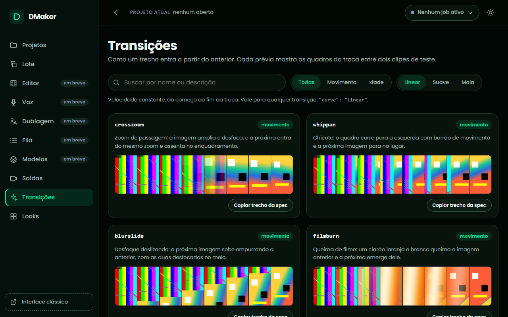

#### Pela CLI

```powershell
dmaker transitions list --kind movimento
dmaker transitions sheet whippan --curve spring
```

A folha de contato vai para `output\transitions`. Para aplicar, ponha em `timeline[N]` da spec `"transition": {"type": "whippan", "duration": 0.5, "curve": "spring"}`.

#### Como conferir

A transição só aparece no render (a prévia ao vivo do player não a mostra). Gere a prévia e olhe o instante da troca. Transição consome tempo: a duração final é a soma dos trechos menos as transições, e `dmaker validate` mostra.

#### Se der errado

- **Nome desconhecido**: confira com `dmaker transitions list`.
- **A troca não passa de metade do trecho**: a duração é limitada à metade de cada trecho; trechos muito curtos pedem transição mais curta.
- **A mola não "passa do ponto" num wipe ou slide**: numa cortina a curva só acelera e assenta; nas de movimento a mola passa de verdade.

### Dar um acabamento de cinema ao vídeo
<!-- tarefa: looks -->
Aplica um acabamento visual pronto, por nome (cinema, quente, frio, preto e branco, vintage), com vinheta, grão, brilho e vazamento de luz.

#### Quando usar

Você quer o vídeo com "cara de filme" ou uma cor uniforme em todos os trechos, sem ajustar brilho e contraste na mão.

**Pedidos que levam a esta tarefa:**
- "Deixa o vídeo com cara de cinema"
- "Põe um tom quente, de fim de tarde"
- "Faz em preto e branco contrastado"

#### Antes de começar

- O nome do look: `cinema`, `quente`, `frio`, `pb-contraste` ou `vintage` (a marca pode definir outros em `looks` no `brand.json`).
- Se algum trecho deve ficar sem acabamento (um cartão, por exemplo): ele leva `"look": "nenhum"`.

#### Pela IA

Diga: "Põe o look cinema no `meu-reel`." A IA muda o campo `look` do projeto, gera a prévia e confere o tamanho. O look do próprio trecho vence o do projeto, e um trecho com `color` próprio mantém a cor dele.

#### Chamadas das ferramentas

```json
[
  {"tool": "edit_project", "arguments": {"name": "meu-reel", "op": {"type": "set_field", "path": "look", "value": "cinema"}}, "para": "aplicar o look a todos os trechos"},
  {"tool": "render_project", "arguments": {"name_or_path": "meu-reel", "preview": true}, "para": "ver o acabamento na prévia"},
  {"tool": "qa_report", "arguments": {"name_or_path": "meu-reel", "output": false}, "para": "conferir o resultado e o tamanho do arquivo"}
]
```

#### Pela interface

Interface nova, **Looks**: cada look aparece ao lado da mesma cena de teste sem acabamento, com o trecho de spec pronto para copiar; o seletor de origem soma os looks de uma marca. Para aplicar, interface nova, **Editor**, aba **JSON**: acrescente `"look": "cinema"` na raiz, **Aplicar** e **Salvar**.

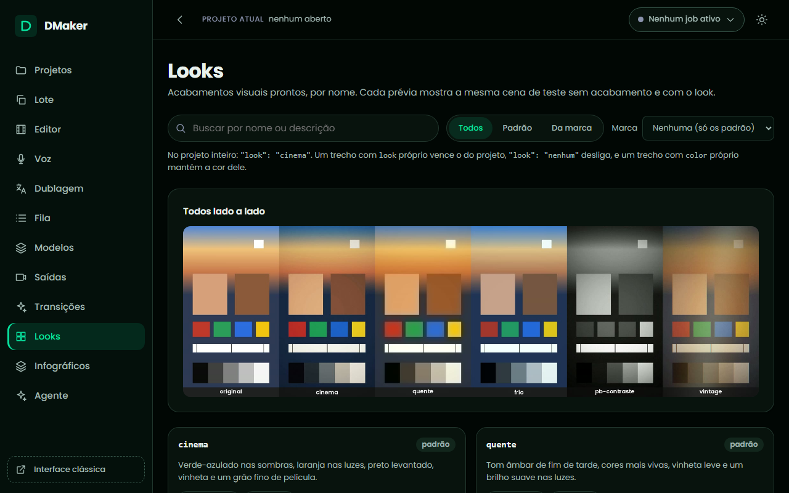

#### Pela CLI

```powershell
dmaker looks list
dmaker looks sheet all
```

As folhas de contato ficam em `output\looks`. Para aplicar, ponha `"look": "cinema"` na raiz da spec e renderize.

#### Como conferir

O look só aparece no render. A **granulação** custa tamanho de arquivo: uns 3 a 4 MB a cada 10 s em 1080x1920, e o look `cinema` inteiro pode passar de 30% a mais. Para um vídeo que precisa ficar leve, use `frio` ou `quente`, que não têm grão. Cada efeito soma de 1 a 5 s de CPU por 10 s de vídeo.

#### Se der errado

- **"look desconhecido"**: o erro vem antes de gastar o render; confira os nomes com `dmaker looks list --brand <marca>`.
- **O look não pegou num trecho**: o trecho tem `color` próprio (mantém a cor) ou `"look": "nenhum"`.
- **Legendas mudaram de cor**: não mudam; texto e legendas ficam por cima do acabamento.

### Pôr efeitos sonoros num instante do vídeo
<!-- tarefa: efeitos-sonoros -->
Põe sons curtos (whoosh, pop, clique, riser, impacto) num instante marcado, ou na entrada de um texto, uma imagem ou uma transição.

#### Quando usar

A entrada de um infográfico, a troca de fundo ou o fim de uma contagem pedem um som. Os sons são sintetizados pelo próprio DMaker e ficam em `assets/sfx`, então funcionam sem internet.

**Pedidos que levam a esta tarefa:**
- "Põe um whoosh quando o gráfico entrar"
- "Quero um som de impacto aos 31 segundos"

#### Antes de começar

- Em que segundo do **vídeo final** o som toca (`at`), ou qual elemento o dispara (texto, imagem, vídeo, transição).
- Qual som: `whoosh`, `whip`, `pop`, `click`, `riser`, `impact` ou `ding`, ou o caminho de um arquivo seu.

#### Pela IA

Diga: "Põe um whoosh aos 12,4 segundos no `meu-reel`." A IA acrescenta o efeito em `audio.sfx` e gera a prévia. O efeito não abaixa a música e fica abaixo da voz; um `riser` deve começar 1,6 s antes da revelação.

#### Chamadas das ferramentas

```json
[
  {"tool": "edit_project", "arguments": {"name": "meu-reel", "op": {"type": "set_field", "path": "audio.sfx", "value": [{"sound": "whoosh", "at": 12.4}, {"sound": "impact", "at": 31.0, "volume": 1.2}]}}, "para": "marcar os efeitos nos instantes"},
  {"tool": "validate_project", "arguments": {"name_or_path": "meu-reel"}, "para": "avisar de efeito depois do fim do vídeo"},
  {"tool": "render_project", "arguments": {"name_or_path": "meu-reel", "preview": true}, "para": "ouvir na prévia"}
]
```

#### Pela interface

Não existe uma tela de efeitos sonoros. Na interface nova, **Editor**, aba **JSON**, acrescente o bloco `audio.sfx` (ou `"sound": true` num texto), **Aplicar** e **Salvar**.

#### Pela CLI

```powershell
dmaker sfx list
dmaker validate projects\meu-reel\spec.json
```

`dmaker sfx list` mostra a biblioteca; `dmaker sfx build` sintetiza os sons de novo. Na spec: `"audio": {"sfx": [{"sound": "whoosh", "at": 12.4}]}`; no texto, imagem ou vídeo, `"sound": true` toca o som padrão do tipo (`pop` em texto e imagem, `whoosh` em vídeo e transição) na entrada.

#### Como conferir

O efeito entra com atraso exato (12,40 s toca em 12,40 s) e fica 6 dB abaixo do pico da voz. A loudness final continua no alvo. O render parcial (`--segments`) ignora `audio.sfx`.

#### Se der errado

- **"som desconhecido"**: o nome não é da biblioteca nem um arquivo existente; confira com `dmaker sfx list`.
- **Aviso de efeito depois do fim**: o `at` passa da duração do vídeo.
- **Muito baixo ou alto**: ajuste `volume` (0 a 1,5; o padrão 1 é a referência).

### Trocar o fundo atrás da pessoa
<!-- tarefa: trocar-fundo -->
Troca o fundo atrás de quem fala por uma cor lisa (branca ou da marca), sem tela verde, recortando a pessoa com uma rede neural.

#### Quando usar

A pessoa gravou de frente, parada, com o fundo bagunçado, e você quer um fundo liso. Funciona melhor com fundo parado; movimentos rápidos podem falhar na borda.

**Pedidos que levam a esta tarefa:**
- "Tira o fundo desse vídeo e põe branco"
- "Troca o fundo atrás da pessoa pela cor da marca"

#### Antes de começar

- Qual trecho (índice na linha do tempo) e a cor do fundo novo (hex ou chave da marca: `primary`, `accent`, `mint`, `white`).
- `resnet50` (padrão) separa melhor; `mobilenetv3` é mais leve e rápido, bom para rascunho.

#### Pela IA

Diga: "No primeiro trecho do `meu-reel`, troca o fundo por branco." A IA acrescenta o recorte no trecho e gera a prévia (o recorte fica em cache: o render final reaproveita).

#### Chamadas das ferramentas

```json
[
  {"tool": "edit_project", "arguments": {"name": "meu-reel", "op": {"type": "set_field", "path": "timeline.0.matte", "value": {"background": "#FFFFFF", "model": "mobilenetv3"}}}, "para": "ligar o recorte no primeiro trecho"},
  {"tool": "render_project", "arguments": {"name_or_path": "meu-reel", "preview": true}, "para": "gerar a prévia com o recorte"},
  {"tool": "qa_report", "arguments": {"name_or_path": "meu-reel", "output": false}, "para": "conferir o resultado"}
]
```

#### Pela interface

Não existe um botão para o recorte: na interface nova, **Editor**, aba **JSON**, ponha o bloco `matte` no clipe, **Aplicar** e **Salvar**. A prévia ao vivo do player não mostra a troca de fundo: gere a **Preview**.

#### Pela CLI

```powershell
dmaker setup
dmaker render projects\meu-reel\spec.json --preview
```

O `dmaker setup` baixa o modelo de recorte (ResNet50, 100 MB; o MobileNetV3 tem 15 MB). Na spec, o clipe leva `"matte": {"background": "#FFFFFF", "model": "mobilenetv3"}`.

#### Como conferir

Veja a borda do cabelo e das mãos na prévia. Gravação com movimento rápido pode "piscar" na borda; nesse caso use `resnet50` ou grave com a pessoa mais parada.

#### Se der errado

- **Modelo não encontrado**: rode `dmaker setup` (ou `dmaker models download rvm-resnet50`).
- **Render lento**: o recorte pesa na CPU; use `mobilenetv3` para rascunho e `downsample` menor.
- **A cadeira ou um objeto some**: use `resnet50`, que separa melhor o que encosta na pessoa.

### Pôr o texto atrás da pessoa
<!-- tarefa: texto-atras -->
Faz o título grande passar atrás de quem fala e na frente da parede, o efeito de profundidade dos Reels, recortando a pessoa só enquanto o texto aparece.

#### Quando usar

O vídeo mostra uma pessoa de frente, com a câmera parada, e você quer um título grande no cenário ("CINCO CAMADAS") com a cabeça e os ombros por cima das letras. O recorte usa a mesma rede neural da troca de fundo e só roda do início ao fim do texto: o resto do vídeo não é tocado.

**Pedidos que levam a esta tarefa:**
- "Põe o título atrás da minha cabeça"
- "Faz aquele efeito de texto atrás da pessoa"

#### Antes de começar

- O trecho tem uma pessoa de frente (cartão e foto não têm: o `validate` avisa) e o texto já está na spec com `start` e `end`. Se ainda não está, crie-o antes (um texto de papel `title`, no meio).
- Custo: perto de 0,5 s por quadro do intervalo em 1080x1920 (3 s de efeito somam uns 50 s ao render final). O recorte fica em cache: trocar só a frase ou a cor do texto não recorta de novo.
- Modelos: o render final usa o `resnet50` (o `dmaker setup` baixa) e a prévia usa o `mobilenetv3`, que baixa na primeira vez (15 MB).

#### Pela IA

Diga: "No `meu-reel`, o título dos 0 aos 3 segundos deve ficar atrás da pessoa." A IA acha o índice do texto, põe `layer: "behind-person"` nele e gera a prévia. Funciona melhor com a pessoa de frente e a câmera parada.

#### Chamadas das ferramentas

```json
[
  {"tool": "timeline_view", "arguments": {"name": "meu-reel"}, "para": "achar o índice do texto entre as sobreposições"},
  {"tool": "edit_project", "arguments": {"name": "meu-reel", "op": {"type": "set_field", "path": "overlays.1.layer", "value": "behind-person"}}, "para": "pôr o texto atrás da pessoa"},
  {"tool": "validate_project", "arguments": {"name_or_path": "meu-reel"}, "para": "avisar se o intervalo só cobre cartão ou foto"},
  {"tool": "render_project", "arguments": {"name_or_path": "meu-reel", "preview": true}, "para": "ver o efeito na prévia"},
  {"tool": "qa_report", "arguments": {"name_or_path": "meu-reel", "output": false}, "para": "conferir o projeto"}
]
```

#### Pela interface

Não existe um botão para a camada: na interface nova, **Editor**, aba **JSON**, ponha `"layer": "behind-person"` no texto, **Aplicar** e **Salvar** (o campo é preservado ao salvar). A prévia ao vivo do player não mostra o efeito: gere a **Preview**.

#### Pela CLI

```powershell
dmaker validate projects\meu-reel\spec.json
dmaker render projects\meu-reel\spec.json --preview
```

Na spec, o texto leva `{"type": "text", "text": "CINCO CAMADAS", "role": "title", "layer": "behind-person", "start": 0, "end": 3, "position": "center", "style": {"size": 190, "color": "#FFFFFF", "outline": 0}}`. O padrão de `layer` é `"front"`, na frente de tudo.

#### Como conferir

A ordem das camadas, de baixo para cima, é: o vídeo, os textos atrás da pessoa, a pessoa recortada e, por cima, imagens, picture-in-picture, audiogramas, textos comuns e legendas. Veja a borda do cabelo e das mãos na prévia (o `mobilenetv3` é mais grosseiro que o `resnet50` do render final). O ASS dos textos atrás da pessoa fica em `overlay_behind.ass`, na pasta do job.

#### Se der errado

- **Aviso em `overlays[N].layer`**: o intervalo do texto só cobre cartão ou foto; não há pessoa a recortar.
- **A borda piscou**: movimento rápido ou câmera em movimento; o efeito pede a pessoa de frente e a câmera parada.
- **Render lento**: o recorte pesa na CPU; reduza o intervalo do texto ou confira só a prévia.

### Pôr uma animação em HTML sobre o vídeo
<!-- tarefa: animacao-html -->
Põe por cima do vídeo uma animação que a IA escreve como código (HTML, CSS e JavaScript, com três dimensões e Lottie): um título grande, um número que conta, um objeto em 3D girando, um mapa com fotos entrando.

#### Quando usar

Você quer um gráfico ou uma animação que o DMaker não tem pronta (para um contador, uma barra ou uma linha, use antes os infográficos prontos, na tarefa "Pôr um infográfico animado no vídeo"): a Terra em corte com rótulos, uma planta baixa em 3D, quadros inclinados. A IA escreve a animação, você confere um quadro dela e o DMaker a desenha quadro a quadro, com fundo transparente, na região do vídeo que você escolher. A mesma animação sai sempre igual.

**Pedidos que levam a esta tarefa:**
- "Põe na parte de cima um número que conta até 87% e um cubo 3D girando"
- "Faz uma animação em HTML com o título entrando e deixa atrás da pessoa"

#### Antes de começar

- O navegador da animação, instalado uma vez: `pip install -e ".[html]"` e `dmaker setup --html` (Chromium de uns 120 MB em `bin/playwright`). Sem ele o `validate` avisa e o render falha com essa instrução.
- Onde ela entra: uma região do projeto (`regions`) ou o quadro todo, e de que instante a qual.
- A animação mora numa pasta do projeto (`composicoes/titulo/index.html` e os arquivos dela) e **não acessa a internet**: só usa a pasta, three.js, lottie-web, a Poppins e as cores da marca, que o DMaker já traz.
- Custo: uns 70 ms por quadro em 1080x1920 (5 s levam uns 12 s), em cache no segundo render.

#### Pela IA

Diga: "No `meu-reel`, põe na região `topo`, dos 1 aos 6 segundos, uma animação com o título 'Cinco camadas' entrando e um cubo 3D girando, nas cores da marca." A IA escreve a animação numa pasta do projeto, confere um quadro dela com `render_html_frame` (inclusive o do meio, sem desenhar os de antes), põe no projeto com `add_html_overlay`, valida, gera a prévia e lê o relatório. O contrato que ela segue, os dois exemplos e o guia de boas práticas estão no `dmaker://guide`, seção "Composição animada em HTML".

#### Chamadas das ferramentas

```json
[
  {"tool": "render_html_frame", "arguments": {"src": "composicoes/titulo", "project": "meu-reel", "at": 2.0, "size": "1080x960"}, "para": "ver o quadro do meio, com os avisos da página"},
  {"tool": "add_html_overlay", "arguments": {"name": "meu-reel", "src": "composicoes/titulo", "start": 1, "end": 6, "region": "topo"}, "para": "pôr a animação na região de cima"},
  {"tool": "validate_project", "arguments": {"name_or_path": "meu-reel"}, "para": "avisar de pasta ausente ou navegador não instalado"},
  {"tool": "render_project", "arguments": {"name_or_path": "meu-reel", "preview": true}, "para": "gerar a prévia"},
  {"tool": "qa_report", "arguments": {"name_or_path": "meu-reel", "output": false}, "para": "conferir o projeto"}
]
```

#### Pela interface

Não existe uma faixa nem um botão para a animação: a edição na linha do tempo fica para a fase 4 da interface nova (DMK-20). O render funciona igual pela interface (**Renderizar**, **Prévia**). Para pôr ou ajustar a animação à mão, use a aba **JSON** do **Editor** (interface nova) e acrescente a sobreposição `{"type": "html", "src": "composicoes/titulo", "region": "topo", "start": 1, "end": 6}`; o campo `data` e os demais são preservados ao salvar.

#### Pela CLI

```powershell
dmaker html frame projects\meu-reel\composicoes\titulo --at 2 --size 1080x960 --background "#3a4a5a"
dmaker validate projects\meu-reel\spec.json
dmaker render projects\meu-reel\spec.json --preview
```

O `dmaker html frame` grava o quadro em `output/html/`; `--data` entrega um JSON à página e `--brand` escolhe a marca dela. Na spec: `{"type": "html", "src": "composicoes/titulo", "region": "topo", "start": 1, "end": 6, "data": {"titulo": "Cinco camadas"}, "motion_blur": true, "layer": "behind-person"}`. `data` chega à página como `dmaker.data`, `motion_blur` borra o que se move rápido e `layer: "behind-person"` põe a animação atrás da pessoa.

#### Como conferir

Veja um quadro antes de renderizar o vídeo: os avisos da página (internet bloqueada, erro de JavaScript, arquivo que não existe nela) saem junto. No vídeo, a animação entra no quadro do início pedido e some no do fim; duas renderizações do mesmo projeto saem idênticas.

#### Se der errado

- **"O Chromium não está em bin/playwright"**: rode `dmaker setup --html`.
- **Aviso "tentou acessar ... na internet"**: a página pediu algo de fora (CDN, imagem de um site). Copie o arquivo para a pasta da animação; o render segue sem a requisição.
- **A animação não se mexe**: use `animation` em CSS, animações Web, GSAP, Lottie ou uma função `window.dmakerSeek(segundos)`; `setTimeout` anda só quando o DMaker manda.
- **Fundo opaco**: a página pintou o `body`; deixe-o sem fundo.

### Pôr um infográfico animado no vídeo
<!-- tarefa: infograficos -->
Põe por cima do vídeo um infográfico pronto que se mexe (um contador, uma barra, uma linha entre dois pontos, uma imagem entrando, uma etiqueta, um grifo à mão ou um emoji animado), escolhido pelo nome e com os valores que você quiser, nas cores e na fonte da marca.

#### Quando usar

Você quer o número que conta até 10.000, a barra que enche até 95 mg com o limite em 400, a linha que liga o prédio ao mapa, a etiqueta "QUARTO", o círculo na palavra da legenda. Cada modelo faz uma coisa só e não traz fundo: combine vários no mesmo assunto. Para outra animação, veja "Pôr uma animação em HTML sobre o vídeo".

**Pedidos que levam a esta tarefa:**
- "Põe um contador de 0 a 10 mil na parte de cima, com 'mais de R$' antes"
- "Faz uma barra até 95 mg com o limite de 400 e circula a palavra 'frio' na legenda"

#### Antes de começar

- O navegador da animação, instalado uma vez: `pip install -e ".[html]"` e `dmaker setup --html`.
- Onde ele entra: uma região do projeto (a `topo` do `explicativo`) e de que instante a qual; sem região, a área própria do modelo.
- Os parâmetros de cada modelo estão na tabela "Infográficos prontos" da referência. Valor fora dela aparece no `validate`, com o caminho do campo.
- Os emojis animados são do Google (CC BY 4.0): ao publicar, dê o crédito "Animated Noto Emoji, Google, CC BY 4.0".

#### Pela IA

Diga: "No `meu-reel`, põe na região `topo`, dos 1 aos 6 segundos, um contador até 10.000 com 'mais de R$' antes." A IA lista os modelos, confere um quadro, põe no projeto, valida e gera a prévia. Para grifar uma palavra da legenda: o modelo `grifo` com `palavra`.

#### Chamadas das ferramentas

```json
[
  {"tool": "list_infographics", "arguments": {}, "para": "ver os modelos e os parâmetros de cada um"},
  {"tool": "render_infographic_frame", "arguments": {"name": "contador", "params": {"ate": 10000, "prefixo": "+ de R$"}, "brand": "medlycare", "at": 1.5}, "para": "ver o quadro antes de pôr no projeto"},
  {"tool": "add_infographic", "arguments": {"project": "meu-reel", "name": "contador", "params": {"ate": 10000, "prefixo": "+ de R$"}, "start": 1, "end": 6, "region": "topo"}, "para": "pôr o contador na região de cima"},
  {"tool": "validate_project", "arguments": {"name_or_path": "meu-reel"}, "para": "apontar valor fora do esquema, arquivo ausente ou navegador não instalado"},
  {"tool": "render_project", "arguments": {"name_or_path": "meu-reel", "preview": true}, "para": "gerar a prévia"},
  {"tool": "qa_report", "arguments": {"name_or_path": "meu-reel", "output": false}, "para": "conferir a zona segura e o resto"}
]
```

#### Pela interface

Interface nova, **Infográficos**: cada modelo tem um quadro de exemplo; **Ajustar os valores** abre o formulário do esquema (rótulos, limites e erros no campo) e mostra o quadro com o que você digitou, no instante e na marca que escolher. **Copiar trecho da spec** copia a composição. Pôr pela linha do tempo fica para a fase 4 da interface nova (DMK-20): por enquanto, cole o trecho em `overlays`, na aba **JSON** do **Editor** (interface nova), e **Aplicar**.

#### Pela CLI

```powershell
dmaker infographics list
dmaker infographics list contador
dmaker infographics frame contador --param ate=10000 --param "prefixo=+ de R$" --brand medlycare --at 1.5
dmaker infographics add meu-reel contador --param ate=10000 --param "prefixo=+ de R$" --region topo --start 1 --end 6
dmaker validate projects\meu-reel\spec.json
```

O `frame` grava o quadro em `output/html/`. Na spec: `{"type": "html", "infographic": "contador", "region": "topo", "start": 1, "end": 6, "data": {"ate": 10000}}`. No `explicativo`, cada assunto aceita `infografico` (`{"nome": "contador", "parametros": {"ate": 10000}}`).

#### Como conferir

O quadro do `frame` é o que o vídeo mostra. No `validate`, `overlays[N].data.ate: precisa ser um número` aponta o valor errado, e o `qa` avisa se a área invade a região coberta pelo app. No vídeo, o contador termina exatamente no valor e para, a barra enche até a conta (95 de 400 é 23,75% do trilho) e o grifo se desenha como traço na palavra da legenda, quando ela é dita.

#### Se der errado

- **"`ate` precisa ser um número"**: o valor está fora do esquema; a mensagem diz o limite ou as opções.
- **"a palavra ... não aparece na legenda"**: o `grifo` não achou a palavra; confira `palavra`, `ocorrencia` e se o projeto tem legendas.
- **O grifo some atrás da caixa da legenda**: a legenda fica sempre na frente; no modo `rounded` aumente a folga (`recuo`).
- **Cor ou fonte inesperadas**: vêm da marca do projeto (`brand`); trocar a marca as troca, sem mexer no modelo.
- **"O Chromium não está em bin/playwright"**: rode `dmaker setup --html`.

### Fazer o vídeo do casamento com duas câmeras
<!-- tarefa: multicam -->
Monta o vídeo de uma cerimônia com duas câmeras sincronizadas pelo áudio, cortando entre elas pelas fases do rito reconhecidas na fala, com cartões de abertura e encerramento.

#### Quando usar

Você tem duas pastas de câmera (a do altar e a lateral) de um casamento, e quer um primeiro corte automático para revisar. Para sincronizar câmeras e gravadores de outro evento, veja o passo a passo mais abaixo.

**Pedidos que levam a esta tarefa:**
- "Monta o vídeo do casamento com as duas câmeras dessas pastas"
- "Sincroniza as câmeras pelo áudio e faz o corte da cerimônia"

#### Antes de começar

- As duas pastas (câmera do altar e câmera lateral), os nomes dos casais (um item por casal, no formato "Nome & Nome") e a data. O resto (celebrante, cidade, igreja, músicos, trilha) tem padrão.
- Se a cerimônia não começa no início da gravação: o segundo em que começa e termina (`inicio`, `fim`).
- Pergunte; nunca invente o caminho de uma pasta nem os nomes.

#### Pela IA

Diga: "Casamento: câmera do altar em `D:\casamento\altar`, lateral em `D:\casamento\lateral`, casal Ana & Carlos, 15.08.2026." A IA cria o projeto pelo modelo `casamento-pascom`, **planeja o corte** (transcreve a câmera do altar, reconhece as fases e monta os clipes), valida, gera a prévia e deixa o ajuste fino (qual câmera fica de frente para quem) para você. O agente local faz esta tarefa.

#### Chamadas das ferramentas

```json
[
  {"tool": "new_from_template", "arguments": {"template": "casamento-pascom", "name": "casamento-ana-carlos", "params": {"camera_altar": "D:/casamento/altar", "camera_lateral": "D:/casamento/lateral", "nomes": ["Ana & Carlos"], "data": "15.08.2026"}}, "para": "criar o projeto com as duas câmeras"},
  {"tool": "plan_multicam", "arguments": {"name_or_path": "casamento-ana-carlos"}, "para": "reconhecer as fases e montar os clipes"},
  {"tool": "validate_project", "arguments": {"name_or_path": "casamento-ana-carlos"}, "para": "conferir duração e avisos"},
  {"tool": "render_project", "arguments": {"name_or_path": "casamento-ana-carlos", "preview": true}, "para": "gerar a prévia do corte"},
  {"tool": "qa_report", "arguments": {"name_or_path": "casamento-ana-carlos", "output": false}, "para": "conferir antes do render final"}
]
```

#### Pela interface

**Projetos**, **Novo projeto**, **Modelo** `casamento-pascom`: preencha as duas pastas, os nomes e a data. **Criar projeto**. O planejamento do corte (a etapa `plan_multicam`) não tem botão: rode `dmaker plan` ou peça à IA. Depois, **Validar** e **Renderizar** (**Prévia**). Para ajustar um corte, use a interface clássica.

#### Pela CLI

```powershell
dmaker new-from-template casamento-pascom casamento-ana-carlos --param camera_altar=D:\casamento\altar --param camera_lateral=D:\casamento\lateral --param nomes="Ana & Carlos" --param data=15.08.2026
dmaker plan casamento-ana-carlos
dmaker validate projects\casamento-ana-carlos\spec.json
dmaker render projects\casamento-ana-carlos\spec.json --preview
```

**Para outro evento**: declare as fontes em `sources` com `sync: "auto"` e confira com `dmaker sync cam1.mp4 cam2.mp4 gravador.wav` (mostra o deslocamento e a confiança de cada fonte; abaixo de 4, confira à mão). Clipes com `source` usam o tempo da sessão: trocar de câmera é trocar o nome. Câmera que grava em vários arquivos usa `parts`. Para revisar um trecho: `dmaker render spec.json --preview --segments 12-20`. Um vídeo de 1 hora leva perto de 2 horas do começo ao fim.

#### Como conferir

O `plan` devolve os avisos (buracos de cobertura, partes posicionadas pelo relógio do arquivo em vez de um link de áudio confiável) e as fases reconhecidas com o instante de cada uma. Confira esses avisos e a prévia antes do render final. O render recusa um projeto com o bloco `multicam` ainda sem planejar.

#### Se der errado

- **"bloco multicam pendente"**: rode `dmaker plan <projeto>` antes de validar ou renderizar.
- **Poucas fases reconhecidas**: a câmera de áudio (a do altar) tem fala baixa; informe `inicio` e `fim` ou ajuste os cortes depois.
- **Uma parte foi posicionada pelo relógio**: confira o trecho com `dmaker sync` ou olhando os quadros.

### Fazer vários vídeos de uma planilha
<!-- tarefa: lote -->
Gera um vídeo por linha de uma planilha (CSV, XLSX ou JSON), todos sobre o mesmo modelo de projeto, com validação antes, pausa e retomada.

#### Quando usar

Você precisa de uma série (dez Reels "procedimento da semana") ou do mesmo anúncio em versões por clínica ou cidade.

**Pedidos que levam a esta tarefa:**
- "Faz os 10 stories dessa planilha"
- "Gera um vídeo para cada linha desse CSV"

#### Antes de começar

- O modelo (`dmaker templates`) e a planilha: uma linha por vídeo, e o nome de cada coluna casa com o parâmetro do modelo sem diferenciar maiúscula, acento ou espaço (`Título` serve para `titulo`).
- Qual coluna dá o nome ao arquivo de cada vídeo (`--name-column`).
- Para ler `.xlsx`: `pip install -e ".[lote]"`. CSV (UTF-8 ou o ANSI do Excel, `,` ou `;`) e JSON não precisam de nada.

Exemplo de planilha para `stories-medlycare` (CSV com `;`):

```
titulo;texto;print
Dica um;A fila de espera organiza quem chega;imagens/dica1.png
Dica dois;Agenda online para o paciente;imagens/dica2.png
```

#### Pela IA

Diga: "Valida a planilha `semana.csv` com o modelo stories e, se estiver certa, gera o lote." A IA valida primeiro (aponta linha, coluna e motivo de cada problema), roda o lote em segundo plano e devolve o relatório do que saiu e do que falhou.

#### Chamadas das ferramentas

```json
[
  {"tool": "validate_batch", "arguments": {"template": "stories-medlycare", "sheet": "C:/planilhas/semana.csv", "name_column": "titulo"}, "para": "conferir a planilha sem renderizar nada"},
  {"tool": "run_batch", "arguments": {"template": "stories-medlycare", "sheet": "C:/planilhas/semana.csv", "name": "semana", "name_column": "titulo", "preview": true}, "para": "gerar as prévias do lote"},
  {"tool": "batch_status", "arguments": {"name": "semana"}, "para": "ver o que saiu e o que falhou"},
  {"tool": "resume_batch", "arguments": {"name": "semana"}, "para": "refazer só o que falta ou foi corrigido"}
]
```

#### Pela interface

Interface nova, **Lote**: escolha o **Modelo**, a **Planilha** (caminho do `.csv`, `.xlsx` ou `.json`) e a **Coluna do nome do arquivo**. A validação aparece em tabela; linhas com problema só ficam de fora se você confirmar. Depois acompanhe o progresso de cada vídeo, **Pausar**, **Retomar**, **Refazer** uma linha e leia o relatório.

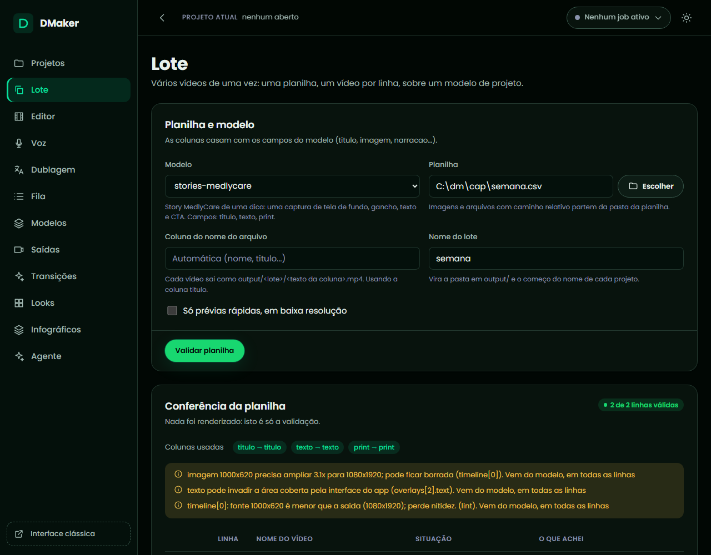

#### Pela CLI

```powershell
dmaker batch validate stories-medlycare semana.csv --name-column titulo
dmaker batch run stories-medlycare semana.csv --name-column titulo --lote semana --preview
dmaker batch status semana
dmaker batch resume semana
```

`--skip-invalid` segue sem as linhas com problema (elas ficam "Pulada" no relatório). `dmaker batch pause semana`, em outra janela, para depois do vídeo em andamento. `--replace` refaz um lote de mesmo nome a partir da planilha atual.

#### Como conferir

Cada linha vira um projeto (`projects/<lote>-<nome>`) e um vídeo em `output/<lote>/<nome>.mp4`. O relatório está em `output/<lote>/relatorio.txt`. Para corrigir um vídeo, edite o projeto dele e rode `dmaker batch resume semana`: só ele é refeito.

#### Se der errado

- **Lote não começa**: há linha inválida; leia a validação (linha, coluna, motivo) ou use `--skip-invalid`.
- **"Coluna ignorada"**: o nome não casa com nenhum parâmetro do modelo; renomeie a coluna.
- **O processo caiu no meio**: `resume` refaz só o vídeo que estava rodando; o que já saiu com a mesma spec não é refeito.
- **Travessão na planilha**: a regra da marca vale para o texto das células; troque por vírgula.

### Exportar o vídeo para outras plataformas
<!-- tarefa: exportar -->
Gera o mesmo projeto em vários formatos de uma vez (Reels, Shorts, Facebook, feed), cada um com o tamanho, a zona segura e o limite da plataforma.

#### Quando usar

O vídeo está aprovado e precisa sair para mais de uma rede. Cada formato é um render completo, então demora o mesmo que um render por formato.

**Pedidos que levam a esta tarefa:**
- "Exporta esse reel também para Shorts e Facebook"
- "Gera o vídeo para o feed quadrado"

#### Antes de começar

- O nome do projeto e a lista de formatos (`dmaker presets` mostra todos; os atalhos `reels`, `stories`, `shorts`, `youtube`, `feed`, `square`, `tiktok`, `status` e `linkedin` também valem).
- Se o vídeo respeita o limite de cada formato (Stories do Facebook, 20 s; WhatsApp, 30 s).

#### Pela IA

Diga: "Exporta o `meu-reel` para Shorts e Facebook Reels." A IA lança a exportação como um job e acompanha até terminar.

#### Chamadas das ferramentas

```json
[
  {"tool": "presets", "arguments": {"platform": "youtube"}, "para": "ver os formatos e limites de uma plataforma"},
  {"tool": "export_project", "arguments": {"name_or_path": "meu-reel", "presets": ["youtube/shorts", "facebook/reels"]}, "para": "exportar para os dois formatos"},
  {"tool": "job_status", "arguments": {"job_id": "exemplo-de-job"}, "para": "acompanhar o job (use o id devolvido)"}
]
```

#### Pela interface

Interface nova, tela do projeto, **Renderizar**, opção **Exportar em vários formatos**: marque os formatos e **Exportar**. No **Editor**, o botão **Exportar** da barra de ações abre a mesma escolha (salva o projeto antes).

#### Pela CLI

```powershell
dmaker presets
dmaker export projects\meu-reel\spec.json youtube/shorts facebook/reels
```

`--preview` gera versões rápidas de conferência; `--no-ui` roda só no terminal.

#### Como conferir

Cada arquivo sai em `output/` com o nome do formato. `dmaker validate` e o relatório de QA avisam quando a duração passa do limite da plataforma.

#### Se der errado

- **Passou do limite da plataforma**: é um aviso (as redes mudam os números); corte o vídeo ou escolha outro formato.
- **Formato desconhecido**: confira o id com `dmaker presets`.
- **Demora**: use `--preview` para conferir e deixe o final para o fim.

### Conferir o vídeo antes de publicar
<!-- tarefa: conferir-video -->
Roda as checagens automáticas em texto (duração, zona segura, ritmo de leitura, contraste, legendas e o arquivo renderizado) sem gastar tempo olhando imagem.

#### Quando usar

Antes de entregar qualquer vídeo, e sempre que algo parecer estranho (texto cortado, som baixo, legenda fora do lugar).

**Pedidos que levam a esta tarefa:**
- "Confere se esse vídeo está certo"
- "Tem algum problema nesse projeto antes de eu publicar?"

#### Antes de começar

- O nome do projeto e, se já renderizou, o vídeo gerado.

#### Pela IA

Diga: "Confere o `meu-reel`." A IA valida, gera a prévia, lê o relatório de QA e só olha quadros se o relatório apontar algo (imagens custam muitos tokens).

#### Chamadas das ferramentas

```json
[
  {"tool": "validate_project", "arguments": {"name_or_path": "meu-reel"}, "para": "duração final e avisos de limite e de marca"},
  {"tool": "render_project", "arguments": {"name_or_path": "meu-reel", "preview": true}, "para": "gerar a prévia"},
  {"tool": "qa_report", "arguments": {"name_or_path": "meu-reel", "output": false}, "para": "conferir o projeto e o arquivo"},
  {"tool": "contact_sheet", "arguments": {"video": "C:/dmaker/output/meu-reel__instagram-reels__preview.mp4"}, "para": "só se o QA apontar algo: grade de quadros"}
]
```

#### Pela interface

Interface nova, tela do projeto: **Validar** (duração e avisos) e **Conferir qualidade** (o relatório de QA). No **Editor**, o botão **Validar** salva antes e valida, e a aba **Preview** traz o vídeo já renderizado com o **Relatório de QA** (do arquivo que você escolheu, prévia ou final), a **Grade de quadros** e o **Quadro em**, um quadro no instante em segundos.

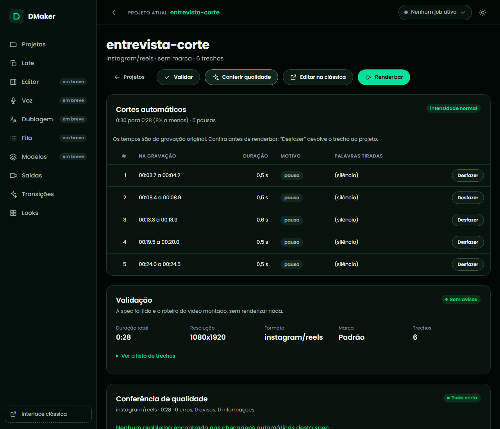

#### Pela CLI

```powershell
dmaker validate projects\meu-reel\spec.json
dmaker qa projects\meu-reel\spec.json
dmaker qa projects\meu-reel\spec.json --output output\meu-reel__instagram-reels.mp4
dmaker sheet output\meu-reel__instagram-reels__preview.mp4
dmaker frames output\meu-reel__instagram-reels__preview.mp4 2 8 15
```

#### Como conferir

O relatório separa o que é do projeto (zona segura, ritmo, contraste, sobreposições, legendas) do que é do arquivo (duração, resolução, quadros pretos, silêncio, loudness perto de -14 LUFS). Cada achado diz onde está.

#### Se der errado

- **Texto fora da zona segura**: mova o texto (`position` ou `region`) ou encurte-o.
- **Loudness longe de -14**: confira `audio.normalize` (padrão `two-pass`).
- **Quadros pretos**: um trecho com `fade_in`/`fade_out` longo, ou um clipe que acaba antes do previsto.

---

## Tarefas de voz e áudio

A voz roda na sua máquina, sem custo e sem internet depois do primeiro download dos modelos. Há dois motores: o **OmniVoice** (voz automática, clones e vozes desenhadas; realista, mas lento na CPU: cerca de 50 s de processamento por segundo de áudio com 16 passos, 25 s no rascunho) e o **Kokoro** (as vozes prontas `dora`, `alex` e `santa`; cerca de 3 s por segundo de áudio, bom para rascunho). Precisa do extra `voice` (veja a instalação). Toda fala sintetizada leva marca d'água inaudível e etiqueta de procedência (veja "Voz gerada" em Conceitos). Os exemplos de CLI supõem a pasta do DMaker.

### Narrar um roteiro com a minha voz
<!-- tarefa: narrar -->
Transforma um texto em áudio falado com a sua voz (clonada de uma gravação sua, com a sua autorização) ou com uma voz pronta, e gera a legenda com o tempo de cada fala.

#### Quando usar

Você tem um roteiro e quer a narração sem gravar. Para um roteiro longo (livro, manual, vários roteiros), use a fila. Para pôr a narração dentro de um vídeo, veja "Pôr a narração dentro de um vídeo".

**Pedidos que levam a esta tarefa:**
- "Narra esse roteiro com a minha voz"
- "Transforma esse texto em áudio"
- "Faz uma narração de rascunho com a voz pronta"

#### Antes de começar

- O texto (ou um arquivo `.txt`). Linha em branco vira pausa de parágrafo; `[pausa 1.2]` fixa uma pausa em segundos; números, R$ e % são lidos por extenso.
- Qual voz: `dmaker voice list` mostra as prontas e as suas. Para a **sua** voz, uma gravação limpa de 3 a 15 s (veja "Clonar uma voz"), e a **autorização de quem fala**: só clone a voz de quem concordou.
- Rascunho ou versão final: o rascunho (`draft`) usa metade do tempo e sai mais áspero.

#### Pela IA

Diga: "Narra este roteiro com a voz `minha-voz`, primeiro em rascunho." A IA confere a voz na biblioteca, sintetiza (um job em segundo plano) e devolve o arquivo, a duração e o tempo de cada fala. A primeira vez baixa o modelo (OmniVoice, 3 GB) e carrega em cerca de 30 s.

#### Chamadas das ferramentas

```json
[
  {"tool": "list_voices", "arguments": {}, "para": "ver as vozes prontas e as suas"},
  {"tool": "synthesize_speech", "arguments": {"text": "Olá! Este é o meu roteiro.\n\nEle tem duas frases.", "voice": "minha-voz", "out": "C:/audio/narracao.wav", "srt": true, "draft": true}, "para": "narrar em rascunho e gravar a legenda"},
  {"tool": "synthesize_speech", "arguments": {"text": "Olá! Este é o meu roteiro.\n\nEle tem duas frases.", "voice": "minha-voz", "out": "C:/audio/narracao.wav", "srt": true}, "para": "narrar na qualidade final"},
  {"tool": "verify_watermark", "arguments": {"path": "C:/audio/narracao.wav"}, "para": "confirmar a etiqueta de voz gerada"}
]
```

#### Pela interface

Interface clássica, aba **Voz**, seção **Narração**: escolha a **Voz**, o **Idioma**, a **Velocidade** (e uma **Semente** opcional, que repete a mesma fala), cole o **Roteiro** e **Gerar narração**. A prévia toca cada frase assim que fica pronta; **Parar** interrompe sem perder o que já saiu. Para um roteiro longo, **Enviar para a fila**. Com um projeto aberto, **Inserir no projeto aberto** põe a narração na posição do player.

#### Pela CLI

```powershell
dmaker voice clone minha-voz referencia.wav --text "Esta é a frase que eu li na gravação, com calma e perto do microfone."
dmaker voice list
dmaker voice say --file roteiro.txt --voice minha-voz --out narracao.wav --srt --draft
dmaker voice say --file roteiro.txt --voice minha-voz --out narracao.wav --srt
```

O primeiro comando cadastra a sua voz (só uma vez; veja "Clonar uma voz" e a autorização). Os dois últimos narram: o rascunho para ouvir o ritmo, e a versão final.

`dmaker voice say "texto direto" --out narracao.wav` serve para frases curtas. Sem `--voice`, fala a voz automática do OmniVoice. `--steps 32` dá a qualidade máxima, `--speed 1.2` acelera, `--seed 7` repete a mesma fala, `--raw` desliga o acabamento de rádio, `--language en` muda o idioma. A saída pode ser `.wav`, `.mp3` ou `.m4a`.

#### Como conferir

O comando mostra a duração do áudio e o tempo de processamento. Confira a legenda `.srt` ao lado do áudio. Nunca prove "que ficou bom" só pelo arquivo existir: ouça o início e o fim, e rode `dmaker voice verify narracao.wav` para confirmar a etiqueta. Cada fala fica em `cache/voice`: refazer o roteiro com poucas mudanças só sintetiza o que mudou.

#### Se der errado

- **Muito lento**: use `--draft`; referências curtas (5 a 10 s) deixam tudo mais rápido; conte cerca de 50 s por segundo de áudio na versão final.
- **O nome saiu mal pronunciado** ("DMaker" vira "DeMaker"): veja "Ensinar o DMaker a pronunciar um nome".
- **"Voz não encontrada"**: o id está errado; confira com `dmaker voice list`.
- **Falta de modelo ou de pacote**: instale o extra `voice` (veja a instalação) e deixe baixar na primeira vez.

### Clonar uma voz
<!-- tarefa: clonar-voz -->
Cria uma voz da biblioteca a partir de uma gravação limpa de quem fala, para usar na narração, na troca de voz e na correção de fala.

#### Quando usar

Você quer que o DMaker fale com a sua voz, ou com a de uma pessoa que **autorizou** isso. Nunca clone a voz de alguém sem a permissão dele: é dado pessoal.

**Pedidos que levam a esta tarefa:**
- "Clona a minha voz com essa gravação"
- "Cria uma voz a partir deste áudio"

#### Antes de começar

- **Pergunte se o dono da voz autorizou a clonagem. Sem autorização, não clone.** A interface exige marcar "Tenho permissão do dono desta voz para cloná-la"; a CLI e as ferramentas não perguntam, então a pergunta é sua.
- Uma gravação de fala limpa, sem música nem ruído, de 3 a 15 s (até 20 s vale inteira; acima disso o DMaker escolhe a janela de 15 s com mais fala). O ideal é a pessoa lendo uma frase natural.
- O que é dito na gravação, se souber (sem isso o Whisper transcreve).

#### Pela IA

Diga: "Tenho a autorização da dona da voz; clona `referencia.wav` com o nome `minha-voz`." A IA cadastra a voz e testa com uma frase curta. Se você não confirmar a autorização, a IA deve perguntar antes.

#### Chamadas das ferramentas

```json
[
  {"tool": "clone_voice", "arguments": {"name": "minha-voz", "reference_audio": "C:/audio/referencia.wav", "language": "pt"}, "para": "cadastrar a voz (só com a autorização do dono)"},
  {"tool": "list_voices", "arguments": {}, "para": "confirmar que a voz entrou na biblioteca"},
  {"tool": "synthesize_speech", "arguments": {"text": "Teste da minha voz clonada.", "voice": "minha-voz", "out": "C:/audio/teste-voz.wav", "draft": true}, "para": "ouvir uma amostra"}
]
```

#### Pela interface

Interface nova, **Voz**, aba **Vozes**, cartão **Nova voz**, **Clonar**: dê o **Nome da voz**, escolha **Enviar arquivo** ou **Gravar pelo microfone**, escreva o que é dito (opcional), escolha **Idioma** e **Marca**, marque **Tenho permissão do dono desta voz para cloná-la** e clique em **Clonar voz**. O botão só habilita com o nome, o áudio e a permissão marcada, e a frase embaixo dele diz o que falta. No microfone, **Gravar** e **Parar gravação** mostram o relógio e o conselho de 5 a 8 segundos; a gravação para sozinha aos 30 segundos e dá para ouvi-la antes de clonar. Se o navegador não achar um microfone ou a permissão for negada, a tela avisa e o envio de arquivo continua valendo. Quando termina, a voz nova entra na **Biblioteca** já escolhida para o roteiro. Na interface clássica, aba **Voz**, seção **Nova voz**, aba **Clonar**, os campos são os mesmos.

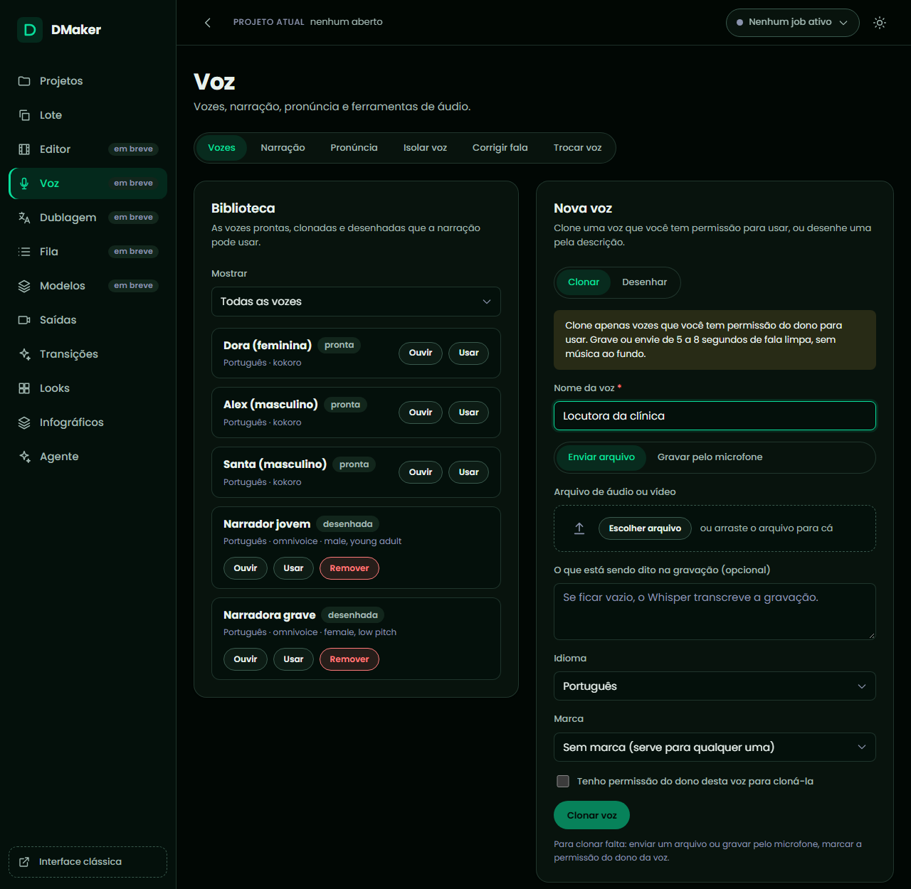

#### Pela CLI

```powershell
dmaker voice clone minha-voz referencia.wav --text "Esta é a frase que eu li na gravação, com calma e perto do microfone."
dmaker voice preview minha-voz --text "Teste da minha voz clonada."
dmaker voice list
dmaker voice remove minha-voz
```

As vozes ficam em `assets/voices/<id>/` (dado pessoal; fora do git). `voice remove` apaga uma voz sua; as prontas não se removem.

#### Como conferir

`dmaker voice preview` gera uma amostra curta para ouvir. A voz clonada mantém o timbre, mas não o sotaque nem a melodia de quem não está na gravação.

#### Se der errado

- **A voz saiu diferente**: a gravação tinha ruído, eco ou música; grave de novo, mais perto do microfone e sem fundo. Use "Separar a voz da música e do ruído" para limpar uma gravação existente.
- **Ficou lento**: uma referência mais curta (5 a 10 s) acelera cada fala.
- **O texto da gravação saiu errado**: passe `--text` com o que foi dito.

### Criar uma voz descrevendo como ela soa
<!-- tarefa: desenhar-voz -->
Cria uma voz sem gravação nenhuma, só descrevendo gênero, idade, tom e sotaque.

#### Quando usar

Você precisa de um narrador que não é ninguém em particular, ou não tem uma gravação limpa para clonar. A voz desenhada ganha uma frase âncora gerada uma vez, para o timbre não mudar entre as falas.

**Pedidos que levam a esta tarefa:**
- "Cria uma voz feminina, grave, de meia-idade"
- "Preciso de um narrador masculino com sotaque britânico"

#### Antes de começar

- Gênero (`male` ou `female`), faixa etária (`child`, `teenager`, `young adult`, `middle-aged`, `elderly`), tom (`very low pitch`, `low pitch`, `moderate pitch`, `high pitch`, `very high pitch`) e sotaque (`american`, `british`, `australian`, `portuguese`... seguido de ` accent`). Apelidos em português (feminino, grave, idoso) também valem.

#### Pela IA

Diga: "Cria a voz `narradora`: feminina, de meia-idade, tom grave." A IA cadastra e narra uma frase de teste.

#### Chamadas das ferramentas

```json
[
  {"tool": "design_voice", "arguments": {"name": "narradora", "gender": "female", "age": "middle-aged", "pitch": "low pitch"}, "para": "cadastrar a voz descrita"},
  {"tool": "synthesize_speech", "arguments": {"text": "Bem-vindos ao nosso canal.", "voice": "narradora", "out": "C:/audio/teste-narradora.wav", "draft": true}, "para": "ouvir a voz"}
]
```

#### Pela interface

Interface nova, **Voz**, aba **Vozes**, cartão **Nova voz**, **Desenhar**: **Nome da voz**, **Gênero**, **Faixa etária**, **Tom**, **Sotaque**, **Idioma**, **Marca**, **Voz sussurrada** e uma **Descrição livre** opcional (quando preenchida, vale no lugar dos quatro primeiros); **Criar voz**. Sem o nome, o campo pede o nome e nada é criado. A voz nova entra na **Biblioteca**, onde **Ouvir** gera uma amostra para você escutar. Na interface clássica, aba **Voz**, **Nova voz**, aba **Desenhar**, os campos são os mesmos.

#### Pela CLI

```powershell
dmaker voice design narradora --gender female --age middle-aged --pitch "low pitch"
dmaker voice preview narradora --text "Bem-vindos ao nosso canal."
```

`--accent "british accent"` põe sotaque, `--whisper` deixa a voz sussurrada, `--instruct "female, low pitch"` passa a descrição inteira de uma vez.

#### Como conferir

Ouça a amostra de `dmaker voice preview`. A voz desenhada é do tipo `design` na lista (`dmaker voice list`).

#### Se der errado

- **Termo não aceito**: use os termos em inglês da lista acima ou os apelidos em português.
- **A voz mudou entre falas**: não deveria; a âncora é gerada uma vez. Apague e crie de novo se o problema persistir.

### Ensinar o DMaker a pronunciar um nome
<!-- tarefa: pronuncia -->
Cadastra como a voz deve falar um termo (uma marca, um nome estrangeiro, uma sigla) sem mudar o que está escrito na legenda.

#### Quando usar

O modelo leu "DMaker" como "DeMaker", ou um nome próprio saiu torto. O dicionário troca só a fala; legendas, SRT e o texto mostrado mantêm a grafia escrita.

**Pedidos que levam a esta tarefa:**
- "A voz fala 'DMaker' errado, ensina a pronúncia"
- "Faz ele falar MedlyCare como 'Medly Quér'"

#### Antes de começar

- O termo como é escrito e como deve soar (escreva do jeito que o modelo fala certo, por exemplo "Di Mêiker").
- O idioma da fala: cada termo vale por idioma (a grafia feita para o português estraga a fala em inglês). O dicionário é global ou de uma marca (a da marca vale por cima).

#### Pela IA

Diga: "Em português, 'DMaker' deve soar 'Di Mêiker'." A IA cadastra o termo e sintetiza uma frase de teste. Para uma só ocorrência, escreva no texto `[[termo|pronúncia]]` (a fala usa a pronúncia, a legenda mostra o termo).

#### Chamadas das ferramentas

```json
[
  {"tool": "pronunciation", "arguments": {"action": "add", "term": "DMaker", "spoken": "Di Mêiker", "language": "pt"}, "para": "cadastrar a pronúncia"},
  {"tool": "pronunciation", "arguments": {"action": "list"}, "para": "conferir o dicionário"},
  {"tool": "synthesize_speech", "arguments": {"text": "O DMaker narra o seu roteiro.", "out": "C:/audio/teste-pronuncia.wav", "draft": true}, "para": "ouvir o resultado"}
]
```

#### Pela interface

Interface clássica, aba **Voz**, seção **Pronúncia**: escolha o **Dicionário** (global ou uma marca), escreva o **Termo**, o **Falar como** e o **Idioma da fala**, e **Adicionar**.

#### Pela CLI

```powershell
dmaker voice lexicon add DMaker "Di Mêiker" --language pt
dmaker voice lexicon list
dmaker voice lexicon remove DMaker --language pt
```

`--brand medlycare` cadastra só para aquela marca. Na dublagem, vale a pronúncia do idioma de destino.

#### Como conferir

Narre uma frase com o termo e ouça. O casamento ignora maiúsculas, vale só para a palavra inteira e usa o termo mais longo primeiro. Mudar o dicionário ressintetiza só as falas afetadas, porque a pronúncia entra na chave do cache.

#### Se der errado

- **Continua errado**: tente outra grafia fonética; o que importa é como o modelo lê.
- **Ficou errado em inglês**: o termo está cadastrado só em `pt`; cadastre também em `en` (ou deixe sem entrada, e ele é lido como está).

### Narrar um roteiro longo em segundo plano (fila)
<!-- tarefa: fila-narracao -->
Põe um roteiro longo (audiobook, manual narrado, vários roteiros) numa fila que narra um item por vez, retoma de onde parou e separa por capítulos.

#### Quando usar

O roteiro leva horas para narrar, ou são vários, e você não quer travar a tela nem perder o que já saiu se o computador reiniciar.

**Pedidos que levam a esta tarefa:**
- "Narra esse livro em capítulos"
- "Põe esses três roteiros na fila de narração"

#### Antes de começar

- O roteiro como texto, ou um arquivo `.txt`, `.md` ou `.docx`. Uma linha com `# `, `Capítulo N` ou `Parte N` (no Word, estilo Título ou Heading 1 e 2) abre um capítulo.
- A voz, o título (nome do item e da pasta) e o formato (`wav` ou `mp3`). A estimativa de tempo parte de cerca de 1,4 s por caractere a 16 passos (0,7 s no rascunho) e passa a usar a velocidade medida nesta máquina.

#### Pela IA

Diga: "Põe o `audiobook.docx` na fila com a voz `narradora`." A IA enfileira e acompanha: estado, capítulo e fala em andamento, porcentagem e tempo restante.

#### Chamadas das ferramentas

```json
[
  {"tool": "voice_queue_add", "arguments": {"file_path": "C:/roteiros/audiobook.docx", "voice": "narradora", "title": "audiobook", "format": "wav"}, "para": "enfileirar o roteiro"},
  {"tool": "voice_queue_list", "arguments": {}, "para": "ver o andamento e o tempo restante"}
]
```

#### Pela interface

Interface clássica, aba **Voz**, seção **Fila de narrações**: **Importar roteiro** (`.txt`, `.md` ou `.docx`), **Título do item**, **Formato**, **Rascunho** se quiser, e **Mandar arquivo para a fila**. A fila roda sozinha enquanto o `dmaker ui` está aberto; **Limpar concluídos** tira os prontos da lista (os áudios continuam na pasta).

#### Pela CLI

```powershell
dmaker voice queue add --file audiobook.docx --voice narradora --title audiobook
dmaker voice queue list
dmaker voice queue run
```

`queue run` executa em primeiro plano, um item por vez, e volta quando a fila esvazia; `queue pause <id>`, `queue resume <id>` e `queue cancel <id>` controlam um item.

#### Como conferir

Cada item grava em `output/narracoes/<título>/`: um arquivo por capítulo (`NN-<capítulo>.wav`), o `<título>-completo.wav` com 1,5 s de silêncio entre capítulos e o `.srt` do completo. Se o processo cair, o item em andamento volta a pendente e retoma sem ressintetizar as falas que já estão em `cache/voice`.

#### Se der errado

- **Item parado**: nada roda sem executor; abra o `dmaker ui` ou rode `dmaker voice queue run`.
- **Capítulos não separaram**: o título não está no formato (`# Título`, `Capítulo N`, `Parte N`; no Word, estilos de título).
- **Demora**: use o rascunho para conferir e a versão final para entregar.

### Pôr a narração dentro de um vídeo
<!-- tarefa: narracao-no-projeto -->
Coloca a fala sintetizada como voz do vídeo, direto na spec, e usa o texto falado como legenda, sem gerar o áudio antes.

#### Quando usar

O vídeo é feito de cartões e imagens (ou de clipes mudos) e a voz é narrada. A música abaixa sozinha sob a narração e a loudness final a conta.

**Pedidos que levam a esta tarefa:**
- "Narra esse texto sobre os cartões do vídeo"
- "Põe a narração no projeto e usa como legenda"

#### Antes de começar

- O projeto, o texto (ou um `.txt` relativo à pasta do projeto), a voz e o instante em que a fala começa.
- A voz e o texto são lidos do cache: só a primeira vez sintetiza.

#### Pela IA

Diga: "No `meu-video`, narra 'Bem-vindo ao DMaker' com a voz `narradora` desde 0,5 s e usa como legenda." A IA usa a receita `narrate_into_project`, que acrescenta `audio.narration`, troca `captions.source` para `narration` e devolve os avisos (voz inexistente, narração que passa do fim) em uma chamada só. Depois gera a prévia.

#### Chamadas das ferramentas

```json
[
  {"tool": "narrate_into_project", "arguments": {"name_or_path": "meu-video", "text": "Bem-vindo ao DMaker.", "voice": "narradora", "start": 0.5, "seed": 1}, "para": "pôr a narração no projeto, usar o texto como legenda e avisar de voz inexistente"},
  {"tool": "render_project", "arguments": {"name_or_path": "meu-video", "preview": true}, "para": "gerar a prévia"}
]
```

#### Pela interface

Interface clássica: na aba **Voz**, **Narração**, gere a fala e use **Inserir no projeto aberto**, que acrescenta em `audio.narration` na posição do player e salva. A trilha `NAR` da linha do tempo mostra cada narração (com a duração real das já sintetizadas) e deixa arrastar para mudar o início.

#### Pela CLI

```powershell
dmaker validate projects\meu-video\spec.json
dmaker render projects\meu-video\spec.json --preview
```

Na spec: `"audio": {"narration": [{"text": "Bem-vindo ao DMaker.", "voice": "narradora", "start": 0.5, "seed": 1}]}` e `"captions": {"source": "narration"}`. Cada item aceita `text` ou `script`, `voice`, `instruct`, `start`, `volume` (0 a 4), `speed`, `language` e `seed`.

#### Como conferir

`dmaker validate` avisa se a voz não existe na biblioteca ou se a narração estimada passa do fim do vídeo; o render avisa se a real passou. Com `--dry-run` nada é sintetizado (usa a estimativa); o render parcial ignora a narração.

#### Se der errado

- **Demora no primeiro render**: está sintetizando; os seguintes usam o cache.
- **Legenda sem destaque**: use `style.mode: "karaoke"` com `source: "narration"`.
- **A música não abaixa**: confira `audio.music.ducking` (padrão ligado).

### Separar a voz da música e do ruído
<!-- tarefa: isolar-voz -->
Separa a fala da música e do ruído de fundo de um vídeo ou áudio, em dois arquivos: a voz limpa e o fundo.

#### Quando usar

Você quer a voz sem a música, o fundo sem a voz (para dublar ou trocar a fala), ou limpar uma gravação antes de clonar uma voz. Usa o Demucs, local.

**Pedidos que levam a esta tarefa:**
- "Tira a música dessa gravação e deixa só a voz"
- "Separa a voz do fundo"

#### Antes de começar

- O arquivo e, para poupar tempo, o trecho (`start` e `end` em segundos). Conte de 3 a 6 vezes a duração do trecho, mais cerca de 30 s para carregar o modelo na primeira vez; o resultado fica em cache.

#### Pela IA

Diga: "Isola a voz dos primeiros 60 segundos de `entrevista.mp4`." A IA lança o job e devolve os dois caminhos (`voice` e `background`).

#### Chamadas das ferramentas

```json
[
  {"tool": "isolate_vocals", "arguments": {"path": "C:/videos/entrevista.mp4", "start": 0, "end": 60, "format": "wav"}, "para": "separar a voz do fundo no trecho"},
  {"tool": "job_status", "arguments": {"job_id": "exemplo-de-job"}, "para": "acompanhar o job (use o id devolvido)"}
]
```

#### Pela interface

Interface nova, **Voz**, aba **Isolar voz**: escolha o **Arquivo** (um vídeo ou áudio do projeto aberto, ou **Enviar um arquivo...** do computador), **Início** e **Fim** opcionais, em segundos, e o **Formato** (`wav`, sem perdas, ou `mp3`), e clique em **Isolar voz**. A barra mostra a etapa e o tempo decorrido. No fim aparecem a **Voz** e o **Fundo**, cada um com player e botão **Baixar voz** ou **Baixar fundo**; o resultado fica na tela mesmo que você troque de aba da Voz. Na interface clássica é a aba **Voz**, seção **Isolar voz**, com os mesmos campos. Num projeto, o clipe aceita `"audio_mode": "voice"` ou `"background"`, que usa a voz ou o fundo no lugar do áudio da câmera.

#### Pela CLI

```powershell
dmaker audio isolate entrevista.mp4 --start 0 --end 60 --format wav
```

Grava `<nome>_voz` e `<nome>_fundo` em `output/isolamento` (`--out-dir` muda a pasta; `--format mp3` comprime).

#### Como conferir

Ouça a voz sozinha e o fundo sozinho. Não é mágica: música muito alta, voz cantada ou várias pessoas falando ao mesmo tempo deixam resíduos de fundo na voz e pedaços de voz no fundo.

#### Se der errado

- **Muito lento**: use `--start` e `--end` estreitos; o cache evita separar de novo o mesmo trecho.
- **Sobrou música na voz**: normal em música alta ou cantada; tente um trecho mais limpo.
- **Falta o modelo**: ele baixa na primeira vez (`dmaker models download demucs-htdemucs` adianta).

### Corrigir uma palavra errada sem regravar
<!-- tarefa: corrigir-fala -->
Troca uma palavra ou frase dita errado numa gravação pela versão certa, falada com a voz do próprio falante, sem regravar nada.

#### Quando usar

Na gravação a pessoa disse "Medicare" em vez de "MedlyCare", ou errou um número. O DMaker acha o trecho pela transcrição, regrava só ele com a voz clonada do falante (tirada de outro pedaço do mesmo arquivo) e emenda. A duração do arquivo não muda e o resto do áudio é o original. Para corrigir o texto da **legenda**, veja a tarefa própria.

**Pedidos que levam a esta tarefa:**
- "Ele falou o nome errado no minuto 2, corrige sem regravar"
- "Corrige essa palavra que eu falei errado, sem gravar de novo"
- "Troca 'cinco mil' por 'quinze mil' nessa fala"

#### Antes de começar

- O arquivo, o texto errado **como foi dito**, e o texto certo. Em vídeo longo, o trecho aproximado (`start` e `end`) poupa a transcrição.
- Se a palavra aparece mais de uma vez, qual ocorrência (1, 2...).

#### Pela IA

Diga: "Em `gravacao.mp4`, onde ele diz 'Medicare', ponha 'MedlyCare'." A IA lista as palavras com tempo (para achar o trecho), corrige e devolve o arquivo novo; você ouve original e corrigido.

#### Chamadas das ferramentas

```json
[
  {"tool": "speech_words", "arguments": {"path": "C:/videos/gravacao.mp4", "start": 0, "end": 60}, "para": "listar as palavras ditas, com o tempo de cada uma"},
  {"tool": "fix_speech", "arguments": {"path": "C:/videos/gravacao.mp4", "find": "Medicare", "text": "MedlyCare", "occurrence": 1}, "para": "regravar o trecho com a voz do falante"},
  {"tool": "job_status", "arguments": {"job_id": "exemplo-de-job"}, "para": "acompanhar o job (use o id devolvido)"}
]
```

#### Pela interface

Interface nova, **Voz**, aba **Corrigir fala**: escolha o **Arquivo**, o intervalo opcional (**Transcrever de** e **até**) e **Transcrever**. As palavras aparecem em linhas, uma por fôlego (pausa de 0,25 s), com o tempo no começo de cada linha. Clique na primeira e na última palavra do trecho errado (uma palavra só: clique nela duas vezes) e o trecho fica marcado. Escreva **O que deve ser dito no lugar**, escolha a **Voz** (ou deixe a do falante), preencha **Guardar a voz do falante como** se quiser reaproveitá-la, deixe marcado **Falar também as palavras vizinhas** (entonação mais natural) e clique em **Corrigir fala**. No fim aparece o resumo do que foi trocado; **Ouvir trecho original** e **Ouvir trecho corrigido** tocam só o trecho trocado, com 1,5 s antes e depois, para ouvir a emenda; **Baixar corrigido** salva o arquivo; **Usar no projeto** troca o arquivo nos trechos do projeto aberto e salva (só vale para um arquivo que veio do projeto, não para um enviado do computador). A transcrição e o trecho escolhido ficam guardados ao trocar de aba. Na interface clássica é a aba **Voz**, seção **Corrigir fala**, com os mesmos campos.

#### Pela CLI

```powershell
dmaker voice words gravacao.mp4 --start 0 --end 60 --words
dmaker voice fix gravacao.mp4 --find "Medicare" --text "MedlyCare"
```

Em vez de `--find`, aponte por tempo: `--start 12.4 --end 13.1`. `--occurrence 2` escolhe a segunda ocorrência; `--no-expand` fala só o trecho trocado; `--voice` usa uma voz da biblioteca; `--save-voice nome` guarda a voz clonada do falante. A saída padrão é `output/correcao/<nome>.corrigido.<ext>`.

#### Como conferir

Ouça o trecho antes e depois e as duas emendas. A emenda cai no ponto mais quieto da pausa (crossfade de 30 ms) e o volume da fala nova é igualado ao do falante. O comprimento do arquivo nunca muda: o texto novo cabe no trecho original (até 10% de diferença nas letras mantém a duração); se for maior, o trecho estica para dentro das pausas vizinhas e, se nem assim couber, a fala é comprimida e `duration_rule` avisa.

#### Se der errado

- **"Texto encontrado mais de uma vez"**: passe `--occurrence`.
- **Não achou o texto**: escreva como foi **dito** (sem acento nem maiúscula importa), ou aponte por tempo.
- **Lento**: conte cerca de 20 s por segundo de fala sintetizada, mais a separação da janela de 60 s ao redor (em cache); reparos próximos reaproveitam a separação.
- **Nome mal pronunciado na fala nova**: use `[[termo|pronúncia]]` no texto ou cadastre o termo (veja a tarefa de pronúncia).

### Trocar a voz de uma gravação inteira
<!-- tarefa: trocar-voz -->
Troca o timbre de quem fala por uma voz da biblioteca, mantendo as palavras, o ritmo, as pausas, a entonação e o fundo.

#### Quando usar

Você quer outra voz na mesma fala, sem refazer o texto. Não traduz (isso é a dublagem) nem refaz um trecho (isso é a correção). Cada quadro da fala original vira um quadro da fala nova, então a duração não muda.

**Pedidos que levam a esta tarefa:**
- "Troca a voz dessa gravação pela voz `narradora`"
- "Faz a minha fala soar com outra voz"

#### Antes de começar

- O arquivo e o id da voz (`dmaker voice list`). Para testar, converta só 20 a 30 s (`start` e `end`) antes do arquivo todo.
- Se a voz de destino é de uma pessoa real, a **autorização** dela.

#### Pela IA

Diga: "Testa a troca de voz nos primeiros 30 s de `gravacao.mp4` com `narradora`." A IA converte o trecho e, se você gostar, o arquivo todo.

#### Chamadas das ferramentas

```json
[
  {"tool": "list_voices", "arguments": {}, "para": "escolher a voz de destino"},
  {"tool": "convert_voice", "arguments": {"path": "C:/videos/gravacao.mp4", "voice": "narradora", "start": 0, "end": 30}, "para": "testar nos primeiros 30 segundos"},
  {"tool": "convert_voice", "arguments": {"path": "C:/videos/gravacao.mp4", "voice": "narradora"}, "para": "converter o arquivo inteiro"}
]
```

#### Pela interface

Interface nova, **Voz**, aba **Trocar voz**: **Arquivo** (do projeto aberto ou **Enviar um arquivo...**), **Voz que vai falar**, **Início** e **Fim** opcionais e **Trocar voz**. No fim aparecem o resumo (trecho ou arquivo, blocos e o ajuste de volume), **Ouvir original** e **Ouvir voz trocada**, que partem do mesmo ponto para comparar a mesma fala, e **Baixar com a voz trocada**. **Usar no projeto** vale quando o arquivo inteiro foi convertido: com **Início** ou **Fim** preenchidos o botão fica desligado e explica por quê. Na interface clássica é a aba **Voz**, seção **Trocar voz**.

#### Pela CLI

```powershell
dmaker voice convert gravacao.mp4 --voice narradora --start 0 --end 30
dmaker voice convert gravacao.mp4 --voice narradora
```

A saída padrão é `output/troca-de-voz/<nome>.<voz>-<id>.<ext>`. Vídeo inteiro passa sem recodificar a imagem; trecho de vídeo é recortado e recodificado.

#### Como conferir

Ouça a prévia de 30 s e compare com o original. O motor muda o timbre, não o sotaque nem a melodia: a fala nova mantém o jeito de falar da original. A voz é separada do fundo (em cache) e o fundo volta como estava. Conte de 1,5 a 2 s por segundo de fala, mais a separação.

#### Se der errado

- **Resultado ruim**: gravação com muita reverberação ou ruído; confira a fala isolada antes (tarefa "Separar a voz da música e do ruído").
- **Voz "não encontrada"**: confira o id em `dmaker voice list`.
- **Baixando modelo**: o conversor baixa os pesos (131 MB) na primeira troca.

### Verificar se um áudio foi gerado pelo DMaker
<!-- tarefa: verificar-audio -->
Diz se um arquivo de áudio ou vídeo tem voz gerada por IA pelo DMaker, lendo a etiqueta de procedência e, sem ela, a marca d'água inaudível do áudio.

#### Quando usar

Você recebeu um arquivo e quer saber se a voz foi sintetizada pelo DMaker, ou quer conferir que uma narração sua saiu marcada. Só detecta o que o DMaker gerou: gravação de pessoa e música nunca são marcadas.

**Pedidos que levam a esta tarefa:**
- "Esse áudio foi gerado pelo DMaker?"
- "Confere se a narração está marcada como voz de IA"

#### Antes de começar

- O arquivo (`.wav`, `.mp3`, `.m4a`, `.mp4`...). Um arquivo recodificado por uma rede social perde a etiqueta, mas a marca d'água do áudio pode sobreviver.

#### Pela IA

Diga: "Verifica se `video.mp4` tem voz gerada pelo DMaker." A IA lê a etiqueta (resposta imediata, com os trechos) e, sem ela, analisa o áudio.

#### Chamadas das ferramentas

```json
[
  {"tool": "verify_watermark", "arguments": {"path": "C:/videos/video.mp4", "check_audio": false}, "para": "ler a etiqueta de procedência"},
  {"tool": "verify_watermark", "arguments": {"path": "C:/videos/video.mp4", "check_audio": true}, "para": "analisar também a marca d'água do áudio"}
]
```

#### Pela interface

Não existe uma tela de verificação: use a CLI ou peça à IA.

#### Pela CLI

```powershell
dmaker voice verify video.mp4
dmaker voice verify video.mp4 --audio
```

#### Como conferir

A resposta tem três níveis. **Encontrada**: o detector reagiu e a assinatura "DM" de 16 bits confere em 15 ou mais bits. **Indício, inconclusivo**: o detector reagiu mas a assinatura não confere (é o que música e tons puros provocam; não prova nada). **Não encontrada**. Só "encontrada" conta como detecção. A etiqueta diz também em que trechos do arquivo a voz gerada entra (`trechos=33.10-34.42`), o que acha uma narração curta num vídeo longo; `--audio` analisa o áudio mesmo quando há etiqueta (cerca de meio segundo por segundo).

#### Se der errado

- **"Não encontrada" num vídeo que você sabe que usa voz do DMaker**: o arquivo foi recodificado (perdeu a etiqueta) ou a narração é curta num vídeo longo; rode com `--audio`.
- **"Indício"**: não conclui nada; tente o arquivo original.
- **Marca ausente nos meus áudios**: `DMAKER_WATERMARK=0` ou `--no-watermark` desligam a marca; confira o ambiente.

---

## Tarefas de dublagem e modelos

A dublagem troca a fala de um vídeo ou áudio por outro idioma, mantendo a música e o ruído de fundo. Ela junta várias peças que também existem sozinhas: separar a voz do fundo, transcrever, traduzir com o Ollama local, clonar a voz de quem fala e sintetizar. Precisa do extra `voice`, do Ollama no ar com o modelo de tradução (`gpt-oss:20b` por padrão; `DMAKER_TRANSLATE_MODEL` troca) e de bastante paciência na CPU: conte cerca de 20 s por segundo de fala sintetizada, mais a separação (3 a 6 vezes a duração, uma vez) e a tradução (minutos). Fora do escopo: sincronia labial.

### Dublar um vídeo para outro idioma
<!-- tarefa: dublar -->
Traduz a fala de um vídeo ou áudio e a refaz, com a voz clonada de quem fala, no idioma escolhido, mantendo o fundo; você revisa a tradução antes de gerar.

#### Quando usar

Você tem um vídeo falado em português (ou outro idioma) e quer a versão em inglês, espanhol, francês... com a mesma voz. O trabalho tem dois passos, com a revisão no meio: preparar (separar, transcrever, traduzir) e gerar.

**Pedidos que levam a esta tarefa:**
- "Como dublo um vídeo para inglês?"
- "Dubla esse vídeo em espanhol com a minha voz"
- "Traduz e refaz a fala em inglês, mantendo a música"

#### Antes de começar

- O arquivo, o idioma da fala (padrão `pt`) e o idioma alvo (`en`, `es`, `fr`, `de`, `it`...).
- O **Ollama no ar** com o modelo de tradução; sem ele o erro diz como abrir.
- Termos que não se traduzem (marcas): vão em `--glossary`; as marcas do dicionário de pronúncia já são mantidas.
- Se quer a voz original por baixo, estilo voice-over (`--keep-original -18`), ou só a dublada.
- **Autorização** de quem fala: a dublagem clona a voz dela.

#### Pela IA

Diga: "Dubla `gravacao.mp4` para inglês." A IA prepara (separa voz e fundo, transcreve, traduz) e mostra a tabela de falas para você corrigir; só então gera a dublagem. Ao final entrega o vídeo dublado e a legenda `.srt` no idioma novo. O trabalho é longo: a IA acompanha o job.

#### Chamadas das ferramentas

```json
[
  {"tool": "dub_prepare", "arguments": {"path": "C:/videos/gravacao.mp4", "target_language": "en", "source_language": "pt"}, "para": "separar, transcrever e traduzir; grava o projeto .dub.json"},
  {"tool": "dub_get", "arguments": {"project": "C:/dmaker/output/dublagem/gravacao.en.dub.json"}, "para": "ler as falas e a tradução para revisar"},
  {"tool": "dub_update_segment", "arguments": {"project": "C:/dmaker/output/dublagem/gravacao.en.dub.json", "segment_id": "s1", "text": "Hello, I am [[MedlyCare|Medly Care]].", "locked": true}, "para": "corrigir a tradução de uma fala e travá-la"},
  {"tool": "dub_render", "arguments": {"project": "C:/dmaker/output/dublagem/gravacao.en.dub.json", "draft": true}, "para": "gerar a dublagem em rascunho"}
]
```

#### Pela interface

Interface nova, **Dublagem**: escolha o **Arquivo** (um vídeo ou áudio do projeto aberto, ou **Enviar um arquivo...**), o **Idioma da fala** e **Dublar para**, o **Modo de voz** e, se quiser, **Quantas pessoas falam**, **Voz da biblioteca**, **Voz original por baixo (dB)**, **Quando a fala não cabe** e **Termos que não se traduzem**. **Preparar (transcrever e traduzir)** mostra a etapa e o tempo e tem o botão **Parar**; no fim aparece o cartão **Falas**, uma tabela com o tempo, o original e a tradução. Corrija o texto e marque **Travar** nas falas que não devem mudar. O aviso **Alterações não salvas** some depois de **Salvar traduções**; **Traduzir de novo as destravadas** pede confirmação e refaz só as falas sem a trava. Para continuar uma dublagem já preparada, escolha-a em **Abrir uma dublagem já preparada** e clique em **Abrir projeto**. **Gerar dublagem** salva a tabela antes e mostra "Sintetizando a fala i de n"; **Rascunho** (8 passos de síntese, metade do tempo) vale para ela e para as trilhas. Depois de gerar, cada fala mostra como coube (cabe, avança na pausa, comprimida, vídeo esticado, não coube) e a marca "nova" quando foi sintetizada agora. No cartão **Dublagem pronta**, **Ouvir original** e **Ouvir dublado** tocam os dois do começo, um de cada vez; **Baixar o vídeo dublado** e **Baixar a legenda (.srt)** salvam os arquivos, e **Usar no projeto** troca o arquivo original pelo dublado nos trechos do projeto aberto e salva (para uma dublagem reaberta, ele acha no projeto aberto o arquivo que foi dublado). A tabela, o resultado e o que você preencheu ficam guardados ao trocar de tela. Na interface clássica é a aba **Voz**, seção **Dublar**, com os mesmos campos: **Preparar** mostra a tabela, **Gerar dublagem** o progresso "fala i de n", e **Ouvir o original** e **Ouvir o dublado** comparam.

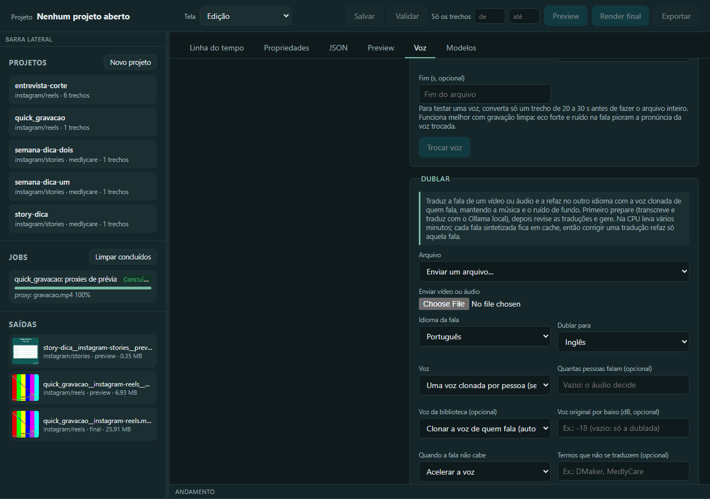

#### Pela CLI

```powershell
dmaker dub prepare gravacao.mp4 --to en --from pt
dmaker dub render output\dublagem\gravacao.en.dub.json --draft
```

Para fazer os dois passos de uma vez, sem revisar: `dmaker dub gravacao.mp4 --to en`. O projeto `output\dublagem\gravacao.en.dub.json` é um JSON editável: corrija o campo `text` de cada fala à mão, ou use `dmaker dub retranslate <projeto>` para traduzir de novo só as falas sem a trava (`locked`). A tradução aceita `[[termo|pronúncia]]`.

O vídeo sai em `output\dublagem\<nome>.<idioma>.<ext>` com a legenda `.srt`. `--draft` usa 8 passos de síntese (metade do tempo, mais áspero); `--steps 32` é o máximo.

#### Como conferir

Ouça o vídeo dublado e leia o `.srt`. Cada fala tem um `status` no relatório (`fits`, `advances`, `squeezed`, `stretched`, `overflow`, `empty`); o resultado traz `warnings` pedindo uma tradução mais curta onde o fim da fala foi cortado. Corrigir uma tradução e gerar de novo só ressintetiza aquela fala (o cache é por texto, voz, idioma, duração e passos).

#### Se der errado

- **"Ollama não está rodando"**: abra o aplicativo ou `ollama serve`, e baixe o modelo (`ollama pull gpt-oss:20b`).
- **A fala traduzida não cabe**: encurte a tradução da fala, ou use o modo que estica o vídeo (tarefa "Dublar esticando o vídeo onde a fala não cabe").
- **Duas pessoas, uma voz só**: veja "Dublar com mais de uma pessoa falando".
- **Muito lento**: use `--draft` para conferir e a versão final só no fim.
- **Quero parar no meio**: na interface nova, **Parar** pede ao servidor que pare na próxima etapa ou fala (a separação da voz em andamento termina antes de parar); o que já foi sintetizado fica em cache e a dublagem preparada não se perde. A CLI e a clássica não têm esse botão.

### Dublar com mais de uma pessoa falando
<!-- tarefa: dublar-varias-pessoas -->
Descobre quem fala em cada trecho e dubla cada pessoa com a sua própria voz clonada.

#### Quando usar

O vídeo é uma conversa ou entrevista com duas ou mais pessoas. O modo `per_speaker` (padrão) separa os falantes por diarização local, sem conta nem token, e monta um clone por pessoa a partir do melhor trecho de 3 a 15 s só com a fala dela.

**Pedidos que levam a esta tarefa:**
- "Dubla essa entrevista com duas vozes diferentes"
- "A segunda pessoa está com a voz da primeira, corrige"

#### Antes de começar

- Quantas pessoas falam, se você souber (`--speakers N` força o número; sem isso o áudio decide).
- A **autorização** de cada pessoa para clonar a voz.
- Os modelos de diarização baixam na primeira vez (cerca de 34 MB). `DMAKER_DIARIZATION=off` desliga a separação.

#### Pela IA

Diga: "Dubla `entrevista.mp4` para inglês; são duas pessoas." A IA prepara com 2 falantes, mostra quem fala cada trecho e troca o falante das falas que ficaram erradas ("Falante 2"); só aquela fala é sintetizada de novo.

#### Chamadas das ferramentas

```json
[
  {"tool": "dub_prepare", "arguments": {"path": "C:/videos/entrevista.mp4", "target_language": "en", "speaker_mode": "per_speaker", "num_speakers": 2}, "para": "preparar separando as duas pessoas"},
  {"tool": "dub_get", "arguments": {"project": "C:/dmaker/output/dublagem/entrevista.en.dub.json"}, "para": "ver o falante de cada fala"},
  {"tool": "dub_update_segment", "arguments": {"project": "C:/dmaker/output/dublagem/entrevista.en.dub.json", "segment_id": "s4", "speaker": "Falante 2"}, "para": "corrigir quem fala uma fala"},
  {"tool": "dub_render", "arguments": {"project": "C:/dmaker/output/dublagem/entrevista.en.dub.json", "draft": true}, "para": "gerar a dublagem"}
]
```

#### Pela interface

Interface nova, **Dublagem**: deixe o **Modo de voz** em "Uma voz clonada por pessoa" e ponha o número em **Quantas pessoas falam**; na tabela de falas, a coluna **Falante** (que aparece com duas ou mais pessoas) é editável: troque o falante da fala que ficou errada, **Salvar traduções** e **Gerar dublagem** (só aquela fala é refeita). Na interface clássica é a aba **Voz**, seção **Dublar**, com a coluna **falante**.

#### Pela CLI

```powershell
dmaker dub prepare entrevista.mp4 --to en --speakers 2
dmaker dub render output\dublagem\entrevista.en.dub.json --draft
```

`--speaker per_segment` clona a voz em volta de cada fala (uma aproximação para vários falantes) e `--speaker single` usa um clone só para o arquivo. Com uma pessoa só, `per_speaker` vale como `single`.

#### Como conferir

A tabela de falas mostra o falante de cada uma; ouça os trechos de troca de pessoa. A diarização roda em cerca de 0,3 vez a duração do áudio.

#### Se der errado

- **Duas pessoas viraram uma**: force com `--speakers 2`.
- **Uma fala está com a voz errada**: troque o falante dela (`dub_update_segment`, `speaker`).
- **Sem o pacote de diarização**: instale o extra `voice`; sem ele, o padrão volta a `per_segment`.

### Dublar esticando o vídeo onde a fala não cabe
<!-- tarefa: dublar-esticar -->
Quando a tradução é mais longa que a fala original, estica o vídeo só naquele trecho em vez de acelerar ou cortar a voz.

#### Quando usar

O inglês (ou outro idioma) saiu mais comprido e a voz acelerada ficou corrida. Há três modos de encaixe: `voz` (padrão: acelera a voz até 1,25x e corta o excesso), `video` (a voz fica natural e o vídeo estica naquela janela, até 1,3x, sem interpolar quadros) e `misto` (a voz acelera até 1,15x e o vídeo estica no que faltar).

**Pedidos que levam a esta tarefa:**
- "A dublagem ficou corrida; estica o vídeo onde precisar"
- "Dubla sem acelerar a voz"

#### Antes de começar

- Aceitar que o arquivo final fique **mais longo** que o original, e que a imagem seja recodificada (x264, CRF 18) nos trechos esticados.

#### Pela IA

Diga: "Dubla `gravacao.mp4` para inglês sem acelerar a voz, esticando o vídeo." A IA usa `fit_mode: "video"`. O resultado diz quais falas esticaram, o fator e quantos segundos a mais.

#### Chamadas das ferramentas

```json
[
  {"tool": "dub_prepare", "arguments": {"path": "C:/videos/gravacao.mp4", "target_language": "en", "fit_mode": "video"}, "para": "preparar já com o encaixe que estica o vídeo"},
  {"tool": "dub_render", "arguments": {"project": "C:/dmaker/output/dublagem/gravacao.en.dub.json", "fit_mode": "misto", "draft": true}, "para": "gerar escolhendo outro modo só desta geração"}
]
```

#### Pela interface

Interface nova, **Dublagem**: o campo **Quando a fala não cabe** escolhe entre acelerar a voz, esticar o vídeo ou os dois; ele é salvo junto com as traduções, e a tabela mostra a situação de cada fala depois de gerar. Na interface clássica é o mesmo campo, na aba **Voz**, seção **Dublar**.

#### Pela CLI

```powershell
dmaker dub prepare gravacao.mp4 --to en --fit video
dmaker dub render output\dublagem\gravacao.en.dub.json --fit misto --draft
```

#### Como conferir

Só a fala que não coube estica; o fundo e a voz original atenuada acompanham o vídeo (mesmo tom) e a legenda `.srt` cai nos tempos novos. O resultado traz `output_seconds` (a duração nova) e `stretched`. Passou de 1,3x: o fim da fala é cortado e há um aviso. Em áudio sem imagem, o modo vale como `voz`.

#### Se der errado

- **A duração mudou e não esperava**: é o efeito do modo `video`; use `voz` para manter a duração.
- **Aviso de fala cortada**: encurte a tradução daquela fala e gere de novo.

### Exportar as trilhas separadas da dublagem
<!-- tarefa: dublar-trilhas -->
Exporta a voz dublada, o fundo e a voz original em arquivos separados, para refazer a mixagem em outro editor (Premiere, DaVinci, CapCut).

#### Quando usar

Você quer controlar o volume da voz e do fundo por conta própria, ou usar a dublagem num editor que não é o DMaker.

**Pedidos que levam a esta tarefa:**
- "Me dá a voz dublada e o fundo em arquivos separados"
- "Exporta os stems da dublagem"

#### Antes de começar

- O projeto `.dub.json` já preparado (tarefa "Dublar um vídeo para outro idioma"). As falas vêm do cache; as que faltarem são sintetizadas.

#### Pela IA

Diga: "Exporta as trilhas separadas da dublagem de `gravacao.en.dub.json`, em um zip." A IA gera os três arquivos.

#### Chamadas das ferramentas

```json
[
  {"tool": "dub_stems", "arguments": {"project": "C:/dmaker/output/dublagem/gravacao.en.dub.json", "make_zip": true}, "para": "exportar voz dublada, fundo e voz original"}
]
```

#### Pela interface

Interface nova, **Dublagem**, ao lado de **Gerar dublagem**: **Baixar trilhas** salva a tabela, gera as trilhas (as falas já sintetizadas vêm do cache) e baixa um `.zip` com os três arquivos; o resumo diz os arquivos e a duração. Na interface clássica é o mesmo botão, na aba **Voz**, seção **Dublar**.

#### Pela CLI

```powershell
dmaker dub stems output\dublagem\gravacao.en.dub.json --zip
dmaker dub render output\dublagem\gravacao.en.dub.json --stems --zip
```

#### Como conferir

Sai uma pasta `output\dublagem\<nome>.<idioma>.trilhas` com `voz-dublada.wav` (só as falas dubladas, nas posições do vídeo), `fundo.wav` e `voz-original.wav` (isolada, sem atenuar). São WAV de 16 bits, 48 kHz, estéreo, com a duração exata do vídeo e alinhados no zero, sem normalização nem limitador: somando a voz dublada e o fundo você reproduz a mixagem antes do acabamento.

#### Se der errado

- **Faltam falas**: o projeto não foi gerado antes; rode `dub render`, ou deixe o `stems` sintetizar o que falta.
- **Duração diferente do original**: o vídeo foi esticado (modo `video` ou `misto`); as trilhas seguem o vídeo esticado.

### Ver, baixar e apagar os modelos de IA
<!-- tarefa: modelos -->
Mostra cada modelo de IA que o DMaker baixa (tamanho no disco, licença, para que serve), baixa antes de precisar, apaga o que não usa e limpa as sobras.

#### Quando usar

O disco está enchendo, você vai trabalhar sem internet e quer baixar tudo antes, ou quer saber a licença de cada modelo. Os modelos baixam sozinhos na primeira vez que uma função precisa deles.

**Pedidos que levam a esta tarefa:**
- "Quanto espaço os modelos ocupam?"
- "Baixa o modelo de voz antes de eu ficar sem internet"
- "Apaga os modelos que eu não uso"

#### Antes de começar

- Confira o espaço livre do disco antes de baixar os grandes (o OmniVoice tem cerca de 3 GB).
- Apagar um modelo desliga as funções que dependem dele; o aviso diz quais. Perguntar antes de apagar.

#### Pela IA

Diga: "Lista os modelos e baixa o OmniVoice." A IA lista, baixa em segundo plano e acompanha. Para apagar, ela só age com a sua confirmação explícita (`confirm`).

#### Chamadas das ferramentas

```json
[
  {"tool": "models", "arguments": {"action": "list"}, "para": "ver estado, tamanho, licença e uso de cada modelo"},
  {"tool": "models", "arguments": {"action": "download", "model_id": "omnivoice"}, "para": "baixar um modelo em segundo plano"},
  {"tool": "models", "arguments": {"action": "remove", "model_id": "kokoro-int8", "confirm": true}, "para": "apagar um modelo (só com a confirmação do usuário)"}
]
```

#### Pela interface

Interface clássica, aba **Modelos**: a tabela mostra o **Modelo**, o **Estado**, **No disco** e a **Licença**, com botões para baixar e apagar; **Medir de novo** refaz a medida do disco, e **Apagar sobras** limpa o que nenhum modelo usa.

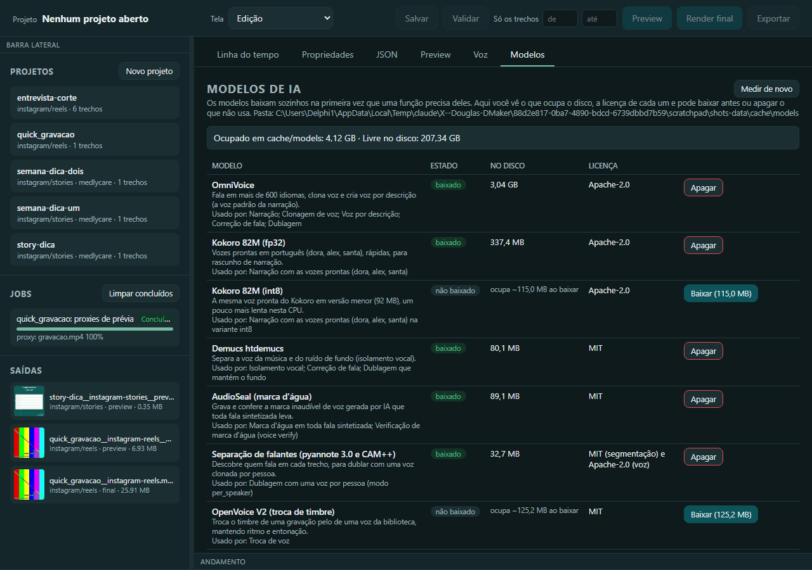

#### Pela CLI

```powershell
dmaker models list
dmaker models download omnivoice
dmaker models remove kokoro-int8
dmaker models prune
```

`remove` e `prune` perguntam antes (`--yes` pula a pergunta). Os modelos: `omnivoice`, `kokoro-fp32`, `kokoro-int8`, `demucs-htdemucs`, `audioseal`, `diarization-sherpa`, `openvoice-v2`, `rvm-resnet50`, `rvm-mobilenetv3` e os `whisper-*` (tiny a large-v3).

#### Como conferir

`dmaker models list` mostra o estado (`instalado`, `parcial` ou `ausente`) e o tamanho medido em disco; um modelo `parcial` ficou pela metade e `download` completa. Os modelos ficam em `cache/models`.

#### Se der errado

- **Download parou**: rode `download` de novo, que retoma e confere que ficou inteiro (hash).
- **Uma função parou de funcionar**: apagou o modelo dela; baixe de novo.
- **Sobrou pasta em `cache/models`**: é sobra de um modelo antigo; `prune` apaga.

---

## Marca MedlyCare

Com `"brand": "medlycare"` na spec, as cores, a fonte e os logos vêm do tema sozinhos. A paleta é teal escuro `#0C535A` (cor primária), verde `#75B9A2` (destaque) e menta `#B2E1CF`, sempre em Poppins; os logos (lockup horizontal, símbolo, versões clara e escura) ficam em `assets/brands/medlycare/`. Sobre um cartão ou um fundo `brand`, o texto muda de cor sozinho (cor da marca em fundo claro, branco em fundo escuro). O vocabulário e as substituições das legendas da marca (nomes que o Whisper costuma errar) já vêm prontos e se somam ao do projeto.

Regras que valem para exemplos, modelos e mensagens:

- **Nunca travessão nem meia-risca** em texto na tela: use vírgula, ponto ou dois-pontos. `dmaker validate` avisa quando encontra um.
- **CTA sempre `medlycare.com.br`**; a oferta atual é teste grátis de 3 meses, sem cartão.
- Tom: abre pela dor do profissional, frases curtas, sem superlativo vazio, sem prometer o que o produto não faz. Só se anuncia o que já está em produção.
- Ritmo de um reel de produto (15 a 30 s): cartão de abertura com a dor (3 s), de 2 a 4 telas do produto em reenquadramento `brand` com legenda de seção (3 a 4 s cada) e cartão escuro de CTA (4 s), com o gancho nos 3 primeiros segundos.

As regras completas de comunicação ficam na skill `medlycare-marketing`; este manual cobre só o que se aplica dentro da spec. Para corrigir um nome que o tema ainda não conhece, use `captions.vocabulary` e `captions.replacements` do projeto, em vez de mexer no `brand.json`.

---

## O que entrou nesta versão

Esta seção reúne o que mudou para quem usa desde a versão anterior (v1). Cada linha aponta a tarefa que ensina a usar.

| Chamado | O que você ganhou | Onde está |
| --- | --- | --- |
| DMK-24 | Infográficos animados prontos (`contador`, `barra`, `linha`, `imagem`, `etiqueta`, `grifo`, `emoji`), com a marca por variáveis, esquema de parâmetros validado no projeto, o atalho `infographic` na composição em HTML, `dmaker infographics`, `list_infographics`, `add_infographic` e a tela **Infográficos**; o modelo `explicativo` aceita um infográfico por assunto | "Pôr um infográfico animado no vídeo" |
| DMK-26 | Animação em HTML sobre o vídeo (`type: "html"`): HTML, CSS e JavaScript, com three.js e Lottie, desenhados quadro a quadro com fundo transparente; `dmaker html frame`, `render_html_frame`, `add_html_overlay` e `dmaker setup --html` | "Pôr uma animação em HTML sobre o vídeo" |
| DMK-28 | Texto atrás da pessoa (`layer: "behind-person"`): o título grande passa entre a parede e quem fala, recortando a pessoa só enquanto o texto aparece | "Pôr o texto atrás da pessoa" |
| DMK-34 | Audiograma: a onda ou as barras de um áudio animadas no ritmo dele, com capa num círculo e legenda; `audio.voiceover` e o modelo `audiograma` | "Fazer um audiograma de um áudio" |
| DMK-23 | Vídeo explicativo: o rosto num quadro embaixo, a imagem de cada assunto em cima, o fundo trocando a cada assunto; regiões nomeadas (`regions`) na spec | "Fazer um vídeo explicativo" |
| DMK-25 | Efeitos sonoros (whoosh, pop, clique, riser, impacto) em `audio.sfx` e na entrada de textos, imagens e transições; `dmaker sfx list` | "Pôr efeitos sonoros num instante do vídeo" |
| DMK-27 | Cortar pausas, vícios e frases repetidas de uma gravação falada (`dmaker autocut`, botão **Cortar gravação**), com a lista do que saiu e **Desfazer** | "Cortar as pausas de uma gravação falada" |
| DMK-29 | Transições de movimento (`crosszoom`, `whippan`, `blurslide`, `filmburn`, `lightleak`), curva de tempo (`linear`, `ease`, `spring`) e a tela **Transições** | "Escolher a transição entre os trechos" |
| DMK-30 | Looks prontos por nome (`cinema`, `quente`, `frio`, `pb-contraste`, `vintage`) e efeitos de acabamento (`grain`, `glow`, `aberration`, `light_leak`); a tela **Looks** | "Dar um acabamento de cinema ao vídeo" |
| DMK-32 | Lote: um vídeo por linha de uma planilha, com validação, pausa e retomada; a tela **Lote** | "Fazer vários vídeos de uma planilha" |
| DMK-33 | Legenda em caixa arredondada (`captions.style.mode: "rounded"`) e `box_shape: "rounded"` nos textos | "Deixar a legenda em caixa arredondada" |
| DMK-37 | A linha do tempo da interface clássica passou a tocar o som da mesa e das faixas externas, fatiado pelos cortes como no render | "Usando pela interface gráfica" |
| DMK-35 | Agente local por conversa, sem internet: kits de ferramentas e triagem, manual curto por kit, receitas do servidor MCP, confirmação antes do que é longo ou difícil de desfazer, segundo motor (servidor compatível com a OpenAI), `dmaker doctor --offline`, a tela **Agente** e a bateria `dmaker agent eval` | "Usando com LLM local (Ollama)" |
| DMK-36 | Este manual, organizado por tarefa, com a versão para IA local (`docs/ia`), a busca `search_manual`, o `dmaker ajuda` e a exportação em PDF e HTML | "Usando com LLM local (Ollama)" |
| DMK-38 | A interface nova passa a fazer o que só a clássica fazia (em andamento): na **Voz**, a aba **Vozes** com a biblioteca (**Ouvir**, **Usar**, **Remover**, filtro por marca) e a **Nova voz** (**Clonar** por arquivo ou microfone e **Desenhar**), mais **Isolar voz**, **Corrigir fala** e **Trocar voz**; o **Editor** com o formulário da spec, a aba **JSON** que também conserta spec inválida, as **Legendas** editáveis, o **Preview** com QA do arquivo escolhido, **Salvar** com `Ctrl+S`, **Desfazer** e **Refazer** (o player e a linha do tempo ainda estão na clássica); e a **Dublagem** (preparar, revisar as falas, gerar, comparar, baixar as trilhas e usar no projeto, com botão de parar) | "Clonar uma voz", "Criar uma voz descrevendo como ela soa", "Dublar um vídeo para outro idioma", "Usando pela interface gráfica" |

Já estavam na versão anterior e agora têm tarefas próprias: a interface nova em Vue (DMK-20), a troca de voz (DMK-5), a dublagem com uma voz por pessoa (DMK-4), a marca d'água e a etiqueta de procedência (DMK-7), a fila de narrações (DMK-6), a prévia ao vivo da narração (DMK-16), a trilha `NAR` (DMK-3), as trilhas separadas (DMK-18), o esticar do vídeo na dublagem (DMK-19) e o gerenciador de modelos (DMK-17).

---

## Referência gerada do código

Esta seção é **gerada**: os quatro blocos abaixo são reescritos por `dmaker manual build` a partir da CLI, do servidor MCP, do modelo da spec e dos esquemas dos infográficos. Nunca edite entre os marcadores; mude o código (ou o texto de ajuda) e regenere. Um teste reprova o projeto se um comando, uma ferramenta ou um campo novo não aparecer aqui.

### Comandos da CLI

<!-- dmaker:gerado cli -->

São 74 comandos. `dmaker COMANDO --help` mostra o mesmo texto na tela, com a versão instalada.

#### Comandos avulsos

- **`dmaker ajuda PERGUNTA`**: Responde uma dúvida sobre o DMaker em português, com o modelo local e a busca no manual (sem internet).
  - `--model` TEXTO: Modelo do Ollama. (padrão gpt-oss:20b)
  - `--url` TEXTO: Endereço do servidor Ollama.
  - `--num-ctx` NÚMERO: Tamanho do contexto (tokens). (padrão 16384)
  - `--timeout` NÚMERO: Espera máxima pela resposta do modelo (s). (padrão 900.0)
  - `--no-model`: Só mostra os trechos do manual, sem pedir a resposta ao modelo.
  - `--offer` / `--no-offer`: Depois da resposta, oferece executar a tarefa pelo agente local. (ligada por padrão)
- **`dmaker autocut SOURCE`**: Corta as pausas, os vícios e as frases repetidas de uma gravação falada. Cria um projeto com os clipes já cortados e mostra a lista do que saiu (tempo e motivo) para conferir antes de renderizar.
  - `--name` TEXTO: Nome do projeto (padrão: nome do arquivo + -corte).
  - `--intensity` TEXTO: suave (só pausas) | normal (pausas e vícios) | agressiva (inclui frases repetidas). (padrão normal)
  - `--min-pause` NÚMERO: Pausa (s) acima da qual vira corte. (padrão 0.5)
  - `--breath` NÚMERO: Silêncio (s) mantido antes e depois de cada fala. (padrão 0.15)
  - `--preset` TEXTO: (padrão instagram/reels)
  - `--brand` TEXTO
  - `--captions` / `--no-captions`: Legendas automáticas seguindo a fala cortada. (ligada por padrão)
  - `--language` TEXTO: Idioma da fala (pt, en, es...). (padrão pt)
  - `--model` TEXTO: Whisper: tiny | base | small | medium | large-v3 (padrão small)
  - `--device` TEXTO: cpu | cuda (padrão cpu)
  - `--overwrite` / `--no-overwrite`: Refaz o projeto se ele já existir.
- **`dmaker captions VIDEO`**: Transcreve com faster-whisper e gera .srt (linhas curtas) e .json (tempo por palavra).
  - `--lang` TEXTO: Idioma (pt, en, es...). (padrão pt)
  - `--model` TEXTO: tiny | base | small | medium | large-v3 (padrão small)
  - `--out` CAMINHO: Arquivo .srt de saída (também gera .json).
  - `--max-words` NÚMERO: Palavras por linha. (padrão 4)
  - `--max-chars` NÚMERO: Caracteres por linha. (padrão 22)
  - `--device` TEXTO: cpu | cuda (padrão cpu)
- **`dmaker card TITLE`**: Gera um cartão (PNG) com o visual da marca, para conferir o design.
  - `--subtitle` TEXTO
  - `--brand` TEXTO: (padrão medlycare)
  - `--preset` TEXTO: (padrão instagram/reels)
  - `--variant` TEXTO: light | dark
  - `--out` CAMINHO
- **`dmaker clean`**: Limpa o cache de trechos intermediários (cache/mez), proxies de prévia (cache/proxy) e formas de onda (cache/waveform).
  - `--jobs` / `--no-jobs`: Apaga também cache/jobs (grafos, ASS, áudio de transcrição).
- **`dmaker cuts NAME`**: Lista o que o autocut removeu do projeto (tempo na gravação original e motivo).
- **`dmaker doctor`**: Verifica FFmpeg, fontes, marcas e dependências opcionais; com --offline, o que falta para usar sem internet.
  - `--hw` / `--no-hw`: Testa encoders de hardware (nvenc/amf/qsv). (ligada por padrão)
  - `--offline`: Confere se tudo que as funções usam já está baixado e mostra o que falha sem rede.
- **`dmaker export SPEC PRESETS...`**: Exporta o mesmo projeto para vários formatos de uma vez. Por padrão abre a interface para acompanhar.
  - `--preview` / `--no-preview`: Versões rápidas de conferência.
  - `--no-ui`: Roda só no terminal; não usa a interface gráfica.
- **`dmaker frames VIDEO TIMES...`**: Extrai quadros em instantes específicos.
  - `--out-dir` CAMINHO
  - `--width` NÚMERO: (padrão 540)
- **`dmaker mcp`**: Sobe o servidor MCP (stdio) para qualquer IA operar o DMaker.
- **`dmaker new NAME`**: Cria projects/<nome>/spec.json a partir dos arquivos fonte.
  - `--preset` TEXTO: Formato de saída (dmaker presets). (padrão instagram/reels)
  - `--src` CAMINHO: Vídeos/imagens fonte, na ordem. (pode repetir)
  - `--brand` TEXTO: Marca (medlycare) ou vazio para o tema padrão.
  - `--captions` / `--no-captions`: Incluir legendas automáticas. (ligada por padrão)
  - `--logo` / `--no-logo`: Incluir logo da marca no canto.
- **`dmaker new-from-template TEMPLATE NAME`**: Cria projects/<nome>/spec.json a partir de um template + parâmetros (dmaker templates lista as opções).
  - `--param` TEXTO: Parâmetro "chave=valor" (listas separadas por vírgula). Repita para cada um. (pode repetir)
  - `--params-json` TEXTO: Parâmetros como um JSON só, ex.: '{"titulo": "..."}'.
- **`dmaker plan NAME`**: Planeja o corte automático de um bloco `multicam`: transcreve a câmera de áudio, reconhece as fases da cerimônia pela fala e substitui o bloco pelos clipes concretos, alternando as câmeras.
- **`dmaker presets [PLATFORM]`**: Lista os formatos de saída disponíveis.
- **`dmaker probe FILES...`**: Mostra duração, tamanho, fps e áudio dos arquivos.
- **`dmaker proxies NAME`**: Gera os proxies 540p H.264 para a prévia ao vivo na interface (cache/proxy) e mostra o status.
- **`dmaker qa SPEC`**: Relatório de QA em texto: o que dá para checar sem olhar imagem.
  - `--output` CAMINHO: Vídeo já renderizado para conferir junto (duração, resolução, quadros pretos, silêncio, loudness). Sem isso, só as checagens estáticas da spec.
- **`dmaker quick SRC`**: Edição rápida de um único vídeo: corte + formato + (legenda, logo, gancho, CTA, música).
  - `--preset` TEXTO: (padrão instagram/reels)
  - `--start` NÚMERO: Entrada (s). (padrão 0.0)
  - `--end` NÚMERO: Saída (s).
  - `--reframe` TEXTO: auto | crop | pad | blur | brand (padrão auto)
  - `--brand` TEXTO
  - `--captions` / `--no-captions`: Legendas automáticas.
  - `--logo` / `--no-logo`: Logo da marca no canto.
  - `--hook` TEXTO: Texto de gancho no topo (primeiros 3 s).
  - `--cta` TEXTO: Chamada no final (últimos 4 s).
  - `--music` CAMINHO: Trilha de fundo.
  - `--preview` / `--no-preview`
  - `--out` CAMINHO
- **`dmaker render SPEC`**: Renderiza o projeto no formato da plataforma. Por padrão abre a interface para acompanhar.
  - `--preview` / `--no-preview`: Render rápido em baixa resolução para conferir.
  - `--dry-run` / `--no-dry-run`: Só mostra os comandos ffmpeg.
  - `--force` / `--no-force`: Ignora o cache de trechos e legendas.
  - `--out` CAMINHO: Arquivo de saída.
  - `--preset` TEXTO: Sobrescreve o preset da spec.
  - `--guides` / `--no-guides`: Desenha as zonas seguras.
  - `--no-captions` / `--no-no-captions`: Não gera legendas.
  - `--quiet` / `--no-quiet`: Sem barra de progresso.
  - `--segments` TEXTO: Render parcial só destes trechos, ex.: 12-20 (para revisar vídeos longos).
  - `--no-ui`: Roda só no terminal; não usa a interface gráfica.
- **`dmaker setup`**: Baixa FFmpeg (bin/ffmpeg), a fonte Poppins (assets/fonts) e o modelo de recorte de pessoa; com --html, o Chromium.
  - `--force` / `--no-force`: Baixa de novo mesmo se já existir.
  - `--html`: Instala só o Chromium da composição em HTML e do PDF do manual (em bin/playwright).
- **`dmaker sheet VIDEO`**: Grade de quadros do vídeo inteiro (para revisar de uma vez).
  - `--out` CAMINHO
  - `--cols` NÚMERO: (padrão 3)
  - `--rows` NÚMERO: (padrão 3)
  - `--width` NÚMERO: Largura de cada quadro. (padrão 360)
- **`dmaker sync MASTER OTHERS...`**: Descobre pelo áudio em que instante do relógio da fonte principal cada outra fonte começa.
  - `--master-stream` NÚMERO: Faixa de áudio da fonte principal. (padrão 0)
  - `--stream` NÚMERO: Faixa de áudio das outras fontes. (padrão 0)
- **`dmaker templates`**: Lista os templates disponíveis (templates/*.json) e os parâmetros de cada um.
- **`dmaker thumbnail VIDEO`**: Extrai um quadro como imagem (capa).
  - `--at` NÚMERO: Instante em segundos. (padrão 1.0)
  - `--out` CAMINHO
- **`dmaker ui`**: Abre a interface gráfica (http://127.0.0.1:8765): projetos, editor, preview e progresso em tempo real.
  - `--port` NÚMERO: Porta local. (padrão 8765)
  - `--no-browser`: Não abre o navegador.
- **`dmaker uncut NAME CUT_IDS...`**: Desfaz cortes do autocut: o trecho volta ao projeto e as legendas acompanham.
- **`dmaker validate SPEC`**: Valida a spec, confere arquivos e mostra a duração final e avisos.

#### dmaker agent

Agente local: opera o DMaker por conversa com um modelo que roda na sua máquina, sem internet. Sem subcomando, abre a conversa no terminal.

- **`dmaker agent eval`**: Mede o agente com a bateria de pedidos reais: acerto, passos, tempo por pedido e memória do modelo.
  - `--model` TEXTO: Modelo a medir (padrão: DMAKER_AGENT_MODEL).
  - `--engine` TEXTO: Motor do modelo: ollama (padrão) ou openai (llama.cpp server, LM Studio).
  - `--url` TEXTO: Endereço do servidor do modelo.
  - `--num-ctx` NÚMERO: Tamanho do contexto (tokens), no Ollama.
  - `--timeout` NÚMERO: Espera máxima por resposta do modelo (s).
  - `--cases` CAMINHO: Arquivo da bateria (padrão: tests/data/agent_eval.json).
  - `--only` TEXTO: Roda só estes pedidos (id); repita a opção. (pode repetir)
  - `--real-tools` / `--stub-heavy`: Executa de verdade as ferramentas pesadas (render, Whisper, dublagem) em vez de simulá-las.
  - `--fake`: Usa o modelo falso que segue o roteiro de cada pedido (valida a bateria).
  - `--out` CAMINHO: Pasta do relatório (padrão: output/avaliacao-agente).

#### dmaker audio

Áudio: isolamento vocal (voz de um lado, música e ruído do outro) com o modelo local Demucs.

- **`dmaker audio isolate FILE`**: Separa a voz do fundo e grava `<nome>_voz` e `<nome>_fundo`. Lento na CPU (veja o fator no fim) e guardado em cache: repetir o mesmo trecho é instantâneo.
  - `--start` NÚMERO: Início do trecho, em segundos no arquivo.
  - `--end` NÚMERO: Fim do trecho, em segundos no arquivo.
  - `--out-dir` CAMINHO: Pasta de saída (padrão: output/isolamento).
  - `--format` TEXTO: wav (sem perdas) ou mp3. (padrão wav)
  - `--stream` NÚMERO: Faixa de áudio do arquivo (0 é a primeira). (padrão 0)
  - `--device` TEXTO: auto | cpu | cuda (padrão auto)

#### dmaker batch

Lote: um vídeo por linha de uma planilha (CSV, XLSX ou JSON) sobre um modelo de projeto.

- **`dmaker batch pause LOTE`**: Pede a um lote em andamento (em outra janela) que pare depois do vídeo que está renderizando.
- **`dmaker batch resume LOTE`**: Continua o lote: renderiza o que falta, o que falhou e o que mudou no projeto. O que já saiu e continua igual não é refeito.
  - `--rows` TEXTO: Só estes vídeos (números da tabela), ex.: 2,4.
  - `--force` / `--no-force`: Refaz também os vídeos que já estão prontos.
- **`dmaker batch run TEMPLATE SHEET`**: Valida, cria um projeto por linha e renderiza tudo em output/<lote>/. Ctrl+C interrompe; retome com `dmaker batch resume`.
  - `--lote` TEXTO: Nome do lote (pasta em output/). Padrão: o da planilha.
  - `--name-column` TEXTO: Coluna cujo texto dá nome ao arquivo de cada vídeo.
  - `--skip-invalid`: Segue sem as linhas com problema, em vez de parar.
  - `--preview` / `--no-preview`: Prévias rápidas em baixa resolução.
  - `--preset` TEXTO: Sobrescreve o formato de saída do modelo.
  - `--replace` / `--no-replace`: Refaz um lote de mesmo nome a partir da planilha atual (o que não mudou não é refeito).
- **`dmaker batch status [LOTE]`**: Mostra o relatório de um lote (o que saiu, o que falhou e por quê) ou a lista de lotes.
- **`dmaker batch validate TEMPLATE SHEET`**: Confere a planilha contra o modelo sem renderizar nada: campo faltando, arquivo inexistente, texto que não cabe e travessão. Sai com erro se alguma linha tem problema.
  - `--name-column` TEXTO: Coluna cujo texto dá nome ao arquivo de cada vídeo.

#### dmaker dub

Dublagem: traduz a fala de um vídeo ou áudio e a refaz, com a voz clonada de quem fala, no idioma alvo.

- **`dmaker dub prepare FILE`**: Separa a voz, transcreve, parte em frases e traduz; grava o projeto `.dub.json` para você revisar.
  - `--to` TEXTO: Idioma alvo (en, es, fr, de, it, pt...). (obrigatória)
  - `--from` TEXTO: Idioma da fala original. (padrão pt)
  - `--speaker` TEXTO: per_speaker (padrão: separa quem fala e usa uma voz clonada por pessoa), per_segment (clona a voz de cada fala) ou single (um clone para o arquivo).
  - `--speakers` NÚMERO: Quantas pessoas falam (força a separação de falantes; sem isso o áudio decide). Só no modo per_speaker.
  - `--voice` TEXTO: Voz da biblioteca no lugar da clonada.
  - `--keep-original` NÚMERO: Mantém a voz original por baixo, em dB (ex.: -18). Sem isso, só a dublada.
  - `--glossary` TEXTO: Termo que não se traduz (repita a opção para vários). (pode repetir)
  - `--brand` TEXTO: Marca cujo dicionário de pronúncia vale.
  - `--project` CAMINHO: Onde gravar o projeto (padrão: output/dublagem/<nome>.<idioma>.dub.json).
  - `--fit` TEXTO: Quando a fala traduzida não cabe no tempo: voz (acelera a voz, o padrão), video (estica o vídeo naquele trecho, até 1,3x) ou misto (acelera a voz até 1,15x e estica o vídeo no resto). (padrão voz)
  - `--device` TEXTO: auto | cpu | cuda (padrão auto)
- **`dmaker dub render PROJECT`**: Gera a dublagem: sintetiza as traduções com a voz de cada falante e monta com o fundo original.
  - `--out` CAMINHO: Arquivo de saída (padrão: output/dublagem/<nome>.<idioma>.<ext>).
  - `--steps` NÚMERO: Passos de síntese do OmniVoice (padrão 16).
  - `--draft` / `--no-draft`: Rascunho: 8 passos no OmniVoice (metade do tempo).
  - `--fit` TEXTO: Quando a fala traduzida não cabe no tempo: voz (acelera a voz, o padrão), video (estica o vídeo naquele trecho, até 1,3x) ou misto (acelera a voz até 1,15x e estica o vídeo no resto). Vale só para esta geração; sem isso vale o `fit_mode` do projeto.
  - `--stems` / `--no-stems`: Exporta também as trilhas separadas (voz dublada, fundo e voz original) em WAV.
  - `--zip`: Com --stems, junta as trilhas num .zip.
  - `--device` TEXTO: auto | cpu | cuda (padrão auto)
- **`dmaker dub retranslate PROJECT`**: Traduz de novo as falas do projeto que não estão travadas (`locked`), sem tocar nas travadas.
  - `--device` TEXTO: auto | cpu | cuda (padrão auto)
- **`dmaker dub run FILE`**: Prepara e gera a dublagem de uma vez (é o que `dmaker dub ARQUIVO --to en` faz).
  - `--to` TEXTO: Idioma alvo (en, es, fr, de, it, pt...). (obrigatória)
  - `--from` TEXTO: Idioma da fala original. (padrão pt)
  - `--speaker` TEXTO: per_speaker (padrão: separa quem fala e usa uma voz clonada por pessoa), per_segment (clona a voz de cada fala) ou single (um clone para o arquivo).
  - `--speakers` NÚMERO: Quantas pessoas falam (força a separação de falantes; sem isso o áudio decide). Só no modo per_speaker.
  - `--voice` TEXTO: Voz da biblioteca no lugar da clonada.
  - `--keep-original` NÚMERO: Mantém a voz original por baixo, em dB (ex.: -18).
  - `--glossary` TEXTO: Termo que não se traduz (repita a opção). (pode repetir)
  - `--brand` TEXTO: Marca cujo dicionário de pronúncia vale.
  - `--out` CAMINHO: Arquivo de saída da dublagem.
  - `--project` CAMINHO: Onde gravar o projeto .dub.json.
  - `--steps` NÚMERO: Passos de síntese do OmniVoice (padrão 16).
  - `--draft` / `--no-draft`: Rascunho: 8 passos no OmniVoice (metade do tempo).
  - `--fit` TEXTO: Quando a fala traduzida não cabe no tempo: voz (acelera a voz, o padrão), video (estica o vídeo naquele trecho, até 1,3x) ou misto (acelera a voz até 1,15x e estica o vídeo no resto). (padrão voz)
  - `--device` TEXTO: auto | cpu | cuda (padrão auto)
- **`dmaker dub stems PROJECT`**: Exporta as trilhas separadas da dublagem (voz dublada, fundo e voz original) para remixar em outro editor.
  - `--out-dir` CAMINHO: Pasta das trilhas (padrão: output/dublagem/<nome>.<idioma>.trilhas).
  - `--zip`: Junta as três trilhas num .zip ao lado da pasta.
  - `--steps` NÚMERO: Passos de síntese do OmniVoice (padrão 16).
  - `--draft` / `--no-draft`: Rascunho: 8 passos no OmniVoice (metade do tempo).
  - `--device` TEXTO: auto | cpu | cuda (padrão auto)

#### dmaker html

Composições em HTML: confere um quadro de uma composição antes de renderizar o vídeo.

- **`dmaker html frame SRC`**: Renderiza um quadro da composição, direto no instante pedido, em PNG com fundo transparente.
  - `--at` NÚMERO: Instante da composição, em segundos. (padrão 0.0)
  - `--size` TEXTO: Tamanho da página, LARGURAxALTURA em px na base 1080 (como a área da região). (padrão 1080x1920)
  - `--out` CAMINHO: PNG de saída (padrão: output/html/<nome>_<instante>s.png).
  - `--duration` NÚMERO: Duração da composição em segundos (a página lê dmaker.duration). (padrão 5.0)
  - `--fps` NÚMERO: Quadros por segundo da composição. (padrão 30.0)
  - `--scale` NÚMERO: Pixels de saída por px da página (0,5 gera a metade). (padrão 1.0)
  - `--brand` TEXTO: Marca cujas cores e fonte a página recebe.
  - `--data` TEXTO: Dados para a página (dmaker.data), em JSON.
  - `--background` TEXTO: Cor lisa por baixo, para ver o transparente (ex.: #808080).

#### dmaker infographics

Infográficos prontos (contador, barra, linha, imagem, etiqueta, grifo, emoji): lista, vê um quadro e põe no projeto.

- **`dmaker infographics add PROJECT_NAME NAME`**: Põe o infográfico nas sobreposições do projeto e salva. Sem região, ele entra na área própria do modelo.
  - `--param` / `-p` TEXTO: Um parâmetro, como ate=10000 (repita para vários). (pode repetir)
  - `--data` TEXTO: Os parâmetros em JSON (os --param valem por cima).
  - `--start` NÚMERO: Quando entra, em segundos. (padrão 0.0)
  - `--end` NÚMERO: Quando sai (padrão: o fim do vídeo).
  - `--region` TEXTO: Região do projeto onde o modelo entra (ex.: topo).
- **`dmaker infographics frame NAME`**: Renderiza um quadro do infográfico com os valores pedidos, em PNG, pelo mesmo renderizador do vídeo.
  - `--param` / `-p` TEXTO: Um parâmetro, como ate=10000 (repita para vários). (pode repetir)
  - `--data` TEXTO: Os parâmetros em JSON (os --param valem por cima).
  - `--at` NÚMERO: Instante, em segundos (padrão: o modelo já desenhado).
  - `--size` TEXTO: LARGURAxALTURA da página, em px na base 1080 (padrão: o do modelo).
  - `--out` CAMINHO: PNG de saída (padrão: output/html/<nome>_<instante>s.png).
  - `--brand` TEXTO: Marca cujas cores, fonte e cantos o modelo recebe.
  - `--background` TEXTO: Cor lisa por baixo, para ver o transparente. (padrão #0F172A)
- **`dmaker infographics list [NAME]`**: Lista os infográficos prontos e, dado um nome, os parâmetros que ele aceita.

#### dmaker looks

Looks: acabamentos visuais prontos por nome (cinema, quente, frio...) e a folha de contato de cada um.

- **`dmaker looks list`**: Lista os looks aceitos em `look` (no projeto e no trecho) e o que cada um faz.
  - `--brand` TEXTO: Soma os looks desta marca (os dela valem no lugar).
- **`dmaker looks sheet NAME`**: Folha de contato: a mesma cena de teste sem acabamento e com o look (JPEG), da esquerda para a direita.
  - `--brand` TEXTO: Soma os looks desta marca.
  - `--out-dir` CAMINHO: Pasta de saída (padrão: output/looks).

#### dmaker manual

Manual: regenera as partes automáticas (referência, docs/ia) e exporta em PDF e HTML.

- **`dmaker manual build`**: Regenera o que o manual tira do código (comandos, ferramentas MCP, campos da spec, índice) e `docs/ia`.
  - `--check`: Só confere: sai com erro se `build` mudaria algum arquivo.
- **`dmaker manual export`**: Exporta o manual em HTML de página única e PDF, com as imagens e o sumário navegável.
  - `--pdf`: Só o PDF (sem nenhuma opção, gera os dois).
  - `--html`: Só o HTML de página única.
  - `--out` CAMINHO: Pasta de saída (padrão: output/manual).

#### dmaker models

Modelos de IA em cache/models: ver o que está baixado e quanto ocupa, baixar, apagar e limpar sobras.

- **`dmaker models download MODEL_ID`**: Baixa o modelo (se faltar) e confere que ficou inteiro. Os de ~3 GB levam minutos.
- **`dmaker models list`**: Lista os modelos com estado, tamanho medido em disco, licença e para que servem, mais as sobras.
- **`dmaker models prune`**: Apaga as sobras: pastas e arquivos em cache/models que nenhum modelo do DMaker usa.
  - `--yes`: Apaga sem perguntar.
- **`dmaker models remove MODEL_ID`**: Apaga o modelo do disco, dizendo antes quais funções dependem dele.
  - `--yes`: Apaga sem perguntar.

#### dmaker sfx

Efeitos sonoros curtos (whoosh, pop, clique...) para pôr num instante do vídeo: ver e gerar a biblioteca.

- **`dmaker sfx build`**: Sintetiza de novo os sons da biblioteca (determinístico: o mesmo código gera os mesmos arquivos) e o LICENSES. Só é preciso ao mudar uma receita em `sfx/synth.py`.
  - `--out` CAMINHO: Pasta de saída (padrão: assets/sfx, a biblioteca do DMaker).
- **`dmaker sfx list`**: Lista os sons da biblioteca (nomes que a spec aceita em `audio.sfx` e em `sound`).

#### dmaker transitions

Transições entre trechos: a lista e a folha de contato (prévia) de cada uma.

- **`dmaker transitions list`**: Lista as transições aceitas em `transition.type` e o que cada uma faz.
  - `--kind` TEXTO: movimento | xfade
- **`dmaker transitions sheet NAME`**: Folha de contato da transição: os quadros da troca entre dois clipes sintéticos (PNG).
  - `--curve` TEXTO: linear | ease | spring | all (padrão linear)
  - `--out-dir` CAMINHO: Pasta de saída (padrão: output/transitions).

#### dmaker voice

Voz: narração por texto, clonagem de voz e voz projetada por descrição (modelo local OmniVoice).

- **`dmaker voice clone NAME REFERENCE`**: Cria uma voz clonada a partir de uma gravação.
  - `--text` TEXTO: O que é dito na gravação (sem isso, o Whisper transcreve).
  - `--brand` TEXTO: Marca dona da voz.
  - `--language` TEXTO: (padrão pt)
- **`dmaker voice convert FILE`**: Troca a voz de uma gravação pela de uma voz da biblioteca, mantendo ritmo, pausas, entonação e o fundo.
  - `--voice` TEXTO: Voz da biblioteca que vai falar no lugar (clonada ou desenhada). (obrigatória)
  - `--start` NÚMERO: Início do trecho (s no arquivo).
  - `--end` NÚMERO: Fim do trecho (s no arquivo).
  - `--out` CAMINHO: Arquivo de saída (padrão: output/troca-de-voz/<nome>.<voz>-<id>.<ext>).
- **`dmaker voice design NAME`**: Cria uma voz descrevendo como ela soa (sem gravação).
  - `--gender` TEXTO: male | female (masculino | feminino)
  - `--age` TEXTO: child, teenager, young adult, middle-aged, elderly
  - `--pitch` TEXTO: very low pitch ... very high pitch (grave ... agudo)
  - `--accent` TEXTO: ex.: british accent, portuguese accent
  - `--whisper` / `--no-whisper`: Voz sussurrada.
  - `--instruct` TEXTO: Descrição completa, ex.: 'female, low pitch'.
  - `--brand` TEXTO: Marca dona da voz.
  - `--language` TEXTO: (padrão pt)
- **`dmaker voice fix FILE`**: Regrava um trecho de fala com a voz do próprio falante (corrige uma palavra sem gravar de novo).
  - `--text` TEXTO: O que deve ser dito no lugar (texto certo). (obrigatória)
  - `--find` TEXTO: Texto errado como foi dito (sem diferenciar acento nem maiúscula).
  - `--occurrence` NÚMERO: Qual ocorrência de --find (1, 2...).
  - `--start` NÚMERO: Início do trecho errado (s no arquivo).
  - `--end` NÚMERO: Fim do trecho errado (s no arquivo).
  - `--search-from` NÚMERO: Com --find, só transcreve a partir daqui (s); poupa tempo em vídeos longos.
  - `--search-to` NÚMERO: Com --find, só transcreve até aqui (s).
  - `--voice` TEXTO: Voz da biblioteca. Sem ela, clona a voz do próprio falante.
  - `--no-expand`: Fala só o trecho trocado, sem as palavras vizinhas.
  - `--save-voice` TEXTO: Guarda a voz clonada do falante na biblioteca com este nome.
  - `--language` TEXTO: Idioma da fala. (padrão pt)
  - `--brand` TEXTO: Marca cujo dicionário de pronúncia vale.
  - `--steps` NÚMERO: Passos de síntese do OmniVoice (padrão 16).
  - `--draft` / `--no-draft`: Rascunho: 8 passos no OmniVoice (metade do tempo).
  - `--seed` NÚMERO: Semente: mesma semente, mesma fala.
  - `--out` CAMINHO: Arquivo de saída (padrão: output/correcao/<nome>.corrigido.<ext>).
  - `--device` TEXTO: auto | cpu | cuda (padrão auto)
- **`dmaker voice list`**: Lista as vozes da biblioteca.
  - `--brand` TEXTO: Só as vozes dessa marca e as sem marca.
- **`dmaker voice preview VOICE_ID`**: Gera uma amostra curta da voz para ouvir antes de usar.
  - `--text` TEXTO: Frase de teste (padrão: uma frase curta no idioma da voz).
  - `--out` CAMINHO
- **`dmaker voice remove VOICE_ID`**: Apaga uma voz da biblioteca.
- **`dmaker voice say [TEXT]`**: Narra um texto. Sem --voice usa a voz automática do OmniVoice (ou a de DMAKER_DEFAULT_VOICE); as vozes prontas (dora, alex, santa) usam o Kokoro, rápido; clones e vozes projetadas usam o OmniVoice (lento na CPU). O resultado de cada fala fica em cache. Toda fala sai com marca d'água inaudível e o arquivo com uma etiqueta de procedência (confira com `dmaker voice verify`).
  - `--out` CAMINHO: Arquivo de saída: .wav, .mp3 ou .m4a.
  - `--voice` TEXTO: Id de uma voz (dmaker voice list): dora, alex, santa ou uma sua.
  - `--file` CAMINHO: Arquivo .txt com o roteiro.
  - `--language` TEXTO: Idioma (pt, en, es...). Padrão: o da voz, ou pt.
  - `--instruct` TEXTO: Descrição da voz, ex.: 'female, low pitch'.
  - `--speed` NÚMERO: Velocidade da fala (1.0 normal, 1.2 mais rápida). (padrão 1.0)
  - `--seed` NÚMERO: Semente: mesma semente, mesma fala.
  - `--steps` NÚMERO: Passos de síntese do OmniVoice (padrão 16, como no VoiceStudio; 32 para máxima qualidade).
  - `--srt` / `--no-srt`: Grava um .srt com o tempo de cada fala.
  - `--draft` / `--no-draft`: Rascunho: 8 passos no OmniVoice (metade do tempo, mais áspero).
  - `--raw` / `--no-raw`: Voz crua do modelo, sem o acabamento broadcast.
  - `--device` TEXTO: auto | cpu | cuda (padrão auto)
  - `--brand` TEXTO: Marca cujo dicionário de pronúncia vale (padrão: a da voz).
  - `--watermark` / `--no-watermark`: Marca d'água inaudível e etiqueta de procedência no arquivo (ligadas por padrão; --no-watermark ou DMAKER_WATERMARK=0 desligam as duas). (ligada por padrão)
- **`dmaker voice verify FILE`**: Confere se o arquivo tem voz gerada por IA do DMaker: lê a etiqueta de procedência e, sem ela, analisa a marca d'água do áudio. Responde em três níveis: encontrada, indício (inconclusivo) ou não encontrada.
  - `--audio`: Analisa também o áudio quando há etiqueta (demora cerca de meio segundo por segundo).
- **`dmaker voice words FILE`**: Lista o que foi dito com o tempo de cada trecho, para escolher o que corrigir com `voice fix`.
  - `--start` NÚMERO: Início do trecho a transcrever (s no arquivo).
  - `--end` NÚMERO: Fim do trecho a transcrever (s no arquivo).
  - `--language` TEXTO: Idioma da fala. (padrão pt)
  - `--words`: Uma palavra por linha, com início e fim.

#### dmaker voice lexicon

Dicionário de pronúncia: como a voz fala cada termo (global ou por marca).

- **`dmaker voice lexicon add TERM SPOKEN`**: Cadastra ou troca a pronúncia de um termo num idioma. Só a fala muda; legendas mantêm o texto escrito.
  - `--brand` TEXTO: Vale só para essa marca (padrão: global).
  - `--language` TEXTO: Idioma da fala em que vale (pt, en...). (padrão pt)
- **`dmaker voice lexicon list`**: Lista os termos: os globais e, com --brand, os da marca (que valem por cima).
  - `--brand` TEXTO: Mostra também os termos dessa marca.
  - `--language` TEXTO: Só esse idioma (padrão: todos).
- **`dmaker voice lexicon remove TERM`**: Tira um termo do dicionário, no idioma dado.
  - `--brand` TEXTO: Tira da marca (padrão: do global).
  - `--language` TEXTO: Idioma do termo a tirar. (padrão pt)

#### dmaker voice queue

Fila de narrações longas (audiobook, vários roteiros): roda em segundo plano e retoma de onde parou.

- **`dmaker voice queue add`**: Põe um roteiro no fim da fila. Quem executa é o `dmaker ui` aberto ou o `dmaker voice queue run`.
  - `--text` TEXTO: Texto a narrar (ou use --file).
  - `--file` CAMINHO: Roteiro em .txt, .md ou .docx, um capítulo por título.
  - `--voice` TEXTO: Id da voz (dmaker voice list). Sem ela, a voz padrão.
  - `--title` TEXTO: Nome do item e da pasta em output/narracoes.
  - `--draft` / `--no-draft`: Rascunho: 8 passos no OmniVoice (metade do tempo).
  - `--format` TEXTO: Formato dos áudios: wav ou mp3. (padrão wav)
  - `--language` TEXTO: Idioma (pt, en...). Padrão: o da voz.
  - `--speed` NÚMERO: Velocidade da fala (1.0 normal). (padrão 1.0)
  - `--brand` TEXTO: Marca cujo dicionário de pronúncia vale.
- **`dmaker voice queue cancel ITEM_ID`**: Cancela um item; o que estava em andamento para na próxima fala.
- **`dmaker voice queue list`**: Mostra a fila: estado, andamento e tempo estimado de cada item.
- **`dmaker voice queue pause ITEM_ID`**: Pausa um item sem perder o que já foi narrado.
- **`dmaker voice queue resume ITEM_ID`**: Devolve um item pausado à fila.
- **`dmaker voice queue run`**: Executa a fila em primeiro plano, um item por vez, e volta quando ela esvazia. Ctrl+C interrompe e o item em andamento retoma de onde parou na próxima execução.

<!-- dmaker:fim-gerado cli -->

### Ferramentas MCP

<!-- dmaker:gerado mcp -->

São 64 ferramentas. Um asterisco (\*) marca o parâmetro obrigatório. O texto completo de cada uma vem do próprio servidor (`dmaker mcp`).

- **`dmaker_guide`**: Manual de operação do DMaker: fluxo, referência da spec e regras da marca.
  Sem parâmetros.
- **`spec_schema`**: JSON Schema da spec de projeto (validação Pydantic).
  Sem parâmetros.
- **`search_manual`**: Busca no manual do DMaker, sem internet e por palavras: devolve os trechos que mais combinam com a pergunta, cada um com a seção, a nota e o texto, e a tarefa do manual que mais combina (o arquivo docs/ia dela traz o passo a passo).
  Parâmetros: `question`\* (texto), `limit` (inteiro, padrão 5).
- **`presets`**: Formatos de saída por plataforma, com tamanho, limite de duração e zonas seguras.
  Parâmetros: `platform` (texto).
- **`brands`**: Marcas (temas) disponíveis e suas cores, fontes e logos.
  Sem parâmetros.
- **`probe_media`**: Duração, tamanho, fps, áudio e orientação de vídeos, imagens e áudios.
  Parâmetros: `paths`\* (lista de texto).
- **`save_project`**: Valida e salva uma spec em projects/<name>/spec.json.
  Parâmetros: `name`\* (texto), `spec`\* (objeto).
- **`list_templates`**: Templates disponíveis (produto, depoimento, stories, vlog, tutorial, explicativo, casamento...) com os parâmetros de cada um.
  Sem parâmetros.
- **`new_from_template`**: Cria um projeto a partir de um template (ver `list_templates`) e parâmetros, sem escrever a spec inteira.
  Parâmetros: `template`\* (texto), `name`\* (texto), `params`\* (objeto).
- **`get_project`**: Lê a spec de um projeto (nome em projects/ ou caminho de spec.json).
  Parâmetros: `name_or_path`\* (texto).
- **`validate_project`**: Confere arquivos, calcula a duração final e lista avisos (limites da plataforma, marca).
  Parâmetros: `name_or_path`\* (texto).
- **`edit_project`**: Aplica uma edição pontual na linha do tempo e salva: split (cortar no cursor), remove, move, trim (aparar entrada/saída), duplicate, insert, overlay_span/overlay_remove/overlay_duplicate e set_field (muda um campo pelo caminho, ex.: "timeline.2.speed").
  Parâmetros: `name`\* (texto), `op`\* (objeto).
- **`timeline_view`**: Vista da linha do tempo multitrilha do projeto (V2/V3... picture-in-picture, TX texto, GR imagem/barra de progresso, V1 trechos, A1 áudio dos clipes, A2... faixas externas, NAR narrações (duração real quando já sintetizadas, senão estimada), MUS música, CC legendas), com o intervalo de cada item já calculado.
  Parâmetros: `name`\* (texto).
- **`plan_multicam`**: Planeja o corte automático de um bloco `multicam` da spec: transcreve a câmera de áudio, reconhece as fases da cerimônia pela fala (termos ditos, ex.: consentimento, votos, alianças) e substitui o bloco pelos clipes concretos, alternando as câmeras pela cadência e atraindo os cortes para pausas da fala.
  Parâmetros: `name_or_path`\* (texto).
- **`autocut`**: Corta as pausas, os vícios de fala e as frases repetidas de uma gravação falada (use no lugar de transcrever e cortar clipe a clipe à mão).
  Parâmetros: `source`\* (texto), `name`\* (texto), `intensity` ("suave" ou "normal" ou "agressiva", padrão normal), `min_pause` (número, padrão 0.5), `breath` (número, padrão 0.15), `preset` (texto, padrão instagram/reels), `brand` (texto), `captions` (sim ou não, padrão sim), `language` (texto, padrão pt), `model` (texto, padrão small), `overwrite` (sim ou não, padrão não), `wait_seconds` (número, padrão 0).
- **`list_cuts`**: Lista o que o `autocut` removeu de um projeto: para cada corte, id, início e fim na gravação original, duração, motivo (silence, filler, repetition), as palavras tiradas e se já foi desfeito, mais a duração antes e depois.
  Parâmetros: `name_or_path`\* (texto).
- **`undo_cut`**: Desfaz um corte do `autocut` (id de list_cuts): o trecho removido volta ao projeto, juntando os clipes vizinhos, e as legendas voltam a incluir as palavras dele.
  Parâmetros: `name_or_path`\* (texto), `cut_id`\* (inteiro).
- **`validate_batch`**: Confere uma planilha de lote contra um modelo (template) SEM renderizar nada: campo obrigatório vazio, arquivo inexistente, número ou lista ilegível, texto que não cabe no espaço, travessão (regra da marca).
  Parâmetros: `template`\* (texto), `sheet`\* (texto), `name_column` (texto).
- **`run_batch`**: Gera vários vídeos de uma vez: um por linha da planilha, sobre o modelo.
  Parâmetros: `template`\* (texto), `sheet`\* (texto), `name` (texto), `name_column` (texto), `skip_invalid` (sim ou não, padrão não), `preview` (sim ou não, padrão não), `preset` (texto), `replace` (sim ou não, padrão não), `wait_seconds` (número, padrão 0).
- **`resume_batch`**: Retoma um lote pausado, interrompido ou com falhas: renderiza o que falta, o que falhou e o projeto que você corrigiu depois; o que já saiu com a mesma spec não é refeito. rows (números da tabela de batch_status) limita a certos vídeos e force=true refaz também os prontos.
  Parâmetros: `name`\* (texto), `rows` (lista de inteiro), `force` (sim ou não, padrão não), `wait_seconds` (número, padrão 0).
- **`pause_batch`**: Pede a um lote em andamento que pare depois do vídeo que está renderizando; nada é perdido e resume_batch continua de onde parou.
  Parâmetros: `name`\* (texto).
- **`batch_status`**: Relatório de um lote: para cada vídeo o estado (Pendente, Renderizando, Pronto, Falhou, Pulada), o arquivo de saída, o tempo e o motivo da falha; mais o resumo e a pasta de saída.
  Parâmetros: `name` (texto).
- **`list_projects`**: Projetos existentes em projects/.
  Sem parâmetros.
- **`render_project`**: Renderiza o projeto. preview=true gera uma versão rápida em baixa resolução para conferir. show_ui=true (padrão) abre a interface gráfica para o usuário acompanhar o andamento; use show_ui=false só se ele pedir para não abrir.
  Parâmetros: `name_or_path`\* (texto), `preview` (sim ou não, padrão não), `preset` (texto), `force` (sim ou não, padrão não), `guides` (sim ou não, padrão não), `no_captions` (sim ou não, padrão não), `segments` (texto), `wait_seconds` (número, padrão 600), `show_ui` (sim ou não, padrão sim).
- **`export_project`**: Exporta o projeto para vários presets (ex.: instagram/reels, youtube/shorts).
  Parâmetros: `name_or_path`\* (texto), `presets`\* (lista de texto), `wait_seconds` (número, padrão 900), `show_ui` (sim ou não, padrão sim).
- **`job_status`**: Situação de um render em segundo plano (running | done | error | cancelled) e o resultado quando pronto.
  Parâmetros: `job_id`\* (texto).
- **`list_jobs`**: Jobs de render desta sessão e, se a interface estiver aberta, os dela também.
  Sem parâmetros.
- **`quick_edit`**: Edição rápida de um único vídeo: corte, formato e opcionais (legendas, logo, gancho, CTA, música).
  Parâmetros: `src`\* (texto), `preset` (texto, padrão instagram/reels), `start` (número, padrão 0.0), `end` (número), `reframe` (texto, padrão auto), `brand` (texto), `captions` (sim ou não, padrão não), `logo` (sim ou não, padrão não), `hook` (texto), `cta` (texto), `music` (texto), `preview` (sim ou não, padrão não), `wait_seconds` (número, padrão 600).
- **`sync_sources`**: Sincroniza câmeras/gravadores do mesmo evento pelo áudio: devolve, para cada arquivo, o instante do relógio da fonte principal em que ele começa (para usar em sources.<nome>.sync).
  Parâmetros: `master`\* (texto), `others`\* (lista de texto), `master_stream` (inteiro, padrão 0), `stream` (inteiro, padrão 0).
- **`transcribe_media`**: Transcreve um vídeo/áudio (Whisper local); salva .srt e .json.
  Parâmetros: `path`\* (texto), `language` (texto, padrão pt), `model` (texto, padrão small), `device` (texto, padrão cpu), `full` (sim ou não, padrão não).
- **`read_captions`**: Lê as legendas automáticas do projeto (captions.auto.json). mode=compact (padrão) devolve um resumo (digest) e só as cues suspeitas (baixa confiança, termo da marca, cue longa/curta, substituição pendente); mode=full devolve tudo, com tempo por palavra (gasta muito mais tokens num vídeo longo).
  Parâmetros: `name_or_path`\* (texto), `mode` ("compact" ou "full", padrão compact), `limit` (inteiro, padrão 40).
- **`fix_captions`**: Corrige o texto de palavras das legendas automáticas: pares {"errado": "certo"} aplicados a todas as cues do projeto (sem acento/caixa).
  Parâmetros: `name_or_path`\* (texto), `replacements`\* (objeto).
- **`contact_sheet`**: Grade de quadros do vídeo inteiro numa única imagem, para revisar composição e texto.
  Parâmetros: `video`\* (texto), `cols` (inteiro, padrão 3), `rows` (inteiro, padrão 3), `width` (inteiro, padrão 320).
- **`qa_report`**: Relatório de QA em texto: checagens automáticas que não precisam de olho humano (zona segura, ritmo de leitura, sobreposições, contraste, legendas e, com output=true, a saída renderizada: duração, resolução, quadros pretos, silêncio, loudness).
  Parâmetros: `name_or_path`\* (texto), `output` (sim ou não, padrão sim).
- **`frames`**: Quadros em instantes específicos do vídeo (segundos), devolvidos como imagens.
  Parâmetros: `video`\* (texto), `times`\* (lista de número), `width` (inteiro, padrão 540).
- **`render_html_frame`**: Renderiza um quadro de uma composição HTML (a animação que você escreveu em HTML, CSS e JavaScript, inclusive three.js e Lottie) no instante `at`, direto nele, e devolve a imagem.
  Parâmetros: `src`\* (texto), `at` (número, padrão 0.0), `size` (texto, padrão 1080x1920), `duration` (número, padrão 5.0), `data` (objeto), `brand` (texto), `project` (texto), `background` (texto, padrão #808080).
- **`add_html_overlay`**: Põe uma composição HTML (type html) nas sobreposições do projeto e salva.
  Parâmetros: `name`\* (texto), `src`\* (texto), `start` (número, padrão 0.0), `end` (número), `region` (texto), `x` (número), `y` (número), `width` (número), `height` (número), `layer` ("front" ou "behind-person", padrão front), `data` (objeto), `motion_blur` (sim ou não, padrão não).
- **`list_infographics`**: Os infográficos animados prontos (contador, barra, linha, imagem, etiqueta, grifo, emoji): para cada um, o nome, a descrição e o esquema dos parâmetros (nome, tipo, padrão, limites e rótulo em português), para você usar sem ler o HTML.
  Sem parâmetros.
- **`add_infographic`**: Põe um infográfico pronto (ver `list_infographics`) nas sobreposições do projeto e salva.
  Parâmetros: `project`\* (texto), `name`\* (texto), `params` (objeto), `start` (número, padrão 0.0), `end` (número), `region` (texto), `x` (número), `y` (número), `width` (número), `height` (número), `layer` ("front" ou "behind-person", padrão front).
- **`render_infographic_frame`**: Renderiza um quadro de um infográfico pronto com os parâmetros pedidos e devolve a imagem, para conferir antes de pôr no projeto.
  Parâmetros: `name`\* (texto), `params` (objeto), `at` (número), `size` (texto), `brand` (texto), `project` (texto), `background` (texto, padrão #0F172A).
- **`render_card_preview`**: Gera um cartão (PNG) com o visual da marca, para aprovar o design antes do render.
  Parâmetros: `title`\* (texto), `subtitle` (texto), `brand` (texto, padrão medlycare), `preset` (texto, padrão instagram/reels), `variant` (texto).
- **`clean_cache`**: Limpa o cache de trechos intermediários (força regerar tudo no próximo render).
  Sem parâmetros.
- **`models`**: Gerencia os modelos de IA em cache/models (OmniVoice, Kokoro, Demucs, Whisper, recorte de pessoa). action=list: estado de cada modelo (baixado, parcial ou ausente), tamanho real em disco, licença, para que serve e quais funções dependem dele, mais as sobras (arquivos que nenhum modelo usa), o total ocupado e o espaço livre. action=download com model_id: baixa em segundo plano e confere o arquivo (devolve job_id, consulte com job_status; os de ~3 GB levam minutos). action=remove com model_id e action=prune (apaga as sobras) EXIGEM confirm=true: sem ele nada é apagado e o erro traz o aviso de quais funções deixam de funcionar.
  Parâmetros: `action` ("list" ou "download" ou "remove" ou "prune", padrão list), `model_id` (texto), `confirm` (sim ou não, padrão não), `wait_seconds` (número, padrão 0).
- **`list_voices`**: Vozes da biblioteca: as prontas (dora, alex, santa; motor kokoro, rápido) e as suas (clones e projetadas; motor omnivoice, lento).
  Parâmetros: `brand` (texto).
- **`clone_voice`**: Clona uma voz a partir de uma gravação de 3 a 15 s de fala limpa (usa só o começo, sem silêncio).
  Parâmetros: `name`\* (texto), `reference_audio`\* (texto), `reference_text` (texto), `brand` (texto), `language` (texto, padrão pt).
- **`design_voice`**: Cria uma voz descrevendo como ela soa, sem gravação.
  Parâmetros: `name`\* (texto), `gender` (texto), `age` (texto), `pitch` (texto), `accent` (texto), `whisper` (sim ou não, padrão não), `instruct` (texto), `brand` (texto), `language` (texto, padrão pt).
- **`synthesize_speech`**: Narra um texto com uma voz da biblioteca (voice = id; sem voice, o OmniVoice com voz automática, ou desenhada se houver instruct) e grava o áudio (.wav, .mp3 ou .m4a).
  Parâmetros: `text`\* (texto), `out` (texto), `voice` (texto), `language` (texto), `speed` (número, padrão 1.0), `instruct` (texto), `seed` (inteiro), `steps` (inteiro), `srt` (sim ou não, padrão não), `draft` (sim ou não, padrão não), `wait_seconds` (número, padrão 0), `brand` (texto).
- **`voice_queue_add`**: Põe uma narração longa (audiobook, manual narrado, vários roteiros) na fila de narrações, que roda um item por vez e retoma de onde parou se o processo cair.
  Parâmetros: `text` (texto), `file_path` (texto), `voice` (texto), `title` (texto), `draft` (sim ou não, padrão não), `format` ("wav" ou "mp3", padrão wav), `language` (texto), `speed` (número, padrão 1.0), `brand` (texto).
- **`voice_queue_list`**: Lista a fila de narrações: estado de cada item (Pendente, Rodando, Pausado, Cancelado, Concluído, Falhou), capítulo e fala em andamento, porcentagem, tempo estimado restante (medido nesta máquina) e os arquivos prontos. eta_label no topo é o tempo para esvaziar a fila.
  Sem parâmetros.
- **`verify_watermark`**: Confere se um áudio ou vídeo (wav, mp3, m4a, mp4...) tem voz gerada por IA pelo DMaker.
  Parâmetros: `path`\* (texto), `check_audio` (sim ou não, padrão não).
- **`pronunciation`**: Dicionário de pronúncia da narração: como a voz fala cada termo (ex.: DMaker -> Di-mêiker). action = list | add | remove.
  Parâmetros: `action`\* ("list" ou "add" ou "remove"), `term` (texto), `spoken` (texto), `brand` (texto), `language` (texto, padrão pt).
- **`narrate_into_project`**: Receita: narra um roteiro e já o põe no projeto, em uma chamada (no lugar de edit_project para audio.narration, edit_project para as legendas e validate_project).
  Parâmetros: `name_or_path`\* (texto), `text`\* (texto), `voice` (texto), `start` (número, padrão 0.0), `language` (texto, padrão pt), `speed` (número, padrão 1.0), `seed` (inteiro), `captions` (sim ou não, padrão sim).
- **`cut_pauses_and_caption`**: Receita: corta as pausas, os vícios e as repetições de uma gravação falada E deixa a legenda pronta, em uma chamada que espera o fim (no lugar de autocut, job_status e list_cuts).
  Parâmetros: `source`\* (texto), `name`\* (texto), `intensity` ("suave" ou "normal" ou "agressiva", padrão normal), `preset` (texto, padrão instagram/reels), `brand` (texto), `language` (texto, padrão pt), `model` (texto, padrão small), `overwrite` (sim ou não, padrão não), `wait_seconds` (número, padrão 1800).
- **`build_explainer_video`**: Receita: monta o vídeo explicativo (o rosto num quadro arredondado embaixo, a imagem de cada assunto em cima e o fundo trocando a cada assunto) em uma chamada, no lugar de probe_media, new_from_template e validate_project. subjects = lista de assuntos em ordem, cada um com 'fim' (segundo em que termina), 'fundo' (escuro, claro, bege, #RRGGBB ou caminho de imagem), 'imagem' (caminho) e 'infografico' ({"nome": "contador", "parametros": {...}}, ver list_infographics): 'fim' vale para todos os assuntos ou para nenhum (sem ele, a gravação é dividida em partes iguais) e os outros são opcionais.
  Parâmetros: `name`\* (texto), `recording`\* (texto), `subjects`\* (lista de objeto), `captions` (sim ou não, padrão sim), `caption_mode` (texto), `brand` (texto).
- **`isolate_vocals`**: Isola a voz: separa a fala (voice) da música e do ruído de fundo (background) de um vídeo ou áudio, ou de um trecho dele (start/end em segundos no arquivo), com o Demucs local.
  Parâmetros: `path`\* (texto), `start` (número), `end` (número), `out_dir` (texto), `format` ("wav" ou "mp3", padrão wav), `wait_seconds` (número, padrão 0).
- **`speech_words`**: Lista as palavras ditas num vídeo ou áudio com o tempo de cada uma (Whisper local), para escolher o trecho de fix_speech. start/end (segundos no arquivo) limitam a transcrição; em vídeos longos, sempre use.
  Parâmetros: `path`\* (texto), `start` (número), `end` (número), `language` (texto, padrão pt), `wait_seconds` (número, padrão 0).
- **`fix_speech`**: Corrige uma fala sem gravar de novo: regrava um trecho do vídeo ou áudio com a voz clonada do próprio falante (ou de voice, da biblioteca) e emenda no original, que mantém a duração e o resto intacto.
  Parâmetros: `path`\* (texto), `text`\* (texto), `find` (texto), `occurrence` (inteiro), `start` (número), `end` (número), `search_from` (número), `search_to` (número), `voice` (texto), `expand` (sim ou não, padrão sim), `save_voice` (texto), `language` (texto, padrão pt), `brand` (texto), `steps` (inteiro), `draft` (sim ou não, padrão não), `seed` (inteiro), `out` (texto), `wait_seconds` (número, padrão 0).
- **`convert_voice`**: Troca a voz de uma gravação inteira pela de uma voz da biblioteca (clonada ou desenhada), mantendo as palavras, o ritmo, as pausas, a entonação e o fundo (música, ambiente).
  Parâmetros: `path`\* (texto), `voice`\* (texto), `start` (número), `end` (número), `out` (texto), `wait_seconds` (número, padrão 0).
- **`dub_prepare`**: Dublagem, passo 1: transcreve a fala de um vídeo ou áudio, parte em frases e traduz para target_language com o Ollama local (modelo em DMAKER_TRANSLATE_MODEL), e grava o projeto editável `.dub.json` (padrão output/dublagem/<nome>.<idioma>.dub.json).
  Parâmetros: `path`\* (texto), `target_language`\* (texto), `source_language` (texto, padrão pt), `speaker_mode` ("per_speaker" ou "per_segment" ou "single"), `voice` (texto), `keep_original_db` (número), `glossary` (lista de texto), `brand` (texto), `project` (texto), `fit_mode` ("voz" ou "video" ou "misto", padrão voz), `wait_seconds` (número, padrão 0), `num_speakers` (inteiro).
- **`dub_render`**: Dublagem, passo 2: gera a dublagem de um projeto `.dub.json` (de dub_prepare): sintetiza cada tradução na voz do falante, na duração que cabe, e monta com a música e o ruído de fundo do original; grava o vídeo (output/dublagem/<nome>.<idioma>.<ext>, out troca) e a legenda .srt no idioma alvo.
  Parâmetros: `project`\* (texto), `out` (texto), `draft` (sim ou não, padrão não), `steps` (inteiro), `fit_mode` ("voz" ou "video" ou "misto"), `wait_seconds` (número, padrão 0).
- **`dub_stems`**: Dublagem: exporta as trilhas separadas de um projeto `.dub.json` para remixar em outro editor (Premiere, DaVinci, CapCut): voz-dublada.wav (só as falas dubladas, posicionadas no tempo), fundo.wav (música e ruído) e voz-original.wav (a voz original isolada, sem atenuar).
  Parâmetros: `project`\* (texto), `out_dir` (texto), `make_zip` (sim ou não, padrão não), `draft` (sim ou não, padrão não), `steps` (inteiro), `wait_seconds` (número, padrão 0).
- **`dub_get`**: Lê um projeto de dublagem (.dub.json): as falas com tempo, original e tradução.
  Parâmetros: `project`\* (texto).
- **`dub_update_segment`**: Corrige uma fala de um projeto de dublagem: text troca a tradução (a pronúncia pode usar [[termo|pronúncia]]); locked=true impede que dub_retranslate a sobrescreva; speaker troca quem fala (um dos falantes do projeto, ex.: "Falante 2"; veja dub_get) e a fala passa a usar a voz dele.
  Parâmetros: `project`\* (texto), `segment_id`\* (texto), `text` (texto), `locked` (sim ou não), `speaker` (texto).
- **`dub_retranslate`**: Traduz de novo, com o Ollama, as falas de um projeto de dublagem que não estão travadas (locked); as travadas, com a sua revisão, ficam como estão.
  Parâmetros: `project`\* (texto), `wait_seconds` (número, padrão 0).

<!-- dmaker:fim-gerado mcp -->

### Campos da spec

<!-- dmaker:gerado spec -->

São 33 blocos e 319 campos. Cada bloco aparece com os campos que ele aceita; um campo fora desta lista é recusado na validação.

#### Project

A raiz do `spec.json`.

| Campo | Tipo | Padrão | O que é |
| --- | --- | --- | --- |
| `name` | texto | obrigatório | Nome do projeto: vira a pasta em projects/ e o nome dos arquivos de saída. |
| `version` | inteiro | 1 | Versão do formato da spec. |
| `output` | `Output` | os valores padrão do bloco | Formato de saída e qualidade. |
| `brand` | texto | nenhum | Marca instalada em assets/brands (cores, fonte, logos e regras de texto). |
| `theme` | objeto | nenhum | Tema montado na hora, no lugar de uma marca instalada. |
| `sources` | mapa de `SourceRef` | vazio | Fontes de uma sessão multicâmera, por nome. |
| `master` | texto | nenhum | Fonte que é o relógio principal da sessão (a primeira, se vazio). |
| `timeline` | lista de `ClipSegment` ou `ImageSegment` ou `CardSegment` (pelo menos 1) | obrigatório | Os trechos do vídeo, em ordem (clipe, imagem ou cartão). |
| `look` | texto | nenhum | Acabamento visual pronto, por nome, para todos os trechos. |
| `overlays` | lista de `TextOverlay` ou `ImageOverlay` ou `ProgressBar` ou `VideoOverlay` ou `AudiogramOverlay` ou `HtmlOverlay` | vazio | Textos, imagens, vídeos (picture-in-picture), barra de progresso, audiograma e animação em HTML por cima da linha do tempo. |
| `captions` | `Captions` | nenhum | Legendas: automáticas, de um .srt ou da narração. |
| `audio` | `AudioSettings` | os valores padrão do bloco | Música, faixas externas, narração, efeitos, volume e normalização. |
| `multicam` | `MulticamBlock` | nenhum | Bloco de corte automático de cerimônia, expandido por `dmaker plan`. |
| `tracks` | mapa de `TrackState` | vazio | Mudo, oculto e bloqueio por trilha da interface, por id de trilha. |
| `regions` | mapa de `Region` | vazio | Retângulos nomeados do quadro, em fração de 0 a 1. |
| `base_dir` | texto | nenhum | Pasta de onde partem os caminhos relativos (preenchida ao carregar o projeto). |

#### AudioSettings

Usado em `Project.audio`.

| Campo | Tipo | Padrão | O que é |
| --- | --- | --- | --- |
| `music` | `Music` | nenhum | Trilha de fundo. |
| `tracks` | lista de `AudioTrack` | vazio | Faixas externas sincronizadas (gravador de mesa, lapela). |
| `narration` | lista de `Narration` | vazio | Falas sintetizadas que entram como a voz do vídeo. |
| `voiceover` | lista de `VoiceoverClip` | vazio | Arquivos de áudio (corte de podcast, áudio de WhatsApp) que viram a voz do vídeo, sem trecho de vídeo. |
| `sfx` | lista de `SfxCue` | vazio | Efeitos sonoros marcados em instantes do vídeo final. |
| `voice_gain` | número, de 0 a 4 | 1.0 | Multiplicador do volume da voz. |
| `normalize` | `"two-pass"` ou `"fast"` ou `"off"` | `two-pass` | `two-pass` mede e ajusta em duas passadas (padrão das redes); `fast` numa só; `off` desliga. |
| `target_lufs` | número, de -30 a -5 | -14 | Loudness alvo da normalização, em LUFS. |
| `mute_clips` | sim ou não | não | Silencia o áudio dos clipes; a música e a narração ficam. |

#### AudioTrack

Usado em `AudioSettings.tracks`.

| Campo | Tipo | Padrão | O que é |
| --- | --- | --- | --- |
| `source` | texto | obrigatório | Nome da fonte em `sources`. |
| `volume` | número, de 0 a 4 | 1.0 | Volume da faixa. |

#### AudiogramOverlay

Usado em `Project.overlays`.

| Campo | Tipo | Padrão | O que é |
| --- | --- | --- | --- |
| `type` | `"audiogram"` | `audiogram` | Tipo do item: escolhe qual dos blocos vale. |
| `style` | `"wave"` ou `"bars"` ou `"circle"` | `bars` | `wave` (linha de onda), `bars` (barras simétricas) ou `circle` (barras em volta de um círculo, onde cabe a foto). |
| `follow` | `"auto"` ou `"voice"` ou `"mix"` | `auto` | O que o desenho acompanha: `voice` (só a voz), `mix` (o áudio final) ou `auto` (a voz, se houver). |
| `color` | texto | nenhum | Ajuste de cor e efeitos de acabamento. |
| `position` | `"top-left"` ou `"top-right"` ou `"bottom-left"` ou `"bottom-right"` ou `"top"` ou `"bottom"` ou `"center"` | nenhum | Canto ou borda onde fica. |
| `x` | número, de 0 a 1 | nenhum | Posição horizontal do centro, de 0 a 1 (use junto de `y`). |
| `y` | número, de 0 a 1 | nenhum | Posição vertical do centro, de 0 a 1 (use junto de `x`). |
| `region` | texto | nenhum | Nome de uma região declarada em `regions`: o item se encaixa nela no lugar de `position`, `x` e `y`. |
| `width` | número, maior que 0, até 1 | 0.8 | Largura, em fração da largura do quadro. |
| `height` | número, maior que 0, até 1 | nenhum | Altura, em fração do quadro; vazio usa a proporção do estilo. |
| `inner_radius` | número, de 0.1 a 0.95 | 0.6 | No `circle`, onde as barras nascem, em fração do raio externo. |
| `margin` | número, mínimo 0 | 40 | Margem da borda, em px na base 1080. |
| `safe_zone` | sim ou não | sim | Respeita a área que a interface do app cobre. |
| `start` | número, mínimo 0 | 0.0 | Quando o desenho aparece, em segundos. |
| `end` | número, mínimo 0 | nenhum | Quando some; vazio vai até o fim do vídeo. |

#### CaptionAnchor

Usado em `HtmlOverlay.anchor`.

| Campo | Tipo | Padrão | O que é |
| --- | --- | --- | --- |
| `word` | texto | obrigatório |  |
| `occurrence` | inteiro, de 1 a 50 | 1 |  |
| `hold` | `"word"` ou `"line"` | `line` |  |
| `margin` | número, de 0 a 400 | 24.0 |  |

#### CaptionStyle

Usado em `Captions.style`.

| Campo | Tipo | Padrão | O que é |
| --- | --- | --- | --- |
| `mode` | `"karaoke"` ou `"classic"` ou `"boxed"` ou `"rounded"` | `karaoke` | `karaoke` destaca palavra a palavra; `classic` mostra a frase; `boxed` põe caixa retangular; `rounded` põe uma caixa arredondada por linha. |
| `font` | texto | nenhum | Fonte; vazio usa a da marca. |
| `weight` | `"light"` ou `"regular"` ou `"medium"` ou `"semibold"` ou `"bold"` ou `"extrabold"` | `bold` | Peso da fonte. |
| `size` | número, maior que 0 | 72 | Tamanho do texto, em px na base 1080. |
| `color` | texto | `white` | Cor do texto. |
| `highlight_color` | texto | nenhum | Cor da palavra ativa; vazio usa o destaque da marca. |
| `outline_color` | texto | nenhum | Cor do contorno. |
| `outline` | número, mínimo 0 | 5 | Espessura do contorno. |
| `shadow` | número, mínimo 0 | 2 | Tamanho da sombra. |
| `uppercase` | sim ou não | sim | Escreve a legenda em maiúsculas. |
| `max_words` | inteiro, de 1 a 12 | 4 | Palavras por linha. |
| `max_chars` | inteiro, de 4 a 80 | 22 | Caracteres por linha. |
| `y` | número, de 0 a 1 | nenhum | Altura da legenda no quadro (0 em cima, 1 embaixo). |
| `pop` | sim ou não | não | Aumenta a palavra ativa (desloca a linha). |
| `box_color` | texto | `#000000` | Cor da caixa de fundo (modos `boxed` e `rounded`). |
| `box_alpha` | número, de 0 a 1 | 0.6 | Opacidade da caixa: 0 some, 1 é sólida. |
| `follow_background` | sim ou não | sim | A legenda acompanha o tom claro ou escuro do cartão que está por baixo. |

#### Captions

Usado em `Project.captions`.

| Campo | Tipo | Padrão | O que é |
| --- | --- | --- | --- |
| `source` | texto | `auto` | `auto` transcreve; `narration` usa o texto da narração; ou o caminho de um .srt ou .json. |
| `language` | texto | `pt` | Idioma da fala. |
| `model` | texto | `small` | Modelo do Whisper: tiny, base, small, medium ou large-v3. |
| `device` | `"cpu"` ou `"cuda"` | `cpu` | Onde transcrever: `cpu` ou `cuda` (placa NVIDIA). |
| `vocabulary` | lista de texto | vazio | Nomes e termos que o Whisper costuma errar; soma com os da marca. |
| `replacements` | mapa de texto | vazio | Trocas fixas de texto, no formato errado: certo; somam com as da marca. |
| `offset` | número | 0.0 | Desloca todas as legendas, em segundos. |
| `enabled` | sim ou não | sim | Desliga as legendas sem apagar a configuração. |
| `style` | `CaptionStyle` | os valores padrão do bloco | Aparência das legendas. |

#### CardSegment

Usado em `Project.timeline`.

| Campo | Tipo | Padrão | O que é |
| --- | --- | --- | --- |
| `label` | texto | nenhum | Rótulo que aparece na linha do tempo da interface. |
| `transition` | `Transition` | nenhum | Como o item entra, vindo do anterior. |
| `fade_in` | número, mínimo 0 | 0.0 | Entrada gradual, em segundos. |
| `fade_out` | número, mínimo 0 | 0.0 | Saída gradual, em segundos. |
| `reframe` | `Reframe` | os valores padrão do bloco | Como o vídeo ou a imagem é ajustado ao formato de saída. |
| `color` | `ColorAdjust` | os valores padrão do bloco | Ajuste de cor e efeitos de acabamento. |
| `look` | texto | nenhum | Look do trecho: vence o do projeto, e `nenhum` desliga o do projeto. |
| `type` | `"card"` | `card` | Tipo do item: escolhe qual dos blocos vale. |
| `duration` | número, maior que 0 | 3.0 | Quanto tempo o cartão fica na tela, em segundos. |
| `title` | texto | texto vazio | Título do cartão (pode ficar vazio num cartão `flat` ou de layout). |
| `subtitle` | texto | nenhum | Subtítulo. |
| `variant` | `"light"` ou `"dark"` | nenhum | `light` ou `dark`; vazio usa o do tema. |
| `logo` | sim ou não | sim | Põe o logo da marca no cartão. |
| `background` | texto | nenhum | Cor, chave do tema ou imagem de fundo. |
| `motion` | `"none"` ou `"zoom-in"` | `zoom-in` | Movimento lento da câmera sobre o cartão. |
| `motion_amount` | número, de 0 a 0.3 | 0.04 | Intensidade do movimento (até 0,3). |
| `layout` | texto | nenhum | Layout de cartão definido pela marca, no lugar de título e subtítulo. |
| `fields` | mapa de texto ou lista de texto | vazio | Valores dos campos do layout. |
| `flat` | sim ou não | não | Cartão de cor lisa, sem decoração e sem exigir título. |

#### ClipSegment

Usado em `Project.timeline`.

| Campo | Tipo | Padrão | O que é |
| --- | --- | --- | --- |
| `label` | texto | nenhum | Rótulo que aparece na linha do tempo da interface. |
| `transition` | `Transition` | nenhum | Como o item entra, vindo do anterior. |
| `fade_in` | número, mínimo 0 | 0.0 | Entrada gradual, em segundos. |
| `fade_out` | número, mínimo 0 | 0.0 | Saída gradual, em segundos. |
| `reframe` | `Reframe` | os valores padrão do bloco | Como o vídeo ou a imagem é ajustado ao formato de saída. |
| `color` | `ColorAdjust` | os valores padrão do bloco | Ajuste de cor e efeitos de acabamento. |
| `look` | texto | nenhum | Look do trecho: vence o do projeto, e `nenhum` desliga o do projeto. |
| `type` | `"clip"` | `clip` | Tipo do item: escolhe qual dos blocos vale. |
| `src` | texto | nenhum | Arquivo de vídeo (use `src` ou `source`, nunca os dois). |
| `source` | texto | nenhum | Nome de uma fonte em `sources`; `start` e `end` passam a ser tempos da sessão. |
| `start` | número, mínimo 0 | 0.0 | Início, em segundos no arquivo (ou na sessão). |
| `end` | número, mínimo 0 | nenhum | Fim, em segundos; vazio vai até o fim do arquivo. |
| `speed` | número, maior que 0, até 8 | 1.0 | Velocidade: 1 normal, 2 o dobro, 0,5 metade. |
| `volume` | número, de 0 a 4 | 1.0 | Volume do áudio do clipe. |
| `mute` | sim ou não | não | Tira o áudio do clipe. |
| `matte` | `Matte` | nenhum | Troca o fundo atrás da pessoa por uma cor lisa, sem chroma key. |
| `audio_mode` | `"original"` ou `"voice"` ou `"background"` | `original` | `original`, `voice` (só a voz, limpa de música e ruído) ou `background` (só o fundo). |
| `audio_fade` | número, de 0 a 0.5 | 0.0 | Fade de áudio nas duas pontas, sem escurecer a imagem; tira o estalo de um corte seco. |

#### ColorAdjust

Usado em `CardSegment.color`, `ClipSegment.color`, `ImageSegment.color`.

| Campo | Tipo | Padrão | O que é |
| --- | --- | --- | --- |
| `brightness` | número, de -1 a 1 | 0.0 | Brilho: 0 não muda, negativo escurece. |
| `contrast` | número, de 0 a 3 | 1.0 | Contraste: 1 não muda. |
| `saturation` | número, de 0 a 3 | 1.0 | Saturação: 1 não muda, 0 é preto e branco. |
| `gamma` | número, de 0.1 a 10 | 1.0 | Gama: 1 não muda. |
| `sharpen` | número, de 0 a 2 | 0.0 | Nitidez. |
| `denoise` | sim ou não | não | Reduz o ruído da imagem. |
| `vignette` | sim ou não ou número | não | Escurece as bordas: sim, ou uma intensidade de 0 a 1. |
| `lut` | texto | nenhum | Arquivo .cube de correção de cor. |
| `extra` | texto | nenhum | Filtro do ffmpeg escrito à mão (uso avançado). |
| `glow` | número, de 0 a 1 | 0.0 | Brilho suave nas luzes. |
| `aberration` | número, de 0 a 1 | 0.0 | Separa o vermelho e o azul nas bordas, como numa lente antiga. |
| `light_leak` | número, de 0 a 1 | 0.0 | Faixa de luz quente que cruza o quadro. |
| `grain` | número, de 0 a 1 | 0.0 | Granulação de filme; aumenta o tamanho do arquivo. |

#### EntrySound

Usado em `HtmlOverlay.sound`, `ImageOverlay.sound`, `TextOverlay.sound`, `Transition.sound`, `VideoOverlay.sound`.

| Campo | Tipo | Padrão | O que é |
| --- | --- | --- | --- |
| `sound` | texto | nenhum | Nome do efeito; vazio usa o som padrão do tipo. |
| `volume` | número, de 0 a 1.5 | 1.0 | Volume do efeito. |
| `offset` | número, de -2 a 2 | 0.0 | Antecipa (negativo) ou atrasa o som, em segundos. |

#### HtmlOverlay

Usado em `Project.overlays`.

| Campo | Tipo | Padrão | O que é |
| --- | --- | --- | --- |
| `type` | `"html"` | `html` | Tipo do item: escolhe qual dos blocos vale. |
| `src` | texto | nenhum | Arquivo `.html` (a página inteira nele) ou pasta com `index.html` e os arquivos que a página usa, relativo à pasta da spec. |
| `infographic` | texto | nenhum |  |
| `start` | número, mínimo 0 | 0.0 | Quando a animação entra, em segundos. |
| `end` | número, mínimo 0 | nenhum | Quando some; vazio vai até o fim do vídeo. |
| `region` | texto | nenhum | Nome de uma região declarada em `regions`: o item se encaixa nela no lugar de `position`, `x` e `y`. |
| `x` | número, de 0 a 1 | nenhum | Posição horizontal do centro, de 0 a 1 (use junto de `y`). |
| `y` | número, de 0 a 1 | nenhum | Posição vertical do centro, de 0 a 1 (use junto de `x`). |
| `width` | número, maior que 0, até 1 | 1.0 | Largura da área, em fração da largura do quadro (sem `region`). |
| `height` | número, maior que 0, até 1 | 1.0 | Altura da área, em fração da altura do quadro (sem `region`). |
| `size` | lista de qualquer valor (pelo menos 2) | nenhum | Largura e altura da página, em px na base 1080; vazio desenha no tamanho da área, sem escala. |
| `data` | objeto | vazio | Dicionário livre entregue à página como `dmaker.data`; entra na chave do cache. |
| `files` | mapa de texto | vazio |  |
| `anchor` | `CaptionAnchor` | nenhum |  |
| `motion_blur` | `MotionBlur` | nenhum | Borrão de movimento por subquadros: `true` liga com os valores padrão, um objeto ajusta, vazio desliga. |
| `layer` | `"front"` ou `"behind-person"` | `front` | `front` (padrão, na frente de tudo) ou `behind-person`, que passa a animação atrás da pessoa recortada. |
| `sound` | sim ou não ou texto ou `EntrySound` | nenhum | Efeito sonoro na entrada: `true` usa o som padrão do tipo, um nome escolhe outro. |

#### ImageOverlay

Usado em `Project.overlays`.

| Campo | Tipo | Padrão | O que é |
| --- | --- | --- | --- |
| `type` | `"image"` | `image` | Tipo do item: escolhe qual dos blocos vale. |
| `src` | texto | `logo` | `logo`, `logo:symbol`, `logo:horizontal_dark`, `logo:symbol_dark` ou o caminho de um PNG. |
| `position` | `"top-left"` ou `"top-right"` ou `"bottom-left"` ou `"bottom-right"` ou `"top"` ou `"bottom"` ou `"center"` | `top-right` | Canto ou borda onde fica. |
| `x` | número, de 0 a 1 | nenhum | Posição horizontal do centro, de 0 a 1 (use junto de `y`). |
| `y` | número, de 0 a 1 | nenhum | Posição vertical do centro, de 0 a 1 (use junto de `x`). |
| `region` | texto | nenhum | Nome de uma região declarada em `regions`: o item se encaixa nela no lugar de `position`, `x` e `y`. |
| `width` | número, maior que 0, até 1 | 0.22 | Largura, em fração da largura do quadro. |
| `margin` | número, mínimo 0 | 40 | Margem da borda, em px na base 1080. |
| `safe_zone` | sim ou não | sim | Respeita a área que a interface do app cobre; `false` cola no canto. |
| `opacity` | número, de 0 a 1 | 1.0 | Opacidade: 1 sólida. |
| `start` | número, mínimo 0 | 0.0 | Quando aparece, em segundos. |
| `end` | número, mínimo 0 | nenhum | Quando some; vazio vai até o fim do vídeo. |
| `fade` | número, mínimo 0 | 0.3 | Entrada e saída graduais, em segundos. |
| `sound` | sim ou não ou texto ou `EntrySound` | nenhum | Efeito sonoro na entrada: `true` usa o som padrão do tipo, um nome escolhe outro. |
| `shape` | `"rect"` ou `"circle"` | `rect` | `rect` (padrão) ou `circle`, que recorta o maior quadrado central da imagem num círculo. |

#### ImageSegment

Usado em `Project.timeline`.

| Campo | Tipo | Padrão | O que é |
| --- | --- | --- | --- |
| `label` | texto | nenhum | Rótulo que aparece na linha do tempo da interface. |
| `transition` | `Transition` | nenhum | Como o item entra, vindo do anterior. |
| `fade_in` | número, mínimo 0 | 0.0 | Entrada gradual, em segundos. |
| `fade_out` | número, mínimo 0 | 0.0 | Saída gradual, em segundos. |
| `reframe` | `Reframe` | os valores padrão do bloco | Como o vídeo ou a imagem é ajustado ao formato de saída. |
| `color` | `ColorAdjust` | os valores padrão do bloco | Ajuste de cor e efeitos de acabamento. |
| `look` | texto | nenhum | Look do trecho: vence o do projeto, e `nenhum` desliga o do projeto. |
| `type` | `"image"` | `image` | Tipo do item: escolhe qual dos blocos vale. |
| `src` | texto | obrigatório | Arquivo da imagem. |
| `duration` | número, maior que 0 | 3.0 | Quanto tempo a imagem fica na tela, em segundos. |
| `motion` | `"none"` ou `"zoom-in"` ou `"zoom-out"` ou `"pan-left"` ou `"pan-right"` | `zoom-in` | Movimento de câmera sobre a imagem (zoom ou deslocamento). |
| `motion_amount` | número, de 0 a 0.6 | 0.12 | Intensidade do movimento (0,04 a 0,15 fica elegante). |

#### Matte

Usado em `ClipSegment.matte`.

| Campo | Tipo | Padrão | O que é |
| --- | --- | --- | --- |
| `background` | texto | `#FFFFFF` | Cor do fundo novo: hex ou chave do tema (`primary`, `accent`, `mint`, `white`). |
| `model` | `"resnet50"` ou `"mobilenetv3"` | `resnet50` | `resnet50` separa melhor; `mobilenetv3` é mais leve e rápido (bom para rascunho). |
| `downsample` | número, maior que 0, até 1 | nenhum | Reduz a resolução do recorte para acelerar; vazio escolhe sozinho. |

#### MotionBlur

Usado em `HtmlOverlay.motion_blur`.

| Campo | Tipo | Padrão | O que é |
| --- | --- | --- | --- |
| `subframes` | inteiro, de 2 a 16 | 5 | Quantos instantes são capturados por quadro (de 2 a 16); o tempo do render cresce na mesma proporção. |
| `shutter` | número, maior que 0, até 1 | 0.5 | Fração do intervalo entre quadros em que o obturador fica aberto: 0,5 é o de 180 graus do cinema, 1 borra de um quadro ao seguinte. |

#### MulticamBlock

Usado em `Project.multicam`.

| Campo | Tipo | Padrão | O que é |
| --- | --- | --- | --- |
| `at` | inteiro, mínimo 0 | obrigatório | Posição na linha do tempo onde entram os clipes planejados. |
| `cameras` | lista de texto (pelo menos 1) | obrigatório | Fontes que podem aparecer nos clipes. |
| `main` | texto | obrigatório | Câmera que fica mais tempo em tela. |
| `audio` | texto | obrigatório | Fonte cuja fala é transcrita para reconhecer as fases da cerimônia. |
| `cadence` | lista de qualquer valor (pelo menos 2) | os valores padrão do bloco | Segundos na câmera principal e na secundária, em cada rodada. |
| `phases` | `"casamento"` ou lista de `PhaseRuleSpec` | `casamento` | `casamento` usa as fases padrão do rito; ou uma lista de regras próprias. |
| `min_clip` | número, maior que 0 | 4.0 | Menor duração de um clipe, em segundos. |
| `snap_window` | número, mínimo 0 | 5.0 | Encaixa o corte numa pausa da fala a até esta distância, em segundos. |
| `pause` | número, mínimo 0 | 0.6 | Silêncio mínimo que conta como pausa, em segundos. |
| `start` | número | nenhum | Onde a cerimônia começa no relógio da sessão; vazio cobre tudo. |
| `end` | número | nenhum | Onde a cerimônia termina no relógio da sessão; vazio cobre tudo. |
| `transition_in` | `Transition` | nenhum | Transição do primeiro clipe planejado. |
| `label` | texto | nenhum | Rótulo na interface. |

#### Music

Usado em `AudioSettings.music`.

| Campo | Tipo | Padrão | O que é |
| --- | --- | --- | --- |
| `src` | texto | obrigatório | Arquivo da trilha. |
| `volume` | número, de 0 a 2 | 0.18 | Volume da música (0,1 a 0,3 costuma bastar). |
| `fade_in` | número, mínimo 0 | 1.0 | Entrada gradual, em segundos. |
| `fade_out` | número, mínimo 0 | 2.0 | Saída gradual, em segundos. |
| `start_at` | número, mínimo 0 | 0.0 | Ponto do arquivo onde a música começa, em segundos. |
| `spans` | lista de `MusicSpan` | vazio | Janelas do vídeo em que a música toca (trilha só na abertura e no encerramento, por exemplo). |
| `loop` | sim ou não | sim | Repete a música se ela acabar antes do vídeo. |
| `ducking` | sim ou não | sim | Abaixa a música quando há voz. |
| `duck_threshold` | número, maior que 0, até 1 | 0.02 | Nível da voz a partir do qual a música abaixa. |
| `duck_ratio` | número, de 1 a 20 | 6 | Quanto a música abaixa quando há voz. |
| `duck_release` | número, de 10 a 5000 | 350 | Tempo para a música voltar ao volume, em milissegundos. |

#### MusicSpan

Usado em `Music.spans`.

| Campo | Tipo | Padrão | O que é |
| --- | --- | --- | --- |
| `start` | número, mínimo 0 | 0.0 | Início da janela no vídeo final, em segundos. |
| `end` | número, mínimo 0 | nenhum | Fim da janela; vazio vai até o fim do vídeo. |
| `start_at` | número, mínimo 0 | 0.0 | Ponto do arquivo onde a música entra nesta janela (com `tail`, a folga antes do fim). |
| `fade_in` | número, mínimo 0 | 1.0 | Entrada gradual, em segundos. |
| `fade_out` | número, mínimo 0 | 2.0 | Saída gradual, em segundos. |
| `from_end` | sim ou não | não | Conta `start` e `end` a partir do fim do vídeo. |
| `tail` | sim ou não | não | Toca o final da música, terminando junto com a janela. |

#### Narration

Usado em `AudioSettings.narration`.

| Campo | Tipo | Padrão | O que é |
| --- | --- | --- | --- |
| `text` | texto | nenhum | O texto falado (use `text` ou `script`, nunca os dois). |
| `script` | texto | nenhum | Arquivo .txt com o roteiro, relativo à pasta do projeto. |
| `voice` | texto | nenhum | Id de uma voz da biblioteca (`dmaker voice list`); vazio usa a voz automática. |
| `instruct` | texto | nenhum | Descrição da voz, quando não há uma voz escolhida. |
| `start` | número, mínimo 0 | 0.0 | Instante do vídeo em que a fala começa, em segundos. |
| `volume` | número, de 0 a 4 | 1.0 | Volume da fala. |
| `speed` | número, de 0.5 a 2 | 1.0 | Velocidade da fala (1 normal). |
| `language` | texto | `pt` | Idioma da fala. |
| `seed` | inteiro | nenhum | Semente: a mesma semente repete a mesma fala. |

#### Output

Usado em `Project.output`.

| Campo | Tipo | Padrão | O que é |
| --- | --- | --- | --- |
| `preset` | texto | `instagram/reels` | Plataforma e formato (`dmaker presets` lista todos). |
| `path` | texto | nenhum | Arquivo de saída; vazio grava em output/ com o nome do projeto e do formato. |
| `fps` | número, maior que 0, até 120 | nenhum | Quadros por segundo; vazio usa o do formato. |
| `encoder` | `"x264"` ou `"auto"` ou `"nvenc"` ou `"amf"` ou `"qsv"` | `x264` | `x264` tem a melhor qualidade; `auto` usa a placa de vídeo quando o `dmaker doctor` achar uma. |
| `quality` | `"max"` ou `"high"` ou `"medium"` ou `"draft"` | `high` | `draft` é o mais rápido; `high` é o padrão; `max` é o mais lento e dá arquivo menor. |
| `thumbnail_at` | número, mínimo 0 | nenhum | Instante da capa, em segundos. |
| `guides` | sim ou não | não | Desenha as zonas seguras do formato por cima do vídeo. |

#### PhaseRuleSpec

Usado em `MulticamBlock.phases`.

| Campo | Tipo | Padrão | O que é |
| --- | --- | --- | --- |
| `name` | texto | obrigatório | Nome da fase. |
| `match` | lista de texto (pelo menos 1) | obrigatório | Termos que, ditos na fala, marcam o começo da fase. |
| `main` | texto | nenhum | Câmera principal só nesta fase. |
| `cadence` | lista de qualquer valor (pelo menos 2) | os valores padrão do bloco | Cadência de troca só nesta fase. |
| `max_duration` | número, maior que 0 | nenhum | Quanto a fase pode durar, em segundos. |

#### ProgressBar

Usado em `Project.overlays`.

| Campo | Tipo | Padrão | O que é |
| --- | --- | --- | --- |
| `type` | `"progress-bar"` | `progress-bar` | Tipo do item: escolhe qual dos blocos vale. |
| `color` | texto | nenhum | Cor da barra; vazio usa o destaque da marca. |
| `height` | número, maior que 0 | 10 | Espessura, em px. |
| `position` | `"top"` ou `"bottom"` | `bottom` | Em cima ou embaixo. |
| `track_alpha` | número, de 0 a 1 | 0.25 | Opacidade do fundo da barra. |

#### Reframe

Usado em `CardSegment.reframe`, `ClipSegment.reframe`, `ImageSegment.reframe`.

| Campo | Tipo | Padrão | O que é |
| --- | --- | --- | --- |
| `mode` | `"auto"` ou `"crop"` ou `"pad"` ou `"blur"` ou `"brand"` ou `"stretch"` | `auto` | `auto` decide; `crop` preenche e corta; `pad` põe barras; `blur` usa fundo desfocado; `brand` usa o fundo da marca; `stretch` estica. |
| `focus` | lista de qualquer valor (pelo menos 2) | os valores padrão do bloco | Ponto do assunto, de 0 a 1 em x e y; o corte mantém esse ponto visível. |
| `zoom` | número, de 1 a 3 | 1.0 | Aproxima o enquadramento (1 sem zoom). |
| `pad_color` | texto | `#000000` | Cor das barras do modo `pad`. |
| `blur` | número, de 1 a 100 | 28.0 | Força do desfoque do modo `blur`. |
| `margin` | número, de 0 a 0.3 | 0.05 | Margem do vídeo dentro do fundo do modo `brand`. |
| `radius` | número, de 0 a 0.2 | 0.018 | Cantos arredondados do modo `brand`. |
| `variant` | `"light"` ou `"dark"` | nenhum | `light` ou `dark` para o fundo do modo `brand`. |

#### Region

Usado em `Project.regions`.

| Campo | Tipo | Padrão | O que é |
| --- | --- | --- | --- |
| `x` | número, entre 0 e 1, sem os extremos | obrigatório | Centro da região na horizontal, de 0 a 1. |
| `y` | número, entre 0 e 1, sem os extremos | obrigatório | Centro da região na vertical, de 0 a 1. |
| `width` | número, maior que 0, até 1 | obrigatório | Largura, em fração do quadro. |
| `height` | número, maior que 0, até 1 | obrigatório | Altura, em fração do quadro. |

#### SfxCue

Usado em `AudioSettings.sfx`.

| Campo | Tipo | Padrão | O que é |
| --- | --- | --- | --- |
| `sound` | texto | obrigatório | Nome de um som da biblioteca (`dmaker sfx list`) ou caminho de um arquivo de áudio. |
| `at` | número, mínimo 0 | obrigatório | Instante no vídeo final, em segundos. |
| `volume` | número, de 0 a 1.5 | 1.0 | Volume do efeito (1 é o nível de referência). |

#### SourceRef

Usado em `Project.sources`.

| Campo | Tipo | Padrão | O que é |
| --- | --- | --- | --- |
| `src` | texto | nenhum | Arquivo da fonte. |
| `parts` | lista de texto | vazio | Lista de arquivos, em ordem, de uma câmera que grava em vários arquivos. |
| `sync` | `"auto"` ou número | 0.0 | `auto` descobre pelo áudio onde a fonte começa; ou o deslocamento em segundos. |
| `audio_stream` | inteiro, mínimo 0 | 0 | Qual faixa de áudio do arquivo usar (0 é a primeira). |
| `label` | texto | nenhum | Rótulo na interface. |

#### TextOverlay

Usado em `Project.overlays`.

| Campo | Tipo | Padrão | O que é |
| --- | --- | --- | --- |
| `type` | `"text"` | `text` | Tipo do item: escolhe qual dos blocos vale. |
| `text` | texto | obrigatório | O texto na tela. |
| `secondary` | texto | nenhum | Segunda linha (o cargo, num `lower-third`). |
| `role` | `"hook"` ou `"title"` ou `"subtitle"` ou `"cta"` ou `"lower-third"` ou `"custom"` | `title` | Papel do texto: define aparência e posição (gancho, título, apoio, CTA, nome e cargo). |
| `start` | número, mínimo 0 | 0.0 | Quando aparece, em segundos. |
| `end` | número, mínimo 0 | nenhum | Quando some; vazio vai até o fim do vídeo. |
| `position` | `"top"` ou `"center"` ou `"bottom"` | nenhum | Posição vertical; vazio usa a do papel. |
| `x` | número, de 0 a 1 | nenhum | Posição horizontal do centro, de 0 a 1 (use junto de `y`). |
| `y` | número, de 0 a 1 | nenhum | Posição vertical do centro, de 0 a 1 (use junto de `x`). |
| `region` | texto | nenhum | Nome de uma região declarada em `regions`: o item se encaixa nela no lugar de `position`, `x` e `y`. |
| `animation` | `"none"` ou `"fade"` ou `"pop"` ou `"slide-up"` ou `"typewriter"` | nenhum | Como entra: `fade`, `pop`, `slide-up`, `typewriter` ou `none`. |
| `style` | `TextStyle` | os valores padrão do bloco | Aparência: sobrescreve a do papel. |
| `sound` | sim ou não ou texto ou `EntrySound` | nenhum | Efeito sonoro na entrada: `true` usa o som padrão do tipo, um nome escolhe outro. |
| `layer` | `"front"` ou `"behind-person"` | `front` | `front` (padrão, na frente de tudo) ou `behind-person`, que passa o texto atrás da pessoa recortada. |

#### TextStyle

Usado em `TextOverlay.style`.

| Campo | Tipo | Padrão | O que é |
| --- | --- | --- | --- |
| `font` | texto | nenhum | Fonte. |
| `weight` | `"light"` ou `"regular"` ou `"medium"` ou `"semibold"` ou `"bold"` ou `"extrabold"` | nenhum | Peso da fonte. |
| `size` | número, maior que 0 | nenhum | Tamanho, em px na base 1080. |
| `color` | texto | nenhum | Cor do texto. |
| `outline_color` | texto | nenhum | Cor do contorno. |
| `outline` | número, mínimo 0 | nenhum | Espessura do contorno. |
| `shadow` | número, mínimo 0 | nenhum | Tamanho da sombra. |
| `box` | sim ou não | nenhum | Põe uma caixa atrás do texto. |
| `box_color` | texto | nenhum | Cor da caixa. |
| `box_alpha` | número, de 0 a 1 | nenhum | Opacidade da caixa. |
| `box_radius` | número, mínimo 0 | nenhum | Raio dos cantos da caixa arredondada. |
| `box_padding` | número, mínimo 0 | nenhum | Margem entre o texto e a borda da caixa. |
| `box_shape` | `"block"` ou `"rounded"` | nenhum | `block` é um retângulo em volta do texto; `rounded` é uma caixa arredondada por linha. |
| `uppercase` | sim ou não | nenhum | Escreve em maiúsculas. |
| `align` | `"left"` ou `"center"` ou `"right"` | nenhum | Alinhamento do texto. |
| `max_width` | número, maior que 0, até 1 | nenhum | Largura máxima, em fração do quadro; só pode estreitar. |
| `spacing` | número | nenhum | Espaço entre as letras. |

#### TrackState

Usado em `Project.tracks`.

| Campo | Tipo | Padrão | O que é |
| --- | --- | --- | --- |
| `muted` | sim ou não | não | Trilha de áudio muda (vale no render). |
| `hidden` | sim ou não | não | Trilha oculta (vale no render). |
| `locked` | sim ou não | não | Trilha bloqueada: só a interface respeita. |

#### Transition

Usado em `CardSegment.transition`, `ClipSegment.transition`, `ImageSegment.transition`, `MulticamBlock.transition_in`.

| Campo | Tipo | Padrão | O que é |
| --- | --- | --- | --- |
| `type` | texto | `fade` | `cut`, as de movimento (`crosszoom`, `whippan`, `blurslide`, `filmburn`, `lightleak`) ou uma do xfade (`fade`, `wipeleft`...). |
| `duration` | número, maior que 0, até 5 | 0.5 | Duração da troca, em segundos (0,3 a 0,6 costuma bastar). |
| `curve` | `"linear"` ou `"ease"` ou `"spring"` | `linear` | Ritmo da troca: `linear`, `ease` (parte e chega devagar) ou `spring` (mola). |
| `sound` | sim ou não ou texto ou `EntrySound` | nenhum | Efeito sonoro na entrada: `true` usa o som padrão do tipo, um nome escolhe outro. |

#### VideoOverlay

Usado em `Project.overlays`.

| Campo | Tipo | Padrão | O que é |
| --- | --- | --- | --- |
| `type` | `"video"` | `video` | Tipo do item: escolhe qual dos blocos vale. |
| `src` | texto | nenhum | Arquivo do vídeo (use `src` ou `source`). |
| `source` | texto | nenhum | Nome de uma fonte em `sources`; `offset` passa a ser tempo da sessão. |
| `start` | número, mínimo 0 | 0.0 | Quando aparece na linha do tempo, em segundos. |
| `end` | número, mínimo 0 | nenhum | Quando some; vazio vai até o fim do vídeo. |
| `offset` | número, mínimo 0 | 0.0 | Ponto de entrada no arquivo, em segundos. |
| `position` | `"top-left"` ou `"top-right"` ou `"bottom-left"` ou `"bottom-right"` ou `"top"` ou `"bottom"` ou `"center"` | `bottom-right` | Canto ou borda onde fica. |
| `x` | número, de 0 a 1 | nenhum | Posição horizontal do centro, de 0 a 1 (use junto de `y`). |
| `y` | número, de 0 a 1 | nenhum | Posição vertical do centro, de 0 a 1 (use junto de `x`). |
| `region` | texto | nenhum | Nome de uma região declarada em `regions`: o item se encaixa nela no lugar de `position`, `x` e `y`. |
| `width` | número, maior que 0, até 1 | 0.28 | Largura, em fração da largura do quadro (0,18 a 0,3 para webcam). |
| `aspect` | texto | nenhum | Proporção do quadro, como `16:9`; o círculo é 1:1. |
| `focus` | lista de qualquer valor (pelo menos 2) | os valores padrão do bloco | Ponto da fonte que o corte mantém visível, de 0 a 1 em x e y. |
| `shape` | `"rect"` ou `"rounded"` ou `"circle"` | `rounded` | `rect`, `rounded` ou `circle`. |
| `radius` | número, de 0 a 0.5 | 0.08 | Cantos arredondados do formato `rounded`. |
| `softness` | número, mínimo 0 | 0.0 | Suaviza a borda do recorte. |
| `border` | número, mínimo 0 | 6 | Espessura da borda. |
| `border_color` | texto | `white` | Cor da borda: chave do tema ou hex. |
| `shadow` | sim ou não | sim | Sombra atrás do quadro. |
| `opacity` | número, de 0 a 1 | 1.0 | Opacidade: 1 sólido. |
| `margin` | número, mínimo 0 | 40 | Margem da borda, em px na base 1080. |
| `volume` | número, de 0 a 4 | 1.0 | Volume do áudio do vídeo (0 deixa mudo). |
| `animation` | `"none"` ou `"fade"` ou `"slide"` | `fade` | Como entra: `fade`, `slide` ou `none`. |
| `fade` | número, mínimo 0 | 0.3 | Entrada e saída graduais, em segundos. |
| `sound` | sim ou não ou texto ou `EntrySound` | nenhum | Efeito sonoro na entrada: `true` usa o som padrão do tipo, um nome escolhe outro. |

#### VoiceoverClip

Usado em `AudioSettings.voiceover`.

| Campo | Tipo | Padrão | O que é |
| --- | --- | --- | --- |
| `src` | texto | obrigatório | Arquivo de áudio, relativo à pasta da spec. |
| `start` | número, mínimo 0 | 0.0 | Instante do vídeo final em que o áudio começa, em segundos. |
| `offset` | número, mínimo 0 | 0.0 | Ponto de entrada no arquivo, em segundos. |
| `end` | número, mínimo 0 | nenhum | Ponto de saída no arquivo, em segundos; vazio vai até o fim dele. |
| `volume` | número, de 0 a 4 | 1.0 | Volume do áudio. |

<!-- dmaker:fim-gerado spec -->

### Infográficos prontos

<!-- dmaker:gerado infograficos -->

São 7 modelos: `barra`, `contador`, `emoji`, `etiqueta`, `grifo`, `imagem`, `linha`. Na spec, `{"type": "html", "infographic": "contador", "region": "topo", "start": 1, "end": 6, "data": {"ate": 10000}}`: o nome troca o `src`, e `data` leva os parâmetros da tabela do modelo. Valor fora da tabela é apontado no `validate_project`, com o caminho do campo (`overlays[2].data.ate`).

#### `barra`: Barra

Uma barra que enche até um valor, com marcas de divisão e, se quiser, a marca de um limite com o seu rótulo (por exemplo 95 mg de cafeína numa barra até 400 mg).

Tamanho natural da página: 900x300 px (base 1080); duração sugerida: 4 s.

| Parâmetro | Tipo | Padrão | Valores aceitos | O que é |
| --- | --- | --- | --- | --- |
| `valor` | número | obrigatório | de 0 a 1000000000 | Valor. Até onde a barra enche. É o número que aparece contando junto. |
| `maximo` | número | `100` | de 1 a 1000000000 | Valor da barra cheia. O valor que corresponde ao fim da barra (400 numa barra de 0 a 400). |
| `limite` | número | vazio | de 0 a 1000000000 | Limite. Onde fica a marca do limite. Sem ele, não há marca. |
| `rotulo_limite` | texto | `limite` | até 30 caracteres | Nome do limite. O que está escrito junto da marca do limite, como "limite" ou "máximo por dia". |
| `rotulo` | texto | vazio | até 40 caracteres | Descrição do valor. Texto pequeno ao lado do número, como "de cafeína". |
| `sufixo` | texto | vazio | até 12 caracteres | Unidade. A unidade depois dos números, como "mg" ou "%". |
| `marcas` | inteiro | `4` | de 0 a 10 | Divisões da barra. Em quantas partes iguais a barra é dividida (4 em 400 marca 100, 200 e 300). 0 não marca. |
| `duracao` | número | `1.4` | de 0.1 a 30 | Tempo enchendo (s). Quantos segundos a barra leva para encher; depois disso ela fica parada. |
| `easing` | uma opção | `suave` | `suave`, `entrada-saida`, `linear` | Ritmo |
| `cor` | cor | `accent` | `#RRGGBB` ou uma cor da marca | Cor da barra |
| `cor_texto` | cor | `white` | `#RRGGBB` ou uma cor da marca | Cor dos textos |
| `sombra` | sim ou não | `sim` |  | Sombra suave |

#### `contador`: Contador

Um número que conta de um valor até outro, com prefixo e sufixo e formatação brasileira (10.000, 1.234,5). Termina exatamente no valor e fica parado.

Tamanho natural da página: 900x300 px (base 1080); duração sugerida: 4 s.

| Parâmetro | Tipo | Padrão | Valores aceitos | O que é |
| --- | --- | --- | --- | --- |
| `de` | número | `0` | de -1000000000 a 1000000000 | Começa em. O número com que a contagem começa. |
| `ate` | número | obrigatório | de -1000000000 a 1000000000 | Termina em. O número em que a contagem para. É o valor que fica na tela. |
| `prefixo` | texto | vazio | até 30 caracteres | Antes do número. Texto pequeno antes do número, como "+ de R$". |
| `sufixo` | texto | vazio | até 30 caracteres | Depois do número. Texto pequeno depois do número, como "mg" ou "%". |
| `casas` | inteiro | `0` | de 0 a 4 | Casas decimais. Quantas casas depois da vírgula (0 mostra só inteiros). |
| `duracao` | número | `1.2` | de 0.1 a 30 | Tempo contando (s). Quantos segundos a contagem leva; depois disso o número fica parado. |
| `easing` | uma opção | `suave` | `suave`, `entrada-saida`, `linear` | Ritmo da contagem. suave começa rápido e desacelera até o valor; entrada-saida acelera e desacelera; linear mantém a velocidade. |
| `cor` | cor | `accent` | `#RRGGBB` ou uma cor da marca | Cor do número. Uma cor da marca (accent, primary, white...) ou um hexadecimal #RRGGBB. |
| `cor_texto` | cor | `white` | `#RRGGBB` ou uma cor da marca | Cor do prefixo e do sufixo |
| `sombra` | sim ou não | `sim` |  | Sombra suave. Uma sombra leve atrás das letras, para ler sobre qualquer fundo. |

#### `emoji`: Emoji animado

Um emoji animado do Google Noto (joinha, check, coração, fogo, festa, lâmpada, café, gráfico subindo, surpresa, risada). Licença CC BY 4.0: dê o crédito "Animated Noto Emoji, Google, CC BY 4.0" na descrição do vídeo.

Tamanho natural da página: 400x400 px (base 1080); duração sugerida: 3 s.

| Parâmetro | Tipo | Padrão | Valores aceitos | O que é |
| --- | --- | --- | --- | --- |
| `emoji` | uma opção | obrigatório | `joinha`, `check`, `coracao`, `fogo`, `festa`, `lampada`, `cafe`, `grafico`, `surpresa`, `risada` | Emoji |
| `repetir` | sim ou não | `não` |  | Repetir enquanto fica. Desligado, o emoji toca uma vez e para na pose de repouso. Ligado, repete até a composição sair. |
| `entrada` | uma opção | `pop` | `pop`, `fade`, `nenhuma` | Como surge |
| `duracao` | número | `0.35` | de 0.05 a 5 | Tempo para surgir (s) |

#### `etiqueta`: Etiqueta

Um rótulo pequeno de borda arredondada que surge num ponto (como "QUARTO" ou "conteúdo ilustrativo"). O arredondado vem da marca.

Tamanho natural da página: 700x240 px (base 1080); duração sugerida: 3 s.

| Parâmetro | Tipo | Padrão | Valores aceitos | O que é |
| --- | --- | --- | --- | --- |
| `texto` | texto | obrigatório | até 40 caracteres | Texto |
| `x` | número | `0.5` | de 0 a 1 | Posição horizontal. Onde fica o centro da etiqueta, de 0 (borda esquerda da área) a 1 (borda direita). |
| `y` | número | `0.5` | de 0 a 1 | Posição vertical. De 0 (topo da área) a 1 (base). |
| `estilo` | uma opção | `cheia` | `cheia`, `contorno` | Estilo. cheia pinta o fundo da etiqueta; contorno deixa só a borda, sobre um fundo escuro suave. |
| `entrada` | uma opção | `pop` | `pop`, `fade`, `deslizar` | Como surge |
| `tamanho` | número | `56` | de 16 a 240 | Tamanho da letra (px) |
| `duracao` | número | `0.35` | de 0.05 a 5 | Tempo para surgir (s) |
| `cor` | cor | `accent` | `#RRGGBB` ou uma cor da marca | Cor da etiqueta |
| `cor_texto` | cor | vazio | `#RRGGBB` ou uma cor da marca | Cor do texto. Sem escolher, o modelo usa a cor da marca (ou o branco) que contrasta mais com a etiqueta. |
| `sombra` | sim ou não | `sim` |  | Sombra suave |

#### `grifo`: Grifo à mão

Um traço feito à mão que se desenha em volta de uma palavra ou de uma área: círculo, sublinhado, marca-texto ou risco. Com `palavra`, circula essa palavra da legenda no momento em que ela é dita.

Tamanho natural da página: 600x220 px (base 1080); duração sugerida: 3 s. Prende-se a uma palavra da legenda (`palavra`).

| Parâmetro | Tipo | Padrão | Valores aceitos | O que é |
| --- | --- | --- | --- | --- |
| `tipo` | uma opção | `circulo` | `circulo`, `sublinhado`, `marca-texto`, `risco` | Tipo de grifo |
| `palavra` | texto | vazio | até 40 caracteres | Palavra da legenda. A palavra a grifar. O grifo aparece quando ela é dita e ocupa o lugar dela na legenda. Vazio, o grifo ocupa a área do modelo. |
| `ocorrencia` | inteiro | `1` | de 1 a 50 | Qual vez que a palavra aparece. 1 é a primeira vez que a palavra é dita (depois do início da composição), 2 é a segunda, e assim por diante. |
| `permanencia` | uma opção | `linha` | `linha`, `palavra` | Até quando fica. linha deixa o grifo enquanto a linha da legenda está na tela; palavra o tira quando a palavra termina. |
| `recuo` | número | `32` | de 0 a 400 | Folga em volta (px). O espaço entre a palavra e a borda da área do modelo, para o traço caber. |
| `espessura` | número | `6` | de 1 a 30 | Espessura do traço (px) |
| `passadas` | inteiro | `2` | de 1 a 4 | Passadas do traço. Quantas vezes o traço passa sobre si mesmo (2 dá o jeito de caneta rabiscando). |
| `duracao` | número | `0.7` | de 0.1 a 10 | Tempo desenhando (s) |
| `cor` | cor | `accent` | `#RRGGBB` ou uma cor da marca | Cor do traço |

#### `imagem`: Imagem animada

Uma imagem (PNG com transparência, foto) que entra com slide, pop ou zoom e ganha um leve movimento de câmera (Ken Burns) enquanto fica na tela.

Tamanho natural da página: 800x600 px (base 1080); duração sugerida: 4 s.

| Parâmetro | Tipo | Padrão | Valores aceitos | O que é |
| --- | --- | --- | --- | --- |
| `arquivo` | arquivo | obrigatório |  | Imagem. O caminho do arquivo PNG, JPG ou WEBP (relativo à pasta do projeto, ou absoluto). O exemplo.png que vem junto do modelo serve para testar. |
| `entrada` | uma opção | `slide` | `slide`, `pop`, `zoom` | Como entra. slide desliza de um lado; pop cresce com um pequeno quique; zoom chega de perto e assenta. |
| `direcao` | uma opção | `esquerda` | `esquerda`, `direita`, `cima`, `baixo` | De onde vem o slide |
| `duracao` | número | `0.7` | de 0.1 a 5 | Tempo para entrar (s) |
| `ken_burns` | número | `0.06` | de 0 a 0.5 | Movimento de câmera. Quanto a imagem cresce devagar enquanto fica na tela (0,06 é 6%). 0 deixa a imagem parada. |
| `ajuste` | uma opção | `conter` | `conter`, `cobrir` | Encaixe na área. conter mostra a imagem inteira; cobrir preenche a área e corta o que sobra. |
| `cantos` | sim ou não | `não` |  | Cantos arredondados. Arredonda os cantos com o raio da marca. Em PNG com transparência, deixe desligado. |
| `sombra` | sim ou não | `sim` |  | Sombra suave |

#### `linha`: Linha

Uma linha que se desenha de um ponto até outro, com um rótulo na ponta (por exemplo, ligando o prédio ao mapa com "2 quadras da praia"). Os pontos são frações da área do modelo.

Tamanho natural da página: 900x500 px (base 1080); duração sugerida: 4 s.

| Parâmetro | Tipo | Padrão | Valores aceitos | O que é |
| --- | --- | --- | --- | --- |
| `de_x` | número | `0.12` | de 0 a 1 | Ponto de partida, posição horizontal. De 0 (borda esquerda da área) a 1 (borda direita). |
| `de_y` | número | `0.75` | de 0 a 1 | Ponto de partida, posição vertical. De 0 (topo da área) a 1 (base). |
| `ate_x` | número | `0.88` | de 0 a 1 | Ponto de chegada, posição horizontal |
| `ate_y` | número | `0.25` | de 0 a 1 | Ponto de chegada, posição vertical |
| `rotulo` | texto | vazio | até 40 caracteres | Rótulo na ponta. Texto que aparece na chegada da linha, quando ela termina de se desenhar. |
| `rotulo_inicio` | texto | vazio | até 40 caracteres | Rótulo na partida. Texto junto ao ponto de partida (opcional). |
| `pontas` | uma opção | `bolinha` | `bolinha`, `seta`, `nenhuma` | Pontas. bolinha põe uma bolinha em cada ponta; seta põe uma seta na chegada; nenhuma deixa a linha limpa. |
| `espessura` | número | `8` | de 2 a 40 | Espessura (px) |
| `tracejada` | sim ou não | `não` |  | Linha tracejada |
| `duracao` | número | `1` | de 0.1 a 30 | Tempo desenhando (s) |
| `easing` | uma opção | `entrada-saida` | `suave`, `entrada-saida`, `linear` | Ritmo |
| `cor` | cor | `accent` | `#RRGGBB` ou uma cor da marca | Cor da linha |
| `cor_texto` | cor | `white` | `#RRGGBB` ou uma cor da marca | Cor dos rótulos |
| `sombra` | sim ou não | `sim` |  | Sombra suave |

<!-- dmaker:fim-gerado infograficos -->

---

## Solução de problemas

| Sintoma | O que fazer |
| --- | --- |
| "FFmpeg/ffprobe não encontrados" | Rode `dmaker setup`; se persistir, confira `bin/ffmpeg/bin/ffmpeg.exe`, ou defina `DMAKER_FFMPEG_DIR` apontando para uma instalação existente. |
| Vídeo HEVC (ProRes, MOV de câmera) não toca na prévia da interface | Normal: o navegador não decodifica. A interface gera um proxy 540p em segundo plano (`cache/proxy`); espere o aviso sumir ou rode `dmaker proxies <projeto>`. O render final usa o arquivo original. |
| A legenda automática errou uma palavra | Veja "Corrigir uma palavra errada na legenda"; some `vocabulary` e `replacements` em `captions` para não errar de novo. |
| A fala gravada tem uma palavra errada | Veja "Corrigir uma palavra errada sem regravar". |
| Render muito lento | Use `--preview` para iterar; `"quality": "high"` (padrão) já é mais rápido que `"max"`; `"encoder": "auto"` usa a placa de vídeo se o `dmaker doctor` detectar uma; confira se o cache de mezaninos não foi limpo sem necessidade. |
| A interface está com código antigo | Ela mesma detecta e reinicia no próximo render, desde que não haja job em andamento. Senão, feche a janela (`Ctrl+C`) e rode `dmaker ui` de novo. |
| Job com erro | O painel de andamento ou `job_status` mostram a mensagem; erros do ffmpeg trazem as últimas linhas do `stderr` e o comando, para reproduzir com `--dry-run`. |
| "Extra inputs are not permitted" | A spec tem um campo que o modelo não reconhece (nome errado ou a mais). Confira o nome na referência de campos da spec. |
| Porta 8765 ocupada | `dmaker ui --port 8770`, ou defina `DMAKER_UI_URL` para onde a interface já roda, para a CLI e o MCP a encontrarem. |
| Cache grande, ou um trecho preso numa versão antiga | `dmaker clean` (mezaninos, proxies, formas de onda); `dmaker clean --jobs` limpa também o histórico; `dmaker render --force` ignora o cache só naquele render. |
| Disco cheio por causa dos modelos de IA | Veja "Ver, baixar e apagar os modelos de IA". |
| O Ollama não responde (`dmaker agent`, `dmaker ajuda`, dublagem) | Abra o aplicativo do Ollama ou rode `ollama serve`; confira o modelo com `ollama list`. O endereço vem de `DMAKER_OLLAMA_URL`. |
| O PDF não sai (`dmaker manual export`) | Faltam o Playwright ou o Chromium: `pip install -e ".[html]"` e `dmaker setup --html`. O HTML sai sem eles (`--html`). |
| A animação em HTML não renderiza ("O Chromium não está em bin/playwright") | Rode `pip install -e ".[html]"` e `dmaker setup --html`; `dmaker validate` avisa antes do render. |
| Aviso "a composição tentou acessar ... na internet" | A animação em HTML não tem rede: só os arquivos dela. Ponha o arquivo (imagem, JSON, biblioteca) na pasta da composição e aponte para ele. O render segue sem a requisição. |
| Não acho como fazer algo | `dmaker ajuda "sua pergunta"`, ou peça à IA que use `search_manual`. |

---

## Anexos

### Estrutura de pastas

```
DMaker/
  src/dmaker/
    domain/       spec (modelo Pydantic), presets, brand, timeline, templates, multicam, tracks, looks, transitions
    media/        ffmpeg (comando + runner injetável), probe, fonts, audiosync, matting, separation, browser, html_render, html_site
    text/         ass, overlays, captions, transcribe (Whisper), translate (Ollama)
    visuals/      cards, motion, reframe_image, geometry, pip
    filtergraph/  grafos ffmpeg como funções puras
    voice/        síntese, vozes, pronúncia, correção de fala, dublagem (partes puras)
    pipeline/     etapas do render e serviços (projects, jobs, qa, lint, batch, dubbing, speech_fix...)
    manual/       o manual: partes geradas, docs/ia, busca e exportação
    ui/           servidor FastAPI, interface clássica (static/) e a nova (dist/)
    agent/        o operador local (Ollama)
    cli.py        adaptador Typer         mcp_server.py   adaptador MCP
  frontend/       a interface nova (Vue 3 + Vite + TypeScript)
  tests/          unitários, integração (ffmpeg real) e MCP (stdio)
  assets/         fonts/, brands/<nome>/, sfx/, html/ (three.js e lottie-web) e voices/ (as suas vozes)
  templates/      modelos de projeto parametrizados
  docs/           este manual, img/ (capturas) e ia/ (a versão para IA local)
  projects/       seus projetos; output/ renders, narrações, dublagens; cache/ intermediários e modelos
  scripts/setup.ps1  instalador
```

### Formato de `layouts.json`

Guardado na raiz do projeto (fora do controle de versão), um objeto com um layout nomeado por chave:

```json
{
  "Meu layout": {
    "version": 1,
    "areas": { "top-center": "player", "top-left": "filters", "bottom": "timeline", "top-right": "media" },
    "sizes": { "row-top": 0.42, "col-left": 240, "col-right": 240, "col-sidebar": 300 },
    "hidden": ["progress"]
  }
}
```

- `areas`: posição (`top-left`, `top-center`, `top-right`, `bottom`) para o painel que a ocupa (`player`, `filters`, `media`, `timeline`).
- `sizes`: `row-top` (fração da altura do player, 0,1 a 0,85), `col-left` e `col-right` (largura em pixels, 160 a 560) e `col-sidebar` (200 a 520).
- `hidden`: painéis ocultos (`player`, `filters`, `media`, `timeline`, `progress`).

Um layout fora do esperado é normalizado em silêncio (entradas inválidas descartadas, tamanhos cortados para o limite mais próximo) em vez de dar erro.

### Variáveis de ambiente

| Variável | Efeito | Padrão |
| --- | --- | --- |
| `DMAKER_HOME` | Raiz do projeto (onde ficam `bin/`, `assets/`, `cache/`, `projects/`, `output/`). Use se rodar o DMaker fora da pasta do repositório. | A pasta do `pyproject.toml`, senão a pasta atual |
| `DMAKER_DATA_DIR` | Onde nascem os dados gerados (cache, saída, projetos, vozes, léxico, layouts). | A própria raiz |
| `DMAKER_FFMPEG_DIR` | Onde procurar `ffmpeg.exe` e `ffprobe.exe` antes de `bin/ffmpeg` e do PATH. | (nenhum) |
| `DMAKER_UI_URL` | Onde a interface está ou deve subir, usado pela CLI e pelo MCP para mandar renders para lá. | `http://127.0.0.1:8765` |
| `DMAKER_OLLAMA_URL` | Endereço do Ollama usado por `dmaker agent` e `dmaker ajuda`. | `http://127.0.0.1:11434` |
| `DMAKER_AGENT_ENGINE` | Motor do agente local: `ollama` ou `openai` (llama.cpp server, LM Studio). | `ollama` |
| `DMAKER_AGENT_MODEL` | Modelo do agente local (nada fixo no código além do padrão). | `gpt-oss:20b` |
| `DMAKER_AGENT_URL` | Endereço do servidor do modelo do agente. | `http://127.0.0.1:11434` (Ollama) ou `http://127.0.0.1:8080` (openai) |
| `DMAKER_AGENT_NUM_CTX` | Contexto (tokens) pedido ao Ollama pelo agente. | `16384` |
| `DMAKER_AGENT_TIMEOUT` | Espera máxima, em segundos, por uma resposta do modelo. | `1800` |
| `DMAKER_AGENT_THINK` | Esforço de raciocínio pedido ao modelo (`low`, `medium`, `high`); sem valor, vale o padrão do modelo. | (padrão do modelo) |
| `DMAKER_AGENT_FREE_HTML` | `1` libera o HTML livre nas composições do agente (só com um modelo que a avaliação aprovou). | desligado |
| `DMAKER_AGENT_EVAL` | `1` liga o teste lento da bateria de avaliação contra o modelo real. | desligado |
| `DMAKER_TRANSLATE_MODEL` | Modelo do Ollama que traduz a dublagem. | `gpt-oss:20b` |
| `DMAKER_DEFAULT_VOICE` | Voz usada quando a narração não escolhe uma (por exemplo `dora`, rápida, para rascunho). | (voz automática do OmniVoice) |
| `DMAKER_WATERMARK` | `0` desliga a marca d'água e a etiqueta de procedência da voz gerada. | ligada |
| `DMAKER_DIARIZATION` | `off` desliga a separação de falantes na dublagem (o padrão volta a `per_segment`). | ligada |

### Onde ficam os logs

Não há um arquivo de log único. Cada render guarda o seu rastro em `cache/jobs/<job>/` (grafo de filtros em `graph.pretty.txt`, texto e legendas em `overlay.ass`, comandos do ffmpeg em `cmd.txt`). O progresso e as mensagens de etapa de um job ficam acessíveis pela interface (painel de andamento) ou pelo MCP (`job_status` e `list_jobs`). Erros de render aparecem no terminal (CLI) ou na resposta da ferramenta (MCP), com as últimas linhas do `stderr` do ffmpeg.

### Como funciona por dentro

1. Cada trecho vira um **mezanino**: um intermediário já no tamanho e na taxa de quadros de saída, guardado em `cache/mez` com chave por conteúdo. Vídeo: corte, velocidade, enquadramento e cor no FFmpeg. Imagens e cartões: reenquadramento no Pillow e movimento de câmera calculado em ponto flutuante, quadro a quadro, com easing (o `zoompan` do FFmpeg recorta em pixels inteiros e faz a imagem tremer).
2. A **montagem** junta os mezaninos (`concat`, `xfade`, `acrossfade`), aplica as sobreposições de imagem, queima um ASS com todo o texto (títulos, legendas, barra de progresso), mistura a música com `sidechaincompress` e normaliza com `loudnorm`, medindo antes numa passada separada.
3. A **codificação** segue o preset da plataforma (libx264, CRF 18, `maxrate` por formato, AAC 48 kHz, `+faststart`), e a miniatura é extraída no fim.

As dependências externas (ffmpeg, Whisper, a sondagem de mídia, o Ollama, o navegador) entram por protocolo e injeção, então o pipeline inteiro roda em testes sem elas.

### Limites conhecidos

- O Whisper roda na CPU por padrão (`captions.device: "cpu"`); com placa NVIDIA e CUDA instalado, use `"cuda"`.
- Os limites de duração por plataforma são avisos, porque as redes mudam esses números.
- Um render final em 1080x1920 leva de 1 a 2 minutos por 20 s de vídeo com x264 `slow`; use `--preview` para iterar.
- Fontes de baixa resolução (prints de 1000 px) perdem nitidez em 1080p; o `dmaker validate` avisa.
- Encoders de hardware (QSV, NVENC, AMF) são detectados pelo `dmaker doctor` e usados com `"encoder": "auto"`. O padrão x264 é o de melhor qualidade (medido: o QSV de uma UHD 620 perde cerca de 7 dB de PSNR); `"quality": "max"` usa x264 `slow`. Placas GeForce MX (130, 150, 250) não têm NVENC.
- A animação em HTML é desenhada na CPU (o WebGL roda por software): perto de 70 ms por quadro em 1080x1920, e o borrão de movimento multiplica isso pelo número de subquadros. A página não acessa a internet.
- Voz e dublagem em CPU são lentas (dezenas de segundos por segundo de áudio); o rascunho (`--draft`) usa metade do tempo.

### Mantendo este manual em dia

O `docs/MANUAL.md` é a única fonte escrita à mão. A referência gerada, o índice de tarefas e a pasta `docs/ia` saem dele e do código com um comando:

```powershell
dmaker manual build
dmaker manual build --check
dmaker manual export
```

`build` reescreve os blocos marcados e os arquivos de `docs/ia`; `build --check` só confere (sai com erro se algo mudaria); `export` gera o PDF e o HTML de página única em `output/manual` (`--pdf` ou `--html` para um só; `--out` muda a pasta). Quem muda algo que o usuário vê (uma tela, um comando, um campo da spec) atualiza a tarefa correspondente neste manual e roda `dmaker manual build` antes de entregar; um teste reprova o projeto se o manual está desatualizado em relação ao código.
